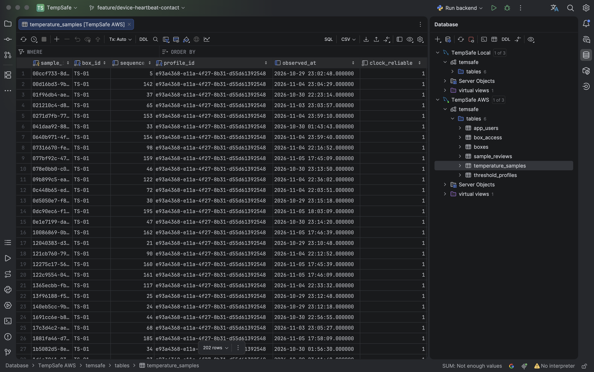
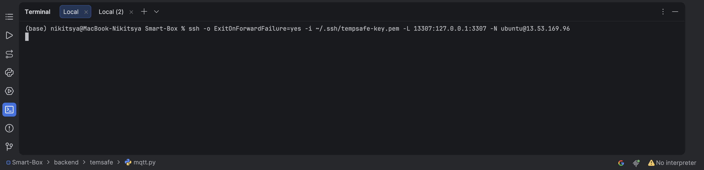
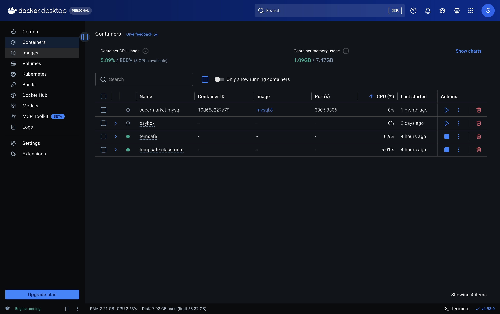
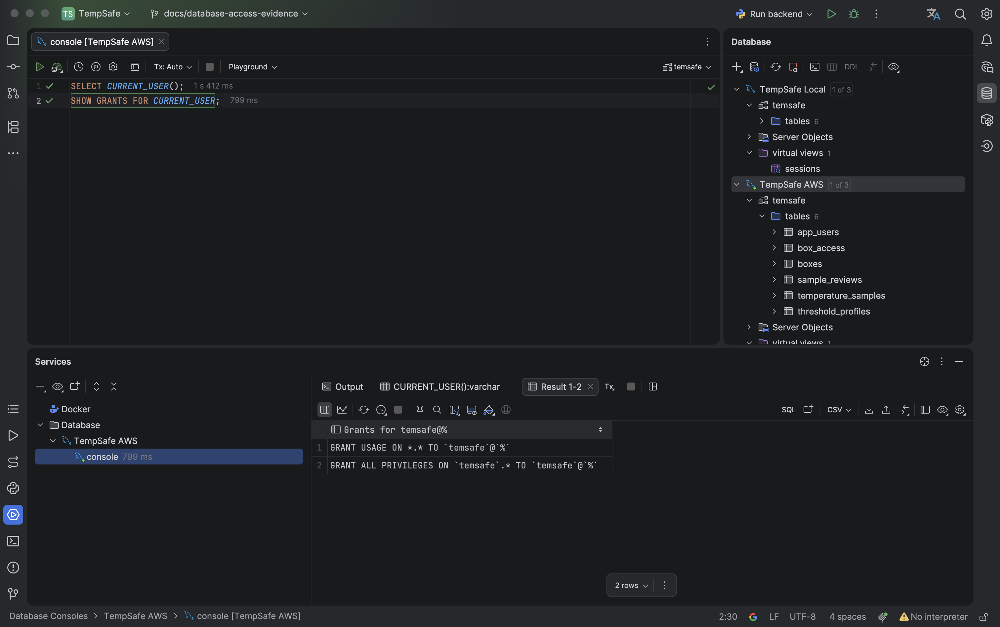

# Viewing the TempSafe database

TempSafe uses the MySQL database `temsafe` in two environments. The development
database runs locally on the Mac. The hosted database runs in Docker on the AWS
EC2 instance alongside the FastAPI backend. PyCharm has a separate connection
for each database.

## Viewing hosted readings in PyCharm

In PyCharm on my Mac, I open **TempSafe AWS → temsafe → tables → temperature_samples**
to inspect readings from the hosted database. Figure 1 shows the AWS connection in the tab title.
The visible rows identify box `TS-01`, the sequence of each reading, its
temperature profile and its observation time. **TempSafe Local** opens the
development database instead.



*Figure 1. Stored readings for TS-01 viewed through the TempSafe AWS connection.*

## How PyCharm reaches the private database

On EC2, Docker maps the server’s loopback address `127.0.0.1:3307` to port
`3306` in the MySQL container. This loopback address is the private database
endpoint used by FastAPI. Website users retrieve readings through the HTTPS API.

I run this command on my Mac to open the tunnel for **TempSafe AWS**:

```sh
ssh -o ExitOnForwardFailure=yes -i ~/.ssh/tempsafe-key.pem -L 13307:127.0.0.1:3307 -N ubuntu@13.53.169.96
```

Figure 2 shows the command in my local PyCharm terminal.



*Figure 2. The SSH command I use for the TempSafe AWS connection.*

I keep that terminal open while I use PyCharm. The `-N` option opens the tunnel
without starting a remote shell, so the terminal can stay quiet. PyCharm connects
to `127.0.0.1:13307` on my Mac. SSH carries that connection to EC2, where the
destination `127.0.0.1:3307` refers to the EC2 instance itself.
The [database connection record](database-connections.md) includes the port
mapping observed on EC2.

## Viewing local services in Docker Desktop

Figure 3 shows the Containers view on the development Mac. The green indicators
beside `temsafe` and `tempsafe-classroom` show that both local Compose projects
were running when the screenshot was taken. Expand `temsafe` to inspect its
MySQL container. In the Smart-Box terminal on my Mac, I checked the port published
by my local container:

```console
$ docker port temsafe-mysql-1 3306/tcp
127.0.0.1:3307
```

This output shows that port `3307` on my Mac leads to MySQL in the local
container. I use that port for **TempSafe Local** and port `13307` for **TempSafe AWS** through the SSH tunnel.



*Figure 3. Local Compose projects in Docker Desktop.*

## Checking the AWS account permissions

On 5 November 2026 I ran these queries in the **TempSafe AWS** console in PyCharm:

```sql
SELECT CURRENT_USER();
SHOW GRANTS FOR CURRENT_USER;
```

Figure 4 shows the grants for `temsafe`@`%`. The global `USAGE` entry grants no
global privileges. The second entry grants `ALL PRIVILEGES` on `temsafe.*`,
so this account can also create, alter and drop tables in the project database.
Figure 4 records the privileges of the PyCharm session.



*Figure 4. MySQL grants for the account used by the TempSafe AWS connection.*

## Checking FastAPI separately

On 5 November 2026 I opened a separate connection on EC2 using the deployed
FastAPI database module and the environment of the active `tempsafe.service`
process. MySQL returned `temsafe@%` for `CURRENT_USER()` and `temsafe` for
`DATABASE()`. This account had the same schema-wide privileges shown in Figure 4.

I then tested a separate account against a temporary local MySQL database.
The account had table-specific grants for the API operations under test.
Sign-in, sign-out, saving and reading a sample, and changing the selected
threshold profile all succeeded. With only `SELECT` on `boxes`, MySQL
rejected the locking read used during a threshold change. Granting `UPDATE`
on that table allowed the change to complete. MySQL rejected attempts to
create, alter and drop tables with error 1142. I removed the local test
account and database afterwards. The hosted service still uses its original
grants.
