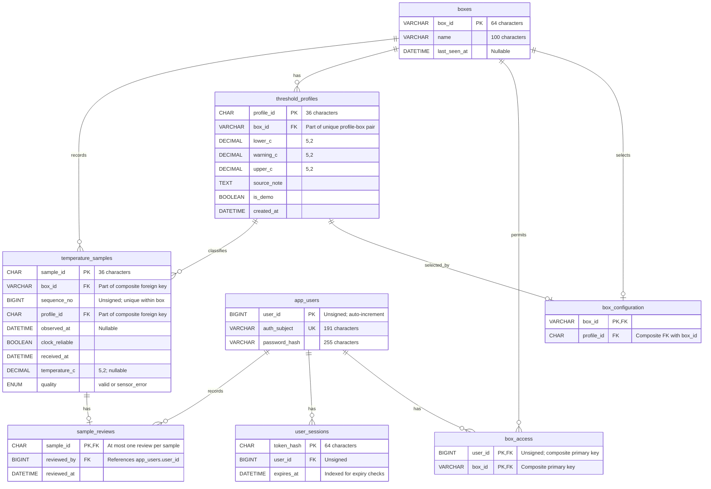

# TempSafe database ERD

Figure 1 shows the eight MySQL tables defined in [schema.sql](../../database/schema.sql).
It describes stored data and constraints, not whether every related application feature
has been implemented.

## Figure 1. Tables, keys and relationships

**Legend:** PK = primary key; FK = foreign key; UK = unique key. `||` means
exactly one, `o{` means zero or many, and `o|` means zero or one. All DATETIME
columns use microsecond precision (`DATETIME(6)`). Composite constraints are
listed below rather than marking their individual columns as independently unique.

## How the tables work together

- `boxes` identifies each monitored box.
- `app_users` stores account identifiers and password hashes. `box_access` links
  users to boxes: a user can access several boxes, and a box can have several users.
  The pair `(user_id, box_id)` is the primary key, preventing duplicate permissions.
- Each `user_sessions` row belongs to one account. An account can have several
  sessions. MySQL deletes its sessions when the account is deleted.
- `threshold_profiles` stores temperature limits for one box. Its check constraint
  requires `lower_c < warning_c < upper_c`.
- `temperature_samples` stores measurements and sensor errors. Each sample belongs
  to one box and references the profile used for that measurement.
- `sample_reviews` stores at most one acknowledgement per sample, linked to one
  reviewing user. It is not a complete audit history of multiple reviews.

## Composite constraints and historical accuracy

The sample foreign key `(profile_id, box_id)` references the unique pair
`threshold_profiles(profile_id, box_id)`. This prevents a measurement from using
another box's profile. The separate foreign key on `temperature_samples.box_id`
references `boxes.box_id`.

The unique pair `(box_id, sequence_no)` prevents duplicate sequence numbers within
a box, while allowing different boxes to use the same sequence number.

When thresholds change, create a new profile and preserve the old one. Existing
samples keep their recorded `profile_id`, so their historical classification does
not change. Profile immutability is a project rule; the schema does not itself
prevent an UPDATE to the threshold values.

A `valid` sample must have a temperature between -40 and 80 degrees Celsius. A
`sensor_error` sample must have a NULL temperature. Validity describes the
measurement, not whether its temperature is within the configured limits.

## Desired box configuration

`box_configuration` selects at most one profile per box. The composite foreign key
`(profile_id, box_id)` references the unique pair on `threshold_profiles`, preventing
a selection from crossing box boundaries. A profile can be selected by at most its
own box. New selections do not change the profiles attached to earlier samples.
This is desired backend configuration, not confirmation that the device has adopted it.
See the [operator API guide](../api/threshold-configuration.md).
