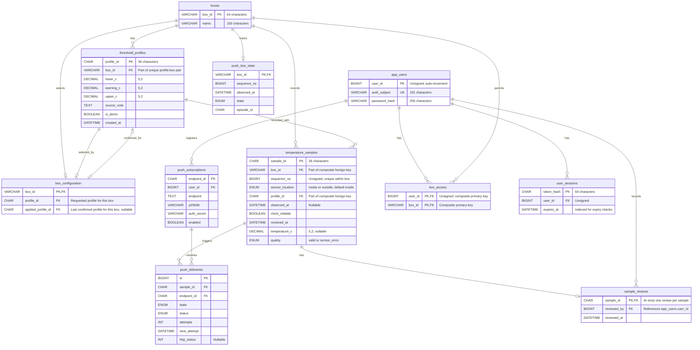

# TempSafe database ERD

Figure 1 shows the eleven MySQL tables defined in [schema.sql](../../database/schema.sql).
It describes stored data and constraints, not whether every related application feature
has been implemented.

## Figure 1. Tables, keys and relationships

**Legend:** PK = primary key; FK = foreign key; UK = unique key. `||` means
exactly one, `o{` means zero or many, and `o|` means zero or one. All DATETIME
columns use microsecond precision (`DATETIME(6)`). Composite constraints are
listed below rather than marking their individual columns as independently unique.

## How the tables work together

- `boxes` identifies each monitored box.
- `app_users` stores account identifiers and password hashes. `box_access` links
  users to boxes: a user can access several boxes, and a box can have several users.
  The pair `(user_id, box_id)` is the primary key, preventing duplicate permissions.
- Each `user_sessions` row belongs to one account. An account can have several
  sessions. MySQL deletes its sessions when the account is deleted.
- `threshold_profiles` stores temperature limits for one box. Its check constraint
  requires `lower_c < warning_c < upper_c`.
- `temperature_samples` stores measurements and sensor errors from both sensors.
  `sensor_location` distinguishes `inside` (SCD41) and `outside` (AM2302).
  Each sample belongs to one box and records its active profile. Only inside
  samples are classified against that profile's limits; outside samples provide
  comparison temperatures and do not affect box alarms.
- `sample_reviews` stores at most one acknowledgement per sample, linked to one
  reviewing user. It is not a complete audit history of multiple reviews.
- `push_subscriptions` associates each browser endpoint with one account.
  `push_box_state` tracks the latest notification state and episode for each box.
  A unique `(sample_id, endpoint_id)` pair in `push_deliveries` prevents duplicate
  jobs for the same sample and subscription.

## Composite constraints and historical accuracy

The sample foreign key `(profile_id, box_id)` references the unique pair
`threshold_profiles(profile_id, box_id)`. This prevents a measurement from using
another box's profile. The separate foreign key on `temperature_samples.box_id`
references `boxes.box_id`.

The unique pair `(box_id, sequence_no)` prevents duplicate sequence numbers within
a box, while allowing different boxes to use the same sequence number. Both sensors
share this counter: filtering to one sensor can leave gaps between sequence numbers
without any missing measurements. Indexes on `(box_id, sensor_location, sequence_no)`
and `(box_id, sensor_location, observed_at)` support separate sensor histories.

When thresholds change, create a new profile and preserve the old one. Existing
inside samples keep their recorded `profile_id`, so their historical classification does
not change. Profile immutability is a project rule; the schema does not itself
prevent an UPDATE to the threshold values.

A `valid` sample must have a temperature between -40 and 80 degrees Celsius. A
`sensor_error` sample must have a NULL temperature. Validity describes the
measurement, not whether its temperature is within the configured limits.

## Raspberry Pi queue and upgrade

This diagram describes the server's **MySQL** database. On the Raspberry Pi,
the existing **SQLite** table is named `readings`, not `temperature_samples`.
Both store `sensor_location`; no separate outside readings table is needed.
SQLite also keeps `uploaded`, which changes only after a matching MQTT storage
acknowledgement. The Pi stores the last adopted profile in `device_configuration`.

[Migration 007](../../database/migrations/007_add_sensor_location.sql) adds the
server column and indexes. The [device initialiser](../../device/database.py)
upgrades the existing SQLite queue. Both upgrades assign `inside` to legacy
samples and preserve identifiers, sequence numbers and temperatures. Follow
the [rollout order](../operations/dual-sensor-rollout.md)
before starting the updated Pi publisher.

## Desired box configuration

`box_configuration` selects at most one profile per box. The composite foreign key
`(profile_id, box_id)` references the unique pair on `threshold_profiles`, preventing
a selection from crossing box boundaries. A profile can be selected by at most its
own box. New selections do not change the profiles attached to earlier samples.
The nullable `applied_profile_id` has its own composite foreign key with `box_id`.
It records the last matching confirmation the backend received from the device.
See the [configuration API guide](../api/threshold-configuration.md).
