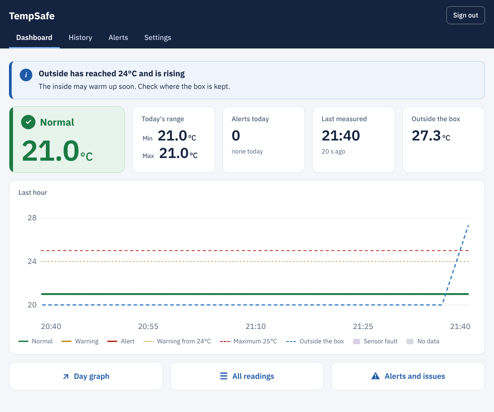
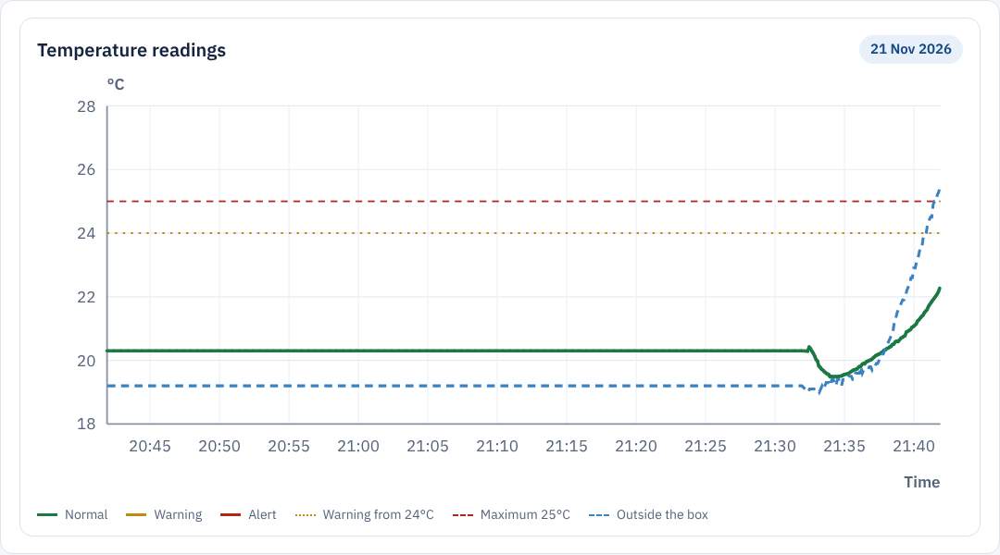

# Outside temperature on the website

**Status:** built against the dual-sensor API (PR #33). The website shows outside data as soon as the box sends it.
**Based on:** Hanna's external temperature experiment on branch `feature/external-temperature-sensor`
(`docs/testing/hardware/external-temperature-experiment.md`; AM2302 outside the box, SCD41 inside) and Nikita's
[dual-sensor rollout and frontend handover](../../operations/dual-sensor-rollout.md#frontend-handover).

The screenshots use the real CSV data from the 20 November heating run, played through a local test server.

## What the outside reading is for

The outside temperature is **information, not a status**. Normal, Warning and Alert, the LED, the buzzer, pop-ups,
browser notifications and the notification history depend only on the temperature **inside** the box (FR-05). The
API agrees: outside samples have `temperature_state: null` and `profile: null`. The outside reading gives Shannon an
early hint that the place where the box is kept is warming up, so she can act before the inside reaches Warning.

That gives three rules for the design:

1. Never use the status colours (green, amber, red) for the outside reading. It is shown in **blue**, the colour of
   information on this website.
2. Never show it as **Warning** or **Alert**, and never add it to the notification history.
3. The blue card appears as soon as the outside has reached Warning from and is rising (Hanna, 22 November), so it
   also shows in a demo where only the outside AM2302 is heated. When the inside rise is confirmed, the card becomes a
   **forecast**, as the lecturer asked on 22 November and as Hanna proposed after her experiment: it says when the
   inside may reach Warning. The time comes from the inside readings, is rounded down and says
   *about*, because it is based on one bench experiment. The card is short (title and one line), because the inside
   and outside values are already in the tiles below it. It is a hint, not a new status: FR-05 has only Normal,
   Warning and Alert, so a small line in the card says that the time is an estimate from the last 2 minutes.

## Where it appears

No new page is needed. The outside reading sits next to the inside reading wherever temperatures are shown. Without
outside data none of it appears, so the website looks exactly as before until the outside sensor is switched on.

| Place                        | What is shown                                                                                                            |
|------------------------------|--------------------------------------------------------------------------------------------------------------------------|
| Dashboard · tile             | **Outside the box** `25.5°C`, only the temperature (Hanna, 22 Nov: fewer numbers). An outside fault shows **Sensor fault · No outside temperature**; old data shows the value in grey and `Last reading 20:46` |
| Dashboard · blue card      | **Outside has reached 24°C and is rising** · The inside may warm up soon. Check where the box is kept. When the inside rise is confirmed: **Warning in about 2 minutes** · Inside is warming fast. Check where the box is kept. · Estimate from the last 2 minutes. |
| Last hour and History graphs | A thin **dashed blue line**, *Outside the box* in the legend. It breaks at gaps over 90 s and at outside faults          |
| Readings table               | Column **Outside °C**: the outside reading closest in time (within 45 s), `Sensor fault`, or `—`                        |
| CSV download                 | Columns **Inside temperature (°C)** and **Outside temperature (°C)**                                                     |
| Alerts page                  | Nothing; alerts are about the medicines inside the box                                                                   |

Outside data never fills in for missing inside data. When the inside sensor has a gap, the inside line breaks and
the grey **No data** band shows, whatever the outside sensor says.







## When the blue card shows

The card is shown when all of these are true, with the limits of the active profile (Hanna, 22 November):

- the newest outside reading is valid, less than 90 s old and has reached **Warning from** (24°C now);
- it is **rising**: at least 0.3°C over the last 2 minutes;
- no Alert banner is showing.

It does not wait for the inside to rise. Then it says **Outside has reached 24°C and is rising** and *The inside may
warm up soon. Check where the box is kept.* If the inside is already at Warning, only *Check where the box is kept.*

The card shows **the time** instead when the inside rise is also confirmed (lecturer's request):

- the newest inside reading is valid, fresh and still **below Warning from**;
- a straight line through the inside readings of the last 2 minutes (at least 4 readings, no gap, no sensor error,
  reliable time) rises by at least **0.2°C per minute**.

**The time** is calculated from the inside readings only:

```
minutes = (Warning from − inside now) ÷ inside rise per minute × 0.85
```

It is shown rounded down: `in about 3 minutes`, `in about 1 minute`, `in less than a minute`. The 0.85 is a safety
margin from Hanna's run: heating speeds up, so a straight line is a little late. Checked on her CSV, played back
through the website:

| Inside  | Outside | Card says          | Inside really reached 24°C after |
|---------|---------|--------------------|----------------------------------|
| 21.3°C  | 23.4°C  | no card (outside below 24°C) | 3.8 min                  |
| 21.8°C  | 24.5°C  | about 3 minutes    | 3.0 min                          |
| 22.0°C  | 25.0°C  | about 2 minutes    | 2.6 min                          |
| 22.3°C  | 25.5°C  | about 2 minutes    | 2.3 min                          |
| 22.6°C  | 26.0°C  | about 1 minute     | 1.8 min                          |
| 23.0°C  | 26.6°C  | about 1 minute     | 1.3 min                          |
| 23.4°C  | 27.2°C  | less than a minute | 0.8 min                          |

During heating the outside air was on average about **1.9°C warmer** than inside the box (up to 4°C), which is why the
outside reaches 24°C while the inside is still around 22°C. That difference gives the warning time.

The card disappears by itself when any condition stops being true. It is a calm card (blue, an *i* icon,
`role="status"`), not a pop-up and not a browser notification, so it does not add to alarm fatigue.

## How the website reads the API

Following the frontend handover:

- Inside and outside are requested **separately**, in parallel: the existing requests (inside by default) and the
  same requests with `sensor_location=outside`. Paging with `before_sequence` keeps `sensor_location`.
- Rows are used as outside data only when they say `"sensor_location": "outside"`, so an older backend that ignores
  the parameter cannot make inside data look like outside data.
- **Sequence numbers are no longer used to find gaps.** Both sensors share the box-wide counter, so inside samples
  100 and 102, 30 s apart, are continuous. A gap is a time gap over 90 s, an unknown time or a time going backwards.
  This is changed in `dashboard.js`, `history.js` and `notifications.js` (`readingGap` in `main.js`).
- If the outside request fails, the page still shows the inside data.
- A late answer for a period that is no longer selected is ignored, for both sensors.

## Universal Design

| Principle                   | How it is met                                                                                |
|-----------------------------|----------------------------------------------------------------------------------------------|
| P3 Simple and Intuitive Use | Same pages and places as now; plain wording ("Warning in about 2 minutes") |
| P4 Perceptible Information  | Value, arrow and words for the trend, not colour alone; dashed line and legend on the graphs |
| P5 Tolerance for Error      | Information only; it cannot raise or clear an Alert, so a wrong outside reading is harmless  |
| P6 Low Physical Effort      | No extra page or action; the card goes away by itself                                        |

## Still open

- The outside sensor is not running on the box yet: the device package from the rollout document has to be
  installed on the Pi first.
- The thresholds (0.3°C outside, 0.2°C per minute inside) and the 0.85 margin come from one experiment and should be
  checked with more runs and the real box.
