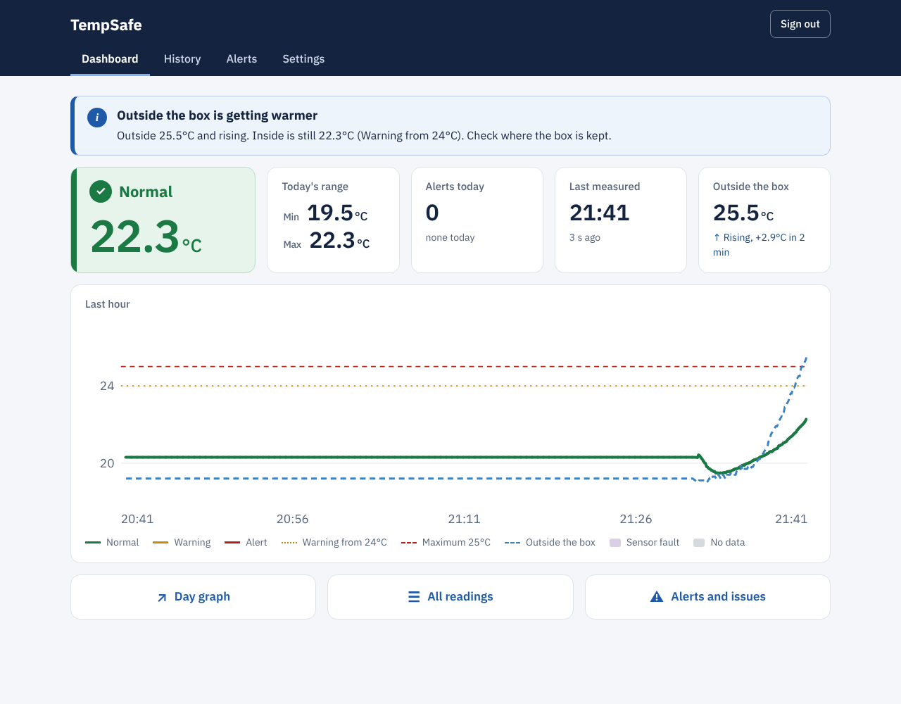
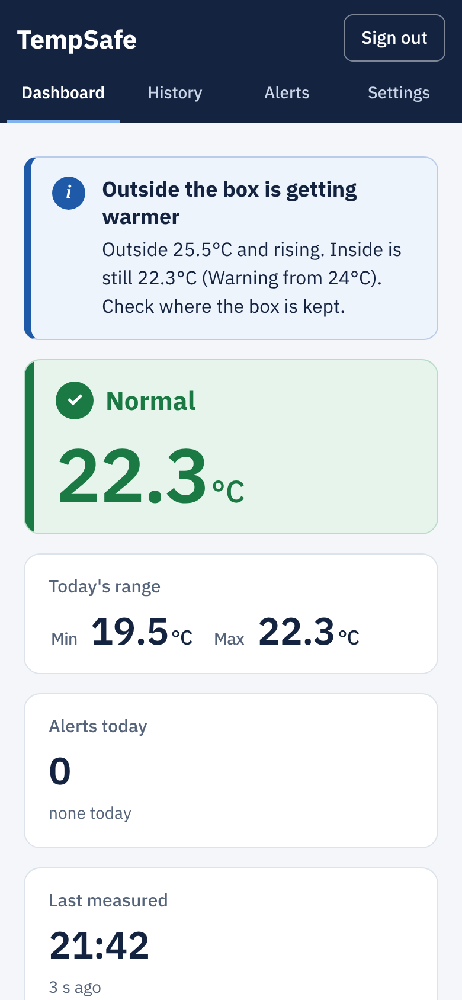

# Outside temperature on the website

**Status:** built against the dual-sensor API (PR #33). The website shows outside data as soon as the box sends it.
**Based on:** Hanna's external temperature experiment on branch `feature/external-temperature-sensor`
(`docs/testing/hardware/external-temperature-experiment.md`; AM2302 outside the box, SCD41 inside) and Nikita's
[dual-sensor rollout and frontend handover](../../operations/dual-sensor-rollout.md#frontend-handover).

The screenshots use the real CSV data from the 20 November heating run, played through a local test server.

## What the outside reading is for

The outside temperature is **information, not a status**. Normal, Warning and Alert, the LED, the buzzer, pop-ups,
browser notifications and the notification history depend only on the temperature **inside** the box (FR-05). The
API agrees: outside samples have `temperature_state: null` and `profile: null`. The outside reading gives Shannon an
early hint that the place where the box is kept is warming up, so she can act before the inside reaches Warning.

That gives three rules for the design:

1. Never use the status colours (green, amber, red) for the outside reading. It is shown in **blue**, the colour of
   information on this website.
2. Never show it as **Warning** or **Alert**, and never add it to the notification history.
3. Do not promise a time. The experiment measured about 2.5 minutes once, on a cardboard bench prototype. The
   message says what is happening now, not when a limit will be reached.

## Where it appears

No new page is needed. The outside reading sits next to the inside reading wherever temperatures are shown. Without
outside data none of it appears, so the website looks exactly as before until the outside sensor is switched on.

| Place                        | What is shown                                                                                                            |
|------------------------------|--------------------------------------------------------------------------------------------------------------------------|
| Dashboard · tile             | **Outside the box** `25.5°C` and `↑ Rising, +2.9°C in 2 min`, `↓ Falling …` or `Steady`. An outside fault shows **Sensor fault · No outside temperature**; old data shows the value in grey and `Last reading 20:46` |
| Dashboard · info banner      | **Outside the box is getting warmer** · Outside 25.5°C and rising. Inside is still 22.3°C (Warning from 24°C). Check where the box is kept. |
| Last hour and History graphs | A thin **dashed blue line**, *Outside the box* in the legend. It breaks at gaps over 90 s and at outside faults          |
| Readings table               | Column **Outside °C**: the outside reading closest in time (within 45 s), `Sensor fault`, or `—`                        |
| CSV download                 | Columns **Inside temperature (°C)** and **Outside temperature (°C)**                                                     |
| Alerts page                  | Nothing; alerts are about the medicines inside the box                                                                   |

Outside data never fills in for missing inside data. When the inside sensor has a gap, the inside line breaks and
the grey **No data** band shows, whatever the outside sensor says.

## When the information banner shows

All of these must be true, with the limits of the active profile:

- the newest outside reading is valid and less than 90 s old;
- it has reached **Warning from** (24°C now);
- it rose by at least **0.3°C** over the last 2 minutes (the experiment's proposal);
- the newest inside reading is valid, fresh and still **below Warning from**;
- no Alert banner is showing.

It disappears by itself when any of these stops being true. It is a calm banner (blue, an *i* icon,
`role="status"`), not a pop-up and not a browser notification, so it does not add to alarm fatigue. A browser
notification for it could be a later option behind its own switch in Settings, off by default.

## How the website reads the API

Following the frontend handover:

- Inside and outside are requested **separately**, in parallel: the existing requests (inside by default) and the
  same requests with `sensor_location=outside`. Paging with `before_sequence` keeps `sensor_location`.
- Rows are used as outside data only when they say `"sensor_location": "outside"`, so an older backend that ignores
  the parameter cannot make inside data look like outside data.
- **Sequence numbers are no longer used to find gaps.** Both sensors share the box-wide counter, so inside samples
  100 and 102, 30 s apart, are continuous. A gap is a time gap over 90 s, an unknown time or a time going backwards.
  This is changed in `dashboard.js`, `history.js` and `notifications.js` (`readingGap` in `main.js`).
- If the outside request fails, the page still shows the inside data.
- A late answer for a period that is no longer selected is ignored, for both sensors.

## Universal Design

| Principle                   | How it is met                                                                                |
|-----------------------------|----------------------------------------------------------------------------------------------|
| P3 Simple and Intuitive Use | Same pages and places as now; plain wording ("Outside the box is getting warmer")           |
| P4 Perceptible Information  | Value, arrow and words for the trend, not colour alone; dashed line and legend on the graphs |
| P5 Tolerance for Error      | Information only; it cannot raise or clear an Alert, so a wrong outside reading is harmless  |
| P6 Low Physical Effort      | No extra page or action; the banner goes away by itself                                      |

## Still open

- The outside sensor is not running on the box yet: the device package from the rollout document has to be
  installed on the Pi first.
- The 0.3°C in 2 minutes threshold comes from one experiment and should be checked with more runs.
