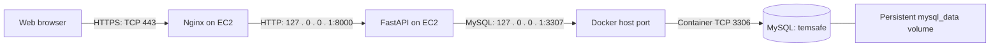
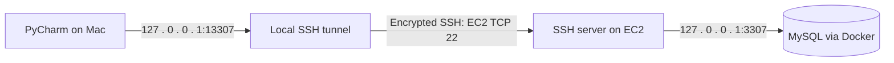

# TempSafe database connections

## Verification status

The repository configuration was checked on 4 November 2026 against
[compose.yaml](../../compose.yaml), [session.py](../../backend/tempsafe/db/session.py)
and the non-secret local environment settings. The hosting paths and service names
below are recorded in the [deployment guide](deployment.md).

After the SSH source rule was updated, server checks succeeded on 4 November 2026.
Some subsequent SSH connections still timed out, so the verification is partial.

| Server check            | Observed result                                                       |
|-------------------------|-----------------------------------------------------------------------|
| Backend service         | `tempsafe.service` active; working directory `/home/ubuntu/Smart-Box` |
| Environment file        | `/home/ubuntu/Smart-Box/.env`, required by systemd                    |
| Backend listener        | `127.0.0.1:8000`                                                      |
| Database container      | `temsafe-mysql-1`, image `mysql:8.4`                                  |
| Published database port | `127.0.0.1:3307` mapped to container port `3306`                      |
| Public listeners        | TCP 22, 80, 443 and 8883; AWS rules still control external access     |
| Database read           | Successful read of `temperature_samples` using the `temsafe` account  |
| Database grants         | `ALL PRIVILEGES` on `temsafe.*`                                       |
| Scheduled backups       | No MySQL backup timer or database-related cron job found              |

The 5 November [FastAPI account check](../testing/database/database-access-evidence.md#checking-fastapi-separately)
subsequently verified the effective database account and schema. On 8 November, the service,
container, loopback mapping, session and configuration tables were rechecked.
The hosted database also contains a `temperature_history` table outside the current eight-table
baseline; its purpose was not established and no table was removed. Current AWS rule sources
and off-server backup configuration remain unverified. Secrets were not displayed.

## Figure 1. Application connection



MySQL runs in Docker on the same EC2 instance as the backend; it is not an RDS
service. The deployment guide records the project at `/home/ubuntu/Smart-Box`
and the backend as the host service `tempsafe.service`.

The backend uses SQLAlchemy with MySQL Connector/Python. It reads the project
`.env` without overwriting existing process environment variables. Therefore,
systemd environment overrides must also be checked when verifying production.

| Setting        | Repository configuration             |
|----------------|--------------------------------------|
| Database host  | `127.0.0.1`                          |
| Host port      | `3307`                               |
| Container port | `3306`                               |
| Database       | `temsafe`                            |
| Database user  | `temsafe`                            |
| Password       | `MYSQL_PASSWORD`, stored outside Git |

In this project, a **private database endpoint** means the host's loopback
listener: `127.0.0.1:3307`. Compose explicitly binds the published port to
loopback rather than every host interface. The browser calls the API and never
connects directly to MySQL. MySQL authentication still applies to local connections.
The configured database connection does not explicitly enable MySQL TLS; HTTPS
protects browser traffic, while SSH protects the remote administration tunnel.

## Figure 2. PyCharm connection through SSH



Start the tunnel in a Mac terminal and keep it open:

```sh
ssh -o ConnectTimeout=10 -o ExitOnForwardFailure=yes \
  -i ~/.ssh/tempsafe-key.pem \
  -L 127.0.0.1:13307:127.0.0.1:3307 \
  -N ubuntu@13.53.169.96
```

The address is the last verified TempSafe public IPv4 address. Check EC2 before
connecting: an automatically assigned address can change after a stop/start.
The key stays on the Mac. Do not upload or commit it.

Configure the PyCharm MySQL data source:

| Field          | Value                                       |
|----------------|---------------------------------------------|
| Host           | `127.0.0.1`                                 |
| Port           | `13307`                                     |
| Database       | `temsafe`                                   |
| User           | `temsafe`                                   |
| Password       | The **server's** `MYSQL_PASSWORD`           |
| IDE SSH tunnel | Disabled when using the manual tunnel above |

The two occurrences of `127.0.0.1` refer to different machines: PyCharm connects
to the Mac's local port; SSH forwards it to the EC2 server's local port. The server
and local development databases can have different passwords despite using the
same database and user names. Closing the tunnel disconnects PyCharm but does not
stop the website or database.

## Network access and troubleshooting

The recorded AWS rules allow website ports 80/443, MQTT TLS port 8883 and SSH port 22.
SSH should be restricted to the operator’s current public IP (`/32`). MySQL ports
3306/3307 and backend port 8000 should not be publicly exposed. The current
security group rules still need live verification; see [Network access](deployment.md#network-access).

| Symptom                            | What to check                                                               |
|------------------------------------|-----------------------------------------------------------------------------|
| SSH connection times out           | Instance state, current public IP, SSH source rule and network connectivity |
| PyCharm reports connection refused | Local tunnel listener, PyCharm port and the server's MySQL listener         |
| SSH reports address already in use | Another process already owns local port 13307                               |
| MySQL reports access denied        | Server database credentials and database grants                             |

An SSH process with no output is not sufficient proof that the tunnel is ready.
On the Mac, check `lsof -nP -iTCP:13307 -sTCP:LISTEN`, then use PyCharm's **Test Connection**. Do not resolve a tunnel
problem by opening MySQL to the internet.

## Persistence, permissions and backups

Compose derives the volume name from the project name. The local default
`tempsafe` uses `tempsafe_mysql_data`. The EC2 project recorded above used
`temsafe`, which gives `temsafe_mysql_data`. Keep that project name on EC2
until its data has been migrated. The volume survives container recreation.
Recovery from loss of the EC2 disk requires a separate backup.

During this AWS inspection, the `temsafe` account had `ALL PRIVILEGES` on
`temsafe.*`. It was not a narrowly restricted runtime account. Separating a
schema-management account from a runtime account is follow-up work; do not describe
least-privilege database access as fully implemented without checking its grants.

Backup checks on 4 November 2026 found:

- No crontab for either `ubuntu` or `root` (confirmed by the command errors).
- No database-related entries in `/etc/crontab` or the checked files under
  `/etc/cron.d`, `/etc/cron.daily`, `/etc/cron.weekly` and `/etc/cron.monthly`.
- No MySQL backup task in the systemd timer list. `dpkg-db-backup` backs up
  package-management metadata, not the application database.
- No backup candidates matching the inspected names and dump extensions under
  `/var/backups`, `/home/ubuntu/Smart-Box`, `/home/ubuntu/backups` or `/opt`.

Those 4 November checks found no evidence of an operational application database backup on
the host. Manual SQL backups were subsequently created before both deployments on 7 November
under `/home/ubuntu/tempsafe-deploy-backups/`; see the
[backup record](deployment.md#deployment-backups). They remain on the same server. They do not rule out custom jobs
elsewhere or external AWS Backup/EBS
snapshots, which were not inspected. Off-server copies, retention and successful
restore tests remain **unverified**. A backup proposal in the design document is
not evidence of a running backup job.

On 5 November 2026 the [PyCharm access record](../testing/database/database-access-evidence.md) documented a read of
hosted samples, the
SSH
forwarding command and the grants returned by the TempSafe AWS console.

The [FastAPI account check](../testing/database/database-access-evidence.md#checking-fastapi-separately) also confirmed
the authenticated
MySQL account and schema using the active service environment.

## Remaining server checks

Use an authorised SSH session to confirm:

1. Current AWS inbound rule sources. A listener check does not verify security groups.
2. External backup services, off-server storage and a restore test. Host cron and
   systemd timer checks are recorded above.

This documentation change does not change server settings or introduce a backup job.
