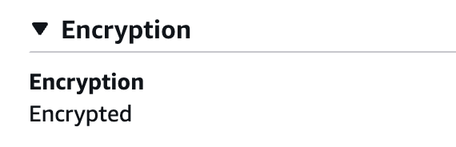

# TempSafe deployment

TempSafe was first deployed on 2 November 2026 at
[https://tempsafe.app](https://tempsafe.app).

## Hosting setup

| Component         | Configuration                                                                       |
|-------------------|-------------------------------------------------------------------------------------|
| Server            | AWS EC2, Ubuntu Server 24.04 LTS, x86-64, `t3.small`                                |
| Storage           | 20 GiB EBS volume                                                                   |
| DNS               | Cloudflare A record for `tempsafe.app` pointing to the server's public IPv4 address |
| HTTPS             | Nginx with a Certbot-managed Let’s Encrypt certificate                              |
| Backend           | FastAPI and Uvicorn, managed by `tempsafe.service`                                  |
| Backend listener  | `127.0.0.1:8000`, reached through Nginx                                             |
| Database          | MySQL 8.4 in Docker Compose, with the persistent `mysql_data` volume                |
| Database listener | `127.0.0.1:3307` on the host                                                        |
| Project directory | `/home/ubuntu/Smart-Box`                                                            |

The frontend and API share the same domain. Closing an SSH session or a local SSH tunnel does not stop
the services. The EC2 instance must remain running for the site to be available.

## HTTPS on Ubuntu

The [Nginx site](../../deploy/tempsafe-nginx.conf) serves the public domain on 443.
It redirects HTTP to HTTPS and serves HTTP-01 certificate challenges for both
`tempsafe.app` and `mqtt.tempsafe.app` from `/var/www/letsencrypt`. Mosquitto
owns port 8883 and uses its own certificate and renewal hook.

On a new host, install Nginx and Certbot. Point the two public DNS names at EC2
and allow port 80. Create the webroot with `sudo install -d -m 755 /var/www/letsencrypt`.
Enable the port-80 server block from the site file on its own first, so that the
challenge path works before the HTTPS certificate exists. On an existing host,
serve that same challenge path through the running proxy until the certificate
has been issued. Preserve any existing proxy-level authentication during migration.
Then run:

```sh
sudo certbot certonly --webroot -w /var/www/letsencrypt --cert-name tempsafe.app -d tempsafe.app
sudo install -m 644 deploy/tempsafe-nginx.conf /etc/nginx/sites-available/tempsafe
sudo ln -sfn /etc/nginx/sites-available/tempsafe /etc/nginx/sites-enabled/tempsafe
sudo nginx -t
```

Disable the distribution’s default site if enabled. When replacing another proxy,
stop it only after validation, start Nginx and check the responses below. If the
checks fail, stop Nginx and restart the previous service. After successful checks,
enable Nginx at boot and disable the previous service. For an existing Nginx
instance, reload it after validation.

```sh
sudo install -m 755 deploy/tempsafe-nginx-renew /etc/letsencrypt/renewal-hooks/deploy/tempsafe-nginx
sudo systemctl enable --now certbot.timer
sudo certbot renew --dry-run
curl -I http://tempsafe.app/
curl -i https://tempsafe.app/api/health
curl -I https://tempsafe.app/docs
```

Expect a 308 redirect to HTTPS, a 200 health response and a 404 for the
documentation paths (`/docs`, `/redoc` and `/openapi.json`). HTTPS responses
carry HSTS, `X-Content-Type-Options: nosniff` and `X-Frame-Options: DENY`.
The renewal hook reloads Nginx after renewal of the website certificate.

### Deployment verification on 5 November 2026

External checks returned 200 for the home page and `/api/health`, 308 for the
HTTP redirect and 404 for `/docs`, `/redoc` and `/openapi.json`. The health
response identified Nginx and carried all three security headers. The box’s latest
reading still returned 200 without a session on the deployed revision. Confirm
per-box authorisation when deploying the protected API. This records the old revision;
the checks below describe the deployed session-based API.

On EC2, Nginx listened on ports 80 and 443 and Mosquitto listened on 8883.
Certbot successfully simulated renewal for both domains. The website renewal
hook passed its configuration test and reloaded Nginx.

## Current deployment — verified 8 November 2026

The server runs commit `3578cfe77c6738fe2e08366337ec8de4776a58ad`, deployed on
7 November. This includes the sign-in integration from PR #25 and heartbeat settings
from PR #21. The checkout is detached at that commit; it does not track new commits
automatically. The server directory remains `/home/ubuntu/Smart-Box`.

- `tempsafe`, `nginx` and `mosquitto` are active; the MySQL container is healthy.
- FastMQTT runs inside FastAPI with one Uvicorn worker. The previous
  `tempsafe-mqtt.service` was stopped and disabled during the update.
- `box_configuration` and `user_sessions` exist. Migration 005 added
  `boxes.heartbeat_interval_seconds`, with a default of 60 seconds.
- External HTTPS checks returned 200 for the home page and `/api/health`, 401
  for anonymous latest-reading, history and heartbeat-configuration requests,
  and 404 for `/docs`.

Sign-in and sign-out are deployed. Application accounts are provisioned separately
from MySQL accounts and require a box assignment. Passwords are stored as Argon2id
hashes. The checks above confirm anonymous access is rejected; they do not replace
an authenticated browser check with an assigned account.

The deployment logs confirmed an MQTT broker connection. A fresh Pi-to-MySQL
reading and matching storage acknowledgement still need verification. Configuring
a heartbeat interval does not yet deliver it to the Pi or prove device contact.

## Network access

The saved EC2 inbound rules supplied on 3 November 2026 allow:

| Port           | Source                                 | Purpose                                                   |
|----------------|----------------------------------------|-----------------------------------------------------------|
| TCP 80 and 443 | `0.0.0.0/0`                            | HTTP and HTTPS for the website                            |
| TCP 8883       | `0.0.0.0/0`                            | Authenticated MQTT over TLS from changing device networks |
| TCP 22         | Operator's public IPv4 address (`/32`) | SSH administration                                        |

No inbound rules expose MQTT port 1883 or MySQL ports 3306/3307. The supplied instance view shows no
broad All TCP or All traffic rule. Broker accounts, TLS and topic permissions are documented in the
[MQTT guide](mqtt.md); AWS network rules do not replace those controls.

## Current limitations

See the [frontend guide](../../frontend/README.md) for application limitations and the
[MQTT guide](mqtt.md) for FastMQTT deployment and device integration status.

Nginx terminates TLS and forwards requests to Uvicorn. FastAPI uses browser sessions
to control access to each box and separate credentials for HTTP device submissions.
For a new installation, install the dependencies, create the current schema and
provision a user with access to the prototype box. For an existing database, check
which migrations are missing before applying them. Verify that anonymous requests
are rejected and that the assigned user can read the box’s data.
See the [authentication and setup guide](../api/api-contract.md#authentication).

For connection diagrams, PyCharm tunnel settings and the distinction between
verified configuration and pending server checks, see [Database connections](database-connections.md).

## Service checks

Run these commands over SSH on the Ubuntu server:

```sh
sudo systemctl status tempsafe nginx mosquitto --no-pager
cd /home/ubuntu/Smart-Box
sudo docker compose -p temsafe ps
curl --fail http://127.0.0.1:8000/api/health
```

The services should be active and the MySQL container healthy. The health endpoint returns
`{"status":"ok"}`, but does not test the database connection. The Compose health check separately
checks MySQL access and the presence of the `sample_reviews` table. It does not
verify that all application migrations have been applied.

To inspect recent logs:

```sh
sudo journalctl -u tempsafe -n 50 --no-pager
sudo journalctl -u nginx -n 50 --no-pager
```

After changing `/etc/nginx/sites-available/tempsafe`, validate it before reloading:

```sh
sudo nginx -t && sudo systemctl reload nginx
```

## Configuration and persistence

Database credentials are stored in the server's `.env` file. Keep that file, SSH private keys and
access credentials out of Git. The backend service definition is stored at
`/etc/systemd/system/tempsafe.service`, with the MQTT override at
`/etc/systemd/system/tempsafe.service.d/mqtt.conf`. The service also reads
`/etc/tempsafe/mqtt.env`; the override enables MQTT and selects one Uvicorn worker.
The Nginx site is enabled through `/etc/nginx/sites-enabled/tempsafe`.

The Docker volume preserves database data when containers are recreated. It is not a backup;
do not run `docker compose down -v` unless the stored data should be deleted.

The initial deployment uses an automatically assigned public IPv4 address. After stopping and starting
the EC2 instance, check its address and update the Cloudflare A record if it has changed.
An Elastic IP can provide a stable address if configured later.

## Updating the application

Changes committed locally or pushed to GitHub do not automatically update the server.
For each deployment:

1. Check the server working tree and record its current commit. Select the reviewed
   target commit explicitly; do not assume the detached checkout follows `master`.
2. Back up the database and any configuration files that will change. Keep the
   previous commit available for rollback.
3. Review the target's dependencies and migrations. The current schema includes
   migrations 003, 004 and 005; apply each only if its table or column is missing.
   See the [database guide](../../database/README.md#apply-migrations). Do not run
   the baseline schema over an existing database.
4. Deploy the selected code and install changed dependencies with
   `.venv/bin/python -m pip install -e .`. Preserve `.env`, MQTT credentials and
   the Compose project name `temsafe`, which selects the existing database volume.
5. Restart `tempsafe.service` and check the services, logs, HTTPS responses and
   authenticated access. Check MQTT storage separately with a real device reading.

If application checks fail, restore the previous code and restart the service.
Confirm that it is compatible with any applied migration before rollback; switching
commits does not undo database changes. Do not automatically restore an old database
snapshot over readings received since the backup.

## Deployment backups

The two updates on 7 November created restricted backup directories on the server:

- `/home/ubuntu/tempsafe-deploy-backups/20261107T232839Z`
- `/home/ubuntu/tempsafe-deploy-backups/20261107T235655Z`

Each contains a database SQL dump and the previous revision. The first also contains
copies of the service definition and MQTT environment file. These are manual backups
on the same server, not evidence of scheduled or off-server backups. Restore testing
and off-server copies remain unverified. Keep the dumps and configuration copies
private; they contain account data or credentials.

## Stored data checks

- **Credentials.** On 5 November 2026, the project's server-side `.env` belonged to
  `ubuntu:ubuntu` with mode `600`. Check ownership and permissions with
  `stat -c '%a %U:%G %n' /home/ubuntu/Smart-Box/.env` without printing its contents.
- **Application passwords.** The schema stores user password hashes in
  `app_users.password_hash`. The deployed login implementation uses Argon2id;
  credentials are not stored as plaintext application passwords.
- **EBS encryption.** On 6 November 2026, a check on the EC2 host traced the
  MySQL container's data directory to the root EBS volume, `vol-00d71e3f3b6db9d09`.
  The EC2 console showed **Encrypted** for this 20 GiB volume with the KMS key
  alias `aws/ebs`. This confirms encryption at rest for MySQL data on that disk.

  
- **MQTT storage.** On 5 November the standalone MQTT service was active on EC2.
  MySQL held 155 samples for TS-01, most recently received at 00:00:10 UTC that day.
  That was the previous ingestion service. FastMQTT replaced it on 7 November.
  For a fresh end-to-end check, match a new Pi sample ID to FastMQTT's storage
  acknowledgement and the same ID in MySQL.

## Package name update: tempsafe

The Python package is now `tempsafe`, and its distribution is `tempsafe-backend`.
After deploying this change, reinstall with `.venv/bin/python -m pip install -e .`
and update every Uvicorn service command (including the MQTT override) to
`tempsafe.main:app`. Run `sudo systemctl daemon-reload` before restarting the
service. The recorded deployment above predates this package rename.

New project settings use the `TEMPSAFE_` prefix. Existing `TEMSAFE_` settings
remain accepted as a compatibility fallback; an explicitly set new setting takes
precedence, including an empty value. Rename the keys in private environment files
when updating an installation, preserving their values.

New installations default to MySQL database and user `tempsafe`. Existing databases
are not renamed by this code change. On the recorded EC2 installation, retain
`MYSQL_DATABASE=temsafe`, `MYSQL_USER=temsafe` and the Compose project name
`temsafe` to keep using the existing data and volume. Set these explicitly before
running Compose or starting the renamed backend. Changing a default does not
migrate a database, rename a MySQL account or copy a Docker volume.
