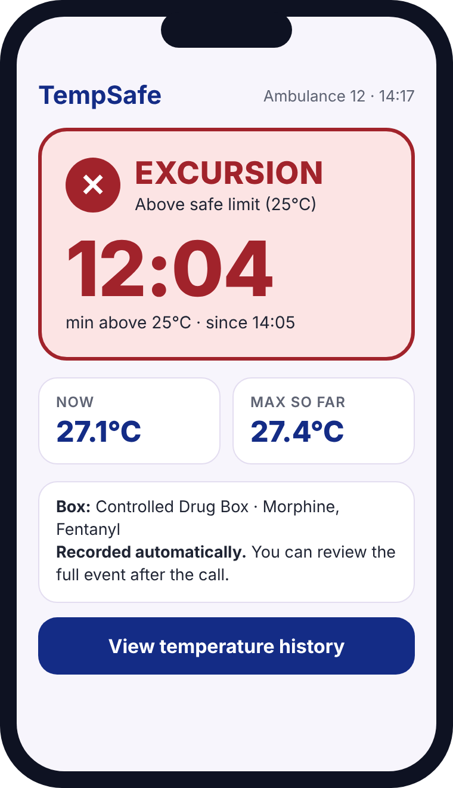
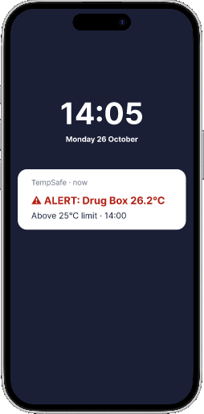
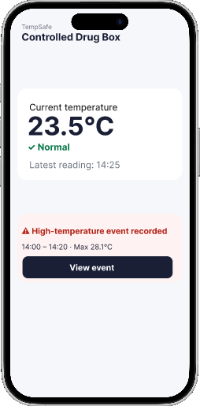
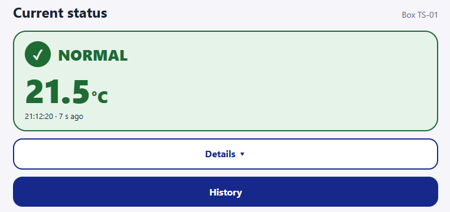
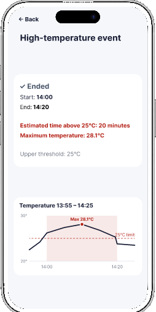
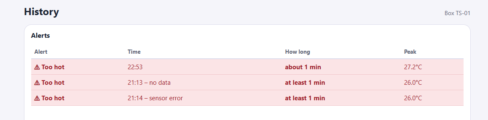
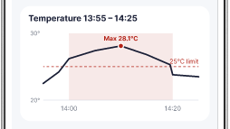
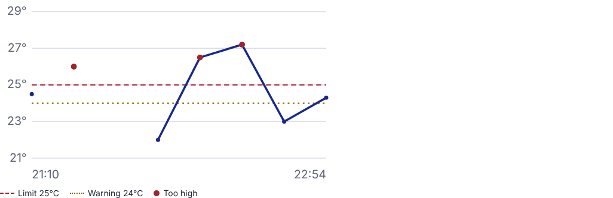

# Main use case: UI pictures

Scrumwise: #71273 · Sprint 7 · Maryna Hordiienko

The main use case is described in [main-use-case.md](../../../requirements/main-use-case.md). It is a hot day. At 14:00, the drug box reaches 26.2°C and Shannon gets an alert. She keeps treating the patient. At 14:25, she opens the app. The box is Normal again, and she checks the event: 14:00–14:20, about 20 minutes above 25°C, with a peak of 28.1°C.

The pictures below show how each step changed from the early concept to Figma and then to the working website.

## Step 0: Early concept

**What it shows:** Our first idea for the status screen.
**What changed:** It had too many numbers, so we made the screen simpler. Now it shows one word, one number and one time. Everything else is in Details.

## Step 1: Notification

| Figma | Website |
|---|---|
|  | Not built yet. Phone alerts (FR-14) are planned for Sprint 8. |

**What it shows:** The alert on Shannon's lock screen: "ALERT: Drug Box 26.2°C, above 25°C limit, 14:00".
**What changed:** One short line with an icon, a word and the temperature, so she understands it in one glance. Today, the box shows the alert with a red LED.

## Step 2: Current status

| Figma | Website |
|---|---|
|  |  |

**What it shows:** The box is Normal now, with the latest temperature and time.
**What changed:** On the website, the status card is the only main element. Details and History are buttons below it. The page updates by itself every 5 seconds.

## Step 3: Event details

| Figma | Website |
|---|---|
|  |  |

**What it shows:** When the alert started and ended, how long it lasted and the peak temperature.
**What changed:** On the website, every alert is one row in the Alerts table, with the columns Alert, Time, How long and Peak. When data is missing, it says "at least", not an exact time.

## Step 4: History

| Figma | Website |
|---|---|
|  |  |

**What it shows:** The temperature over time, with the 25°C limit line.
**What changed:** The website graph also shows the 24°C warning line and a legend. The line breaks when there is no data, so a gap does not look like normal readings.

## Notes

- The Figma pictures use the demo data from the main use case. The website screenshots use local test data, so the times and numbers are different.
- No paper sketches of this use case are in the repository. If the team has photos of the sketches, add them as `00-paper-sketch.jpg`.

## DoD

- [x] The pictures show each step of the main use case: notification, current status, event details and history.
- [x] Each step has a Figma picture and a website screenshot, where one exists. The notification is not on the website yet.
- [x] Each picture has a short caption: what it shows and what changed.
