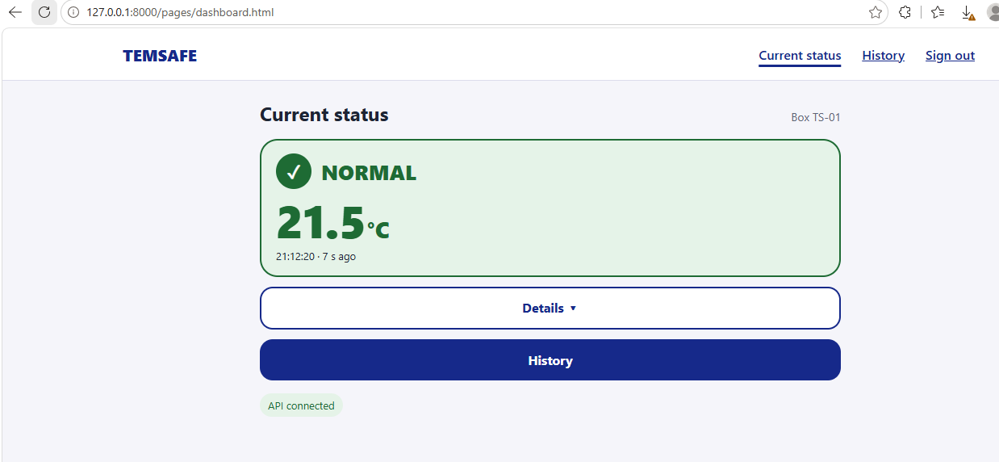
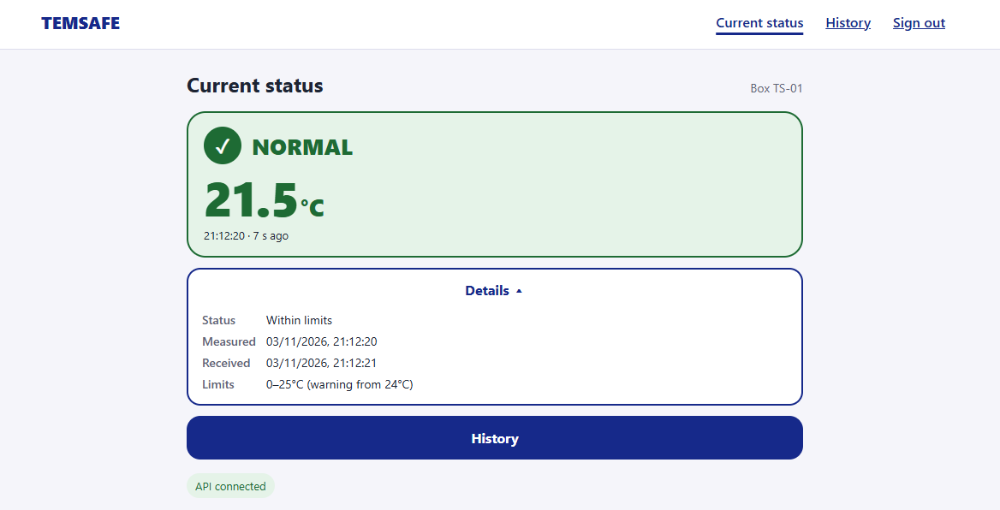
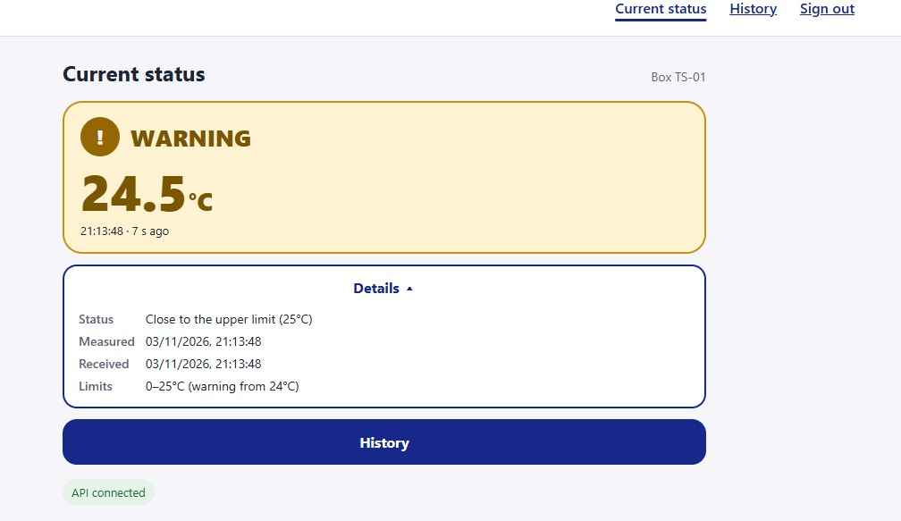
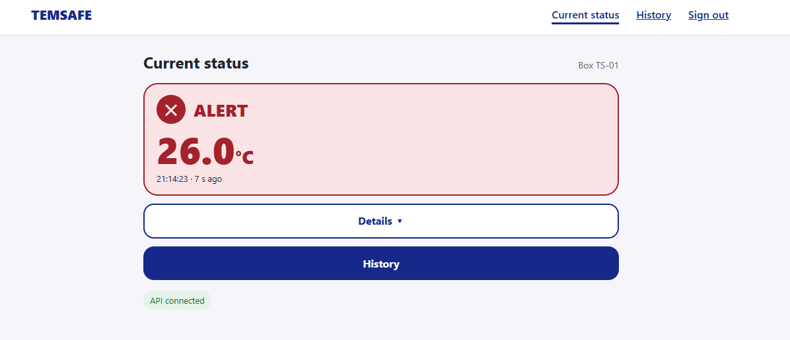
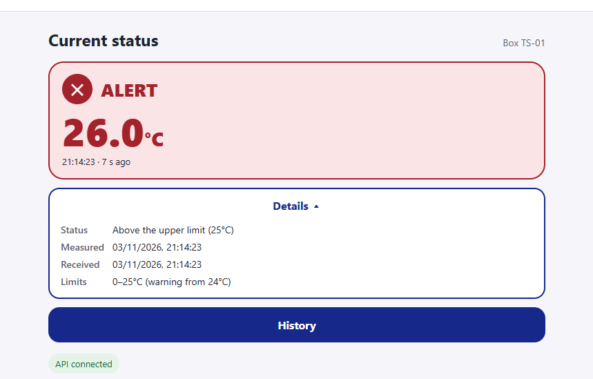
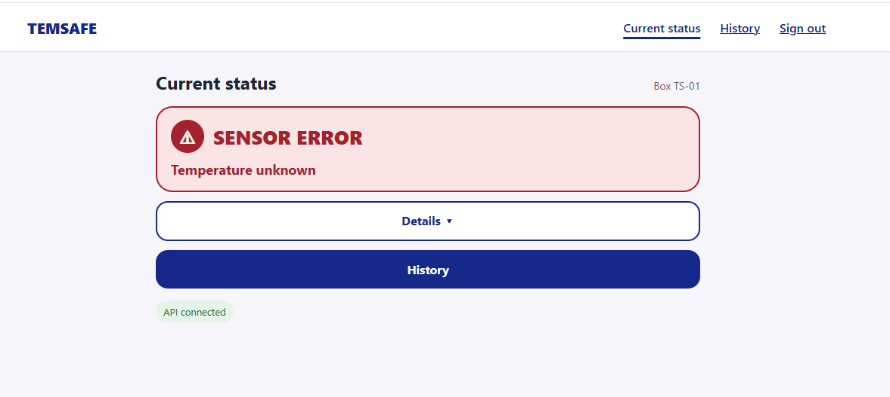
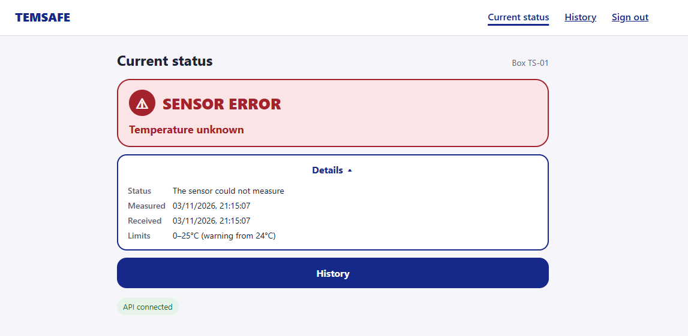

# Core scenario accessibility review

**Project:** TempSafe (Smart-Box)  
**Date:** 3 November 2026  
**Backlog item:** #71051 — Review core scenario accessibility  
**Branch:** `feature/core-scenario-accessibility`  
**Author:** Maryna Hordiienko

## 1. Accessibility from the start

Our team treated usability and accessibility as part of the design from the first sprint, not as a final check.
From the beginning we tested how people perceive the status information, compared different versions and kept
rewriting the text so that a paramedic can understand the box status in a few seconds, often under time pressure.
Earlier decisions recorded in the design documents include:

- **Plain status words.** The states are NORMAL, WARNING and ALERT, each with a symbol as well as a colour
  ([ui-wording.md](../design/ui-wording.md), AC-01).
- **No clinical judgements.** The interface never says "safe" or "unsafe"; it only compares readings with the
  configured limits.
- **Old or missing data is never shown as Normal.** Stale data, sensor errors and unreliable times each have their
  own state (AC-11).
- **Accessibility criteria for every screen** based on WCAG 2.2 AA
  ([accessibility-criteria.md](../design/accessibility-criteria.md)).

After testing how the information was perceived, the team agreed that the design described in section 4 is the most
effective way to show the box status. The reasons are:

- **Familiar colours.** Green, yellow and red follow the widely known traffic-light pattern: green means everything
  is fine, yellow means pay attention and red means act now. Users understand them without learning anything new.
- **Never colour alone.** About 1 in 12 men has some form of colour blindness, and screens can be hard to read in
  sunlight or in a moving ambulance. Every status therefore also has a word (NORMAL, WARNING, ALERT) and a symbol (✓, !,
  ✕), so it can be understood without seeing the colour.
- **Numbers first.** People read a large number faster than a sentence. The temperature is the largest element on
  the screen, so the most important value is seen at a glance.
- **One word, one number, one time.** The main card answers only "what is the status, what is the temperature and
  how recent is it". Less text means less reading and fewer mistakes under stress.
- **Details on demand.** Explanations, times and limits are still available, but only after tapping Details. This
  keeps the main screen calm without hiding information.
- **No number when it is unknown.** When the sensor fails or the data is old, the card says "Temperature unknown"
  instead of showing an old value, so no one can mistake old data for the current temperature.

This review continues that work on the version users will see.

## 2. Reviewed version and screens

**Version:** the web application in `frontend/` on `master` at commit `464f9d2` (dashboard connected to the API,
history table), served by FastAPI.

**Core flow:** open the current status → read the status and temperature → open Details → open History → sign out.

| Screen         | States checked                                                                                           |
|----------------|----------------------------------------------------------------------------------------------------------|
| Current status | NORMAL, WARNING, ALERT, NO NEW DATA (stale), SENSOR ERROR, UNKNOWN time, no readings, loading, API error |
| History        | Readings with a sensor error and an unreliable time, empty list, box not found, API error                |

## 3. How it was checked

| Check               | Method                                                                               |
|---------------------|--------------------------------------------------------------------------------------|
| Accessibility rules | axe-core 4.10.2 (WCAG 2.2 A and AA) on every state, with API responses for each case |
| Keyboard and focus  | Tab, Shift+Tab, Enter and Space through both pages                                   |
| Contrast            | Contrast ratio of each colour pair in `frontend/css/main.css`                        |
| Phone and desktop   | 320 px (also covers 200% zoom), 375 px and 1280 px                                   |
| Status wording      | Each message read as a paramedic: is it short, clear and free of technical terms?    |

## 4. Main finding: too much text

The status screen showed long, technical sentences ("configured limits", "warning threshold", "not confirmed live",
"Received by server") and a second card with all the data. On a phone this filled the screen and slowed reading.

The screen was simplified so the paramedic sees only what they need first, and the rest one tap away:

| Main screen                               | Behind "Details"                                       |
|-------------------------------------------|--------------------------------------------------------|
| Status word and symbol, e.g. **✕ ALERT** | Short explanation, e.g. "Above the upper limit (25°C)" |
| Temperature, e.g. **25.9°C**              | Measured and received time                             |
| Time and age, e.g. "20:52:46 · 7 s ago"   | Limits, e.g. "0–25°C (warning from 24°C)"              |
| Buttons: **Details**, **History**         | Last old reading for error states                      |

| Before                                                                                                       | After                                                         |
|--------------------------------------------------------------------------------------------------------------|---------------------------------------------------------------|
| NORMAL · Within configured limits (0–24°C) · Observed … · Live                                               | **NORMAL** · 21.8°C · 20:52:46 · 6 s ago                      |
| WARNING · At or above warning threshold (24°C)                                                               | **WARNING** · 24.6°C (explanation in Details)                 |
| DATA STALE · Current conditions unknown. The last reading is old. · Last recorded temperature … (historical) | **NO NEW DATA** · Temperature unknown                         |
| SENSOR ERROR · The sensor could not measure the temperature. · Temperature unavailable                       | **SENSOR ERROR** · Temperature unknown                        |
| UNKNOWN · Recorded temperature: 24.5°C (not confirmed live)                                                  | **UNKNOWN** · Temperature unknown (24.5°C (old) in Details)   |
| NOT REPORTING                                                                                                | **NO CONNECTION**                                             |
| No observations yet · This box has not sent any readings. Current conditions are unknown.                    | **No readings yet** · Check that the box is on and connected. |
| Unable to load temperature · Please check the connection and try again.                                      | **Can't load temperature** · Check your internet and refresh. |
| View temperature history · Temperature history                                                               | **History**                                                   |
| Times are original observation times. Readings are listed newest first, in the order they were measured.     | Newest first. Times are when measured.                        |

When there is no current temperature, the main card never shows a number, so old data cannot be read as current.
"Details" is a native `
` element: it opens with Enter or Space and screen readers announce whether it is
expanded.

## 5. Accessibility fixes

| #  | Problem                                                                     | Fix                                  | Recheck |
|----|-----------------------------------------------------------------------------|--------------------------------------|---------|
| F1 | Too much text on the status screen (section 4).                             | Short main card and a Details panel. | Pass    |
| F2 | Input borders had 1.9:1 contrast.                                           | Darker border, 4.2:1.                | Pass    |
| F3 | White "!" on the WARNING icon had 2.8:1 contrast.                           | Darker icon background, 5.0:1.       | Pass    |
| F4 | Navigation links (Current status, History, Sign out) were below 44 px high. | Minimum height 44 px.                | Pass    |

**Result:** no axe-core violations on any state of either page, no sideways scrolling at 320 px, every control
reachable with the keyboard with a visible 3 px focus outline, and no JavaScript errors.

## 6. Screenshots

All screenshots are from the application served by FastAPI with test readings sent through the API.

**NORMAL**

**NORMAL with Details open**

**WARNING with Details open**

**ALERT**

**ALERT with Details open**

**SENSOR ERROR: no number is shown**

**SENSOR ERROR with Details open**

## 7. Results by criterion

| ID    | Result | Notes                                                                           |
|-------|--------|---------------------------------------------------------------------------------|
| AC-01 | Pass   | Every state has a text heading and a symbol as well as colour.                  |
| AC-02 | Pass   | Text 4.5:1 or higher; icons and field borders 3:1 or higher.                    |
| AC-03 | Pass   | Status, Details, History and Sign out work with the keyboard only.              |
| AC-04 | Pass   | Every focused element shows a 3 px navy outline.                                |
| AC-05 | Pass   | Sign-in fields have visible, linked labels.                                     |
| AC-06 | Pass   | Status uses `role="status"`; ALERT, SENSOR ERROR and errors use `role="alert"`. |
| AC-08 | Pass   | Buttons, Details and navigation links at least 44 px high.                      |
| AC-09 | Pass   | No sideways scrolling at 320 px.                                                |
| AC-10 | Pass   | Error messages say what went wrong and what to do, in fewer words.              |
| AC-11 | Pass   | Old or missing data is never shown as current NORMAL.                           |
| AC-12 | Pass   | Live states show clock time and age, e.g. "20:52:46 · 7 s ago".                 |

AC-07 (graph with an equivalent table) does not apply yet: the history page has a table but no graph.

## 8. Remaining improvements (backlog items)

| #  | Improvement                                                                             | Priority |
|----|-----------------------------------------------------------------------------------------|----------|
| R1 | Update `ui-wording.md` with the new short wording.                                      | Medium   |
| R2 | Hide the "API connected" badge from users; it is a developer message.                   | Low      |
| R3 | Test the core flow with a screen reader (NVDA or VoiceOver).                            | Medium   |
| R4 | Raise the border contrast of the WARNING and grey status cards.                         | Low      |
| R5 | On phones, keep the navigation on one line (Sign out currently wraps to a second line). | Low      |

## 9. Definition of Done

| Requirement                                                                                                 | Status                               |
|-------------------------------------------------------------------------------------------------------------|--------------------------------------|
| The reviewed version and screens are identified.                                                            | Completed                            |
| The core flow has been checked for keyboard access, visible focus, meaningful labels and readable contrast. | Completed                            |
| Status information uses text or symbols as well as colour.                                                  | Completed                            |
| Phone and desktop layouts have been checked for readable content and usable controls.                       | Completed                            |
| Findings are recorded; issues preventing completion of the core flow are fixed and rechecked.               | Completed                            |
| Remaining improvements are recorded as backlog items.                                                       | Completed (R1–R5 added to Scrumwise) |
