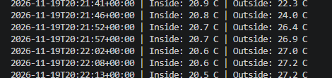
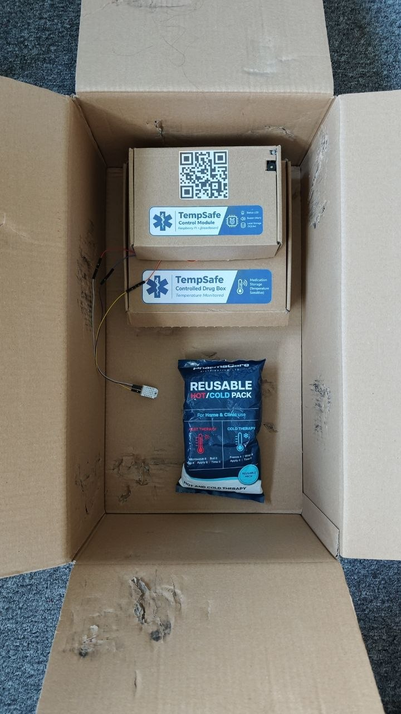
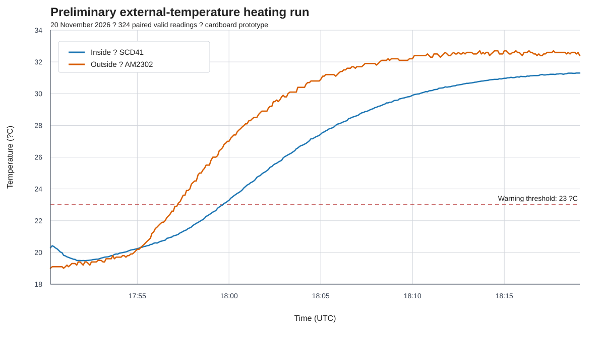

# Internal and External Temperature Experiment

**Status:** Initial sensor check and one preliminary heating run completed.

## Initial two-sensor check — 19 November 2026

The SCD41 and AM2302 were read together on the Raspberry Pi using
`external_temperature_test.py`. The script printed readings to the terminal without saving
or publishing them. During the check, the AM2302 was warmed by holding it in a hand.

Both sensors returned readings. In the captured output, the outside reading rose from
22.3 °C to 27.2 °C while the inside reading changed from 20.9 °C to 20.5 °C.
This confirms that the outside reading responded during this check; it does not establish
sensor accuracy or predict the behaviour of a real medication box.



## Preliminary experiment setup — 20 November 2026

The prototype box was placed inside a larger cardboard box. A reusable hot/cold
pack, warmed beforehand, was placed in the larger box to raise the surrounding
temperature. The SCD41 remained inside the prototype box and the AM2302
measured the surrounding air.



## Purpose

Observe how temperature inside the prototype box changes when the surrounding
air warms and cools. Compare the two temperature curves and their delay before
deciding whether external temperature could support a useful prediction.
Existing internal-temperature Warning and Alert rules remain unchanged.

## Equipment and procedure

- Raspberry Pi 5, SCD41 inside the prototype box and AM2302 outside it.
- Breadboard, wires and a 10 kohm pull-up resistor for the AM2302.
- Larger cardboard box and a reusable hot/cold pack warmed beforehand.

The main temperature logger was stopped. `device/external_temperature_experiment.py`
was run by itself to record both sensors. The warmed pack was already present in the
larger box when recording began. The run continued for approximately 29 minutes.
The sensors were read approximately every five seconds and sequentially, so their
individual readings are not exactly simultaneous.

## Measurement file

The experiment script creates a separate CSV file for each run. It does not write to
SQLite or publish through MQTT. Failed values remain empty and have a status rather
than being replaced with zero or an earlier reading.

CSV columns:

```text
timestamp_utc,inside_temperature_c,inside_status,outside_temperature_c,outside_status
```

Statuses: `valid`, `not_ready`, or `sensor_error`.

## Results — preliminary heating run

CSV
evidence: [external_temperature_experiment_20261120T175011Z.csv](external_temperature_experiment_20261120T175011Z.csv)

The run recorded 324 paired valid readings from 17:50:16 to 18:19:07 UTC.
No cooling stage was recorded.

| Measure           | Inside (SCD41) | Outside (AM2302) |
|-------------------|----------------|------------------|
| First reading     | 20.29 °C       | 19.00 °C         |
| Final reading     | 31.30 °C       | 32.40 °C         |
| Change during run | +11.01 °C      | +13.40 °C        |

The outside sensor first reached 23 °C at 17:57:14 UTC. The inside sensor
first reached 23 °C at 17:59:44 UTC, approximately 2.5 minutes later.



## Conclusion

During this preliminary run, the outside temperature rose before the temperature
inside the prototype box. The 23 °C threshold was reached by the inside sensor
approximately 2.5 minutes after it was reached by the outside sensor. This
demonstrates that an external sensor can provide an earlier signal of a warming
environment.

This is one bench experiment using a cardboard prototype and a reusable hot/cold
pack. It does not validate a prediction for a real medication transport box or an
ambulance. The recorded delay is an experimental estimate, not a guaranteed time
to reach a temperature limit.

## Proposed follow-up

The result supports a future **early environmental warning**. It would be an
informational message, not an Alert:

> External temperature is rising. The internal Warning threshold may be reached
> in approximately 2–3 minutes.

For the proof of concept, the message would appear only when the external
temperature has reached the active Warning limit and is still rising, while the
internal temperature remains below that limit. Existing Warning, Alert, LED and
buzzer behaviour would continue to depend only on the internal temperature.
