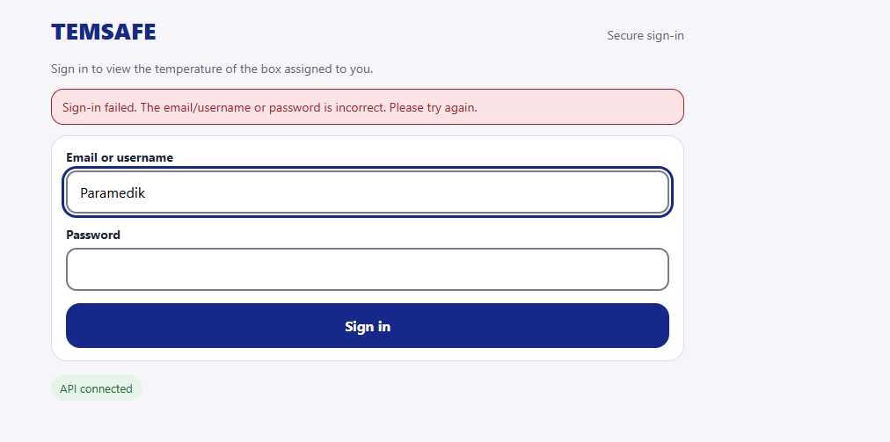
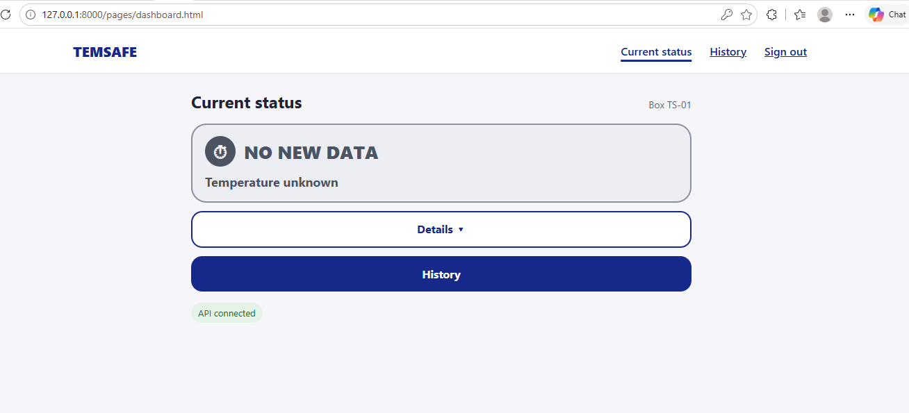
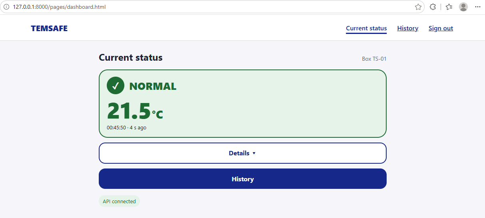
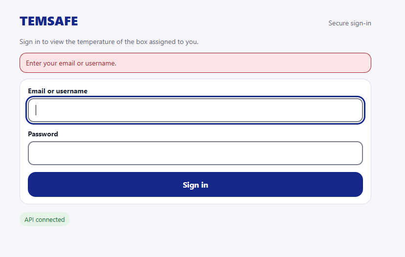
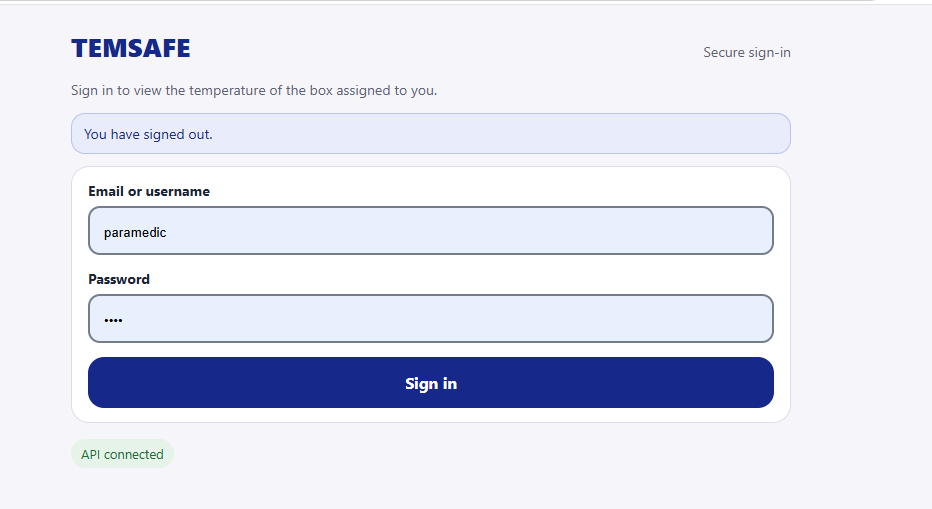
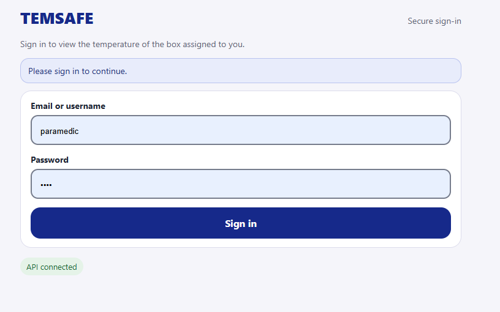
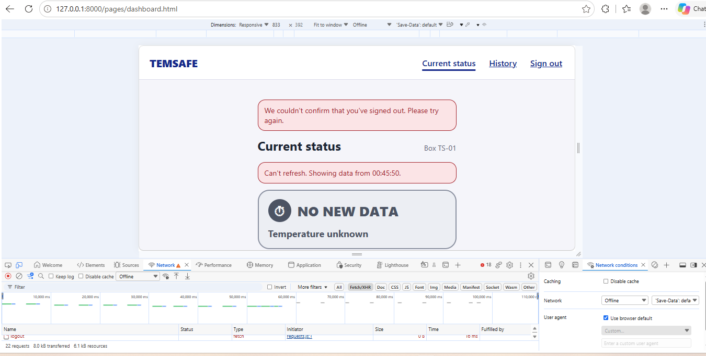

# Sign-in test report

Scrumwise: #71290 · Sprint 7 · Maryna Hordiienko
Branch: `feature/connect-sign-in` · Date: 6 November 2026

## What was tested

The sign-in page now uses the real login endpoint (`POST /api/login`). Only signed-in users can see the box data. Sign out uses `POST /api/logout`.

## Test setup

1. Local MySQL in Docker: `docker compose up -d --wait mysql`.
2. Migrations `003` and `004` applied, so the database has the users and sessions tables.
3. One local test user, `paramedic`, with access to box TS-01. The password is used only on the local database.
4. The device key is set in `.env`. It is local only and is not in Git.
5. Server: `python -m uvicorn temsafe.main:app --reload`, opened at http://127.0.0.1:8000/.
6. A test reading (21.5°C) was sent to `POST /api/readings` with the device key, so the dashboard had live data.

## Results

| # | Test | Expected | Result |
|---|---|---|---|
| 1 | Wrong username | Error message, user stays on the sign-in page | ✅ Pass |
| 2 | Correct username and password | Dashboard opens | ✅ Pass |
| 3 | Signed in, no recent readings | NO NEW DATA, "Temperature unknown", no old number | ✅ Pass |
| 4 | Signed in, new reading sent | NORMAL 21.5°C, updates by itself within 5 s | ✅ Pass |
| 5 | Empty fields | Clear message, password not in the page address | ✅ Pass |
| 6 | Sign out | Session ends, sign-in page shows "You have signed out." | ✅ Pass |
| 7 | Open the dashboard after sign out | Goes back to the sign-in page | ✅ Pass |
| 8 | Sign out when the server cannot be reached | User stays on the page, sees an error, can try again | ✅ Pass |

## Test 1: Wrong login

I typed the wrong username (`Paramedik` instead of `paramedic`). The page showed the error message and stayed on sign-in. The password field was cleared.

## Test 2 and 3: Correct login, no new data

I signed in as `paramedic`. The dashboard opened. The server log showed `POST /api/login 204 No Content`.

No device was sending readings, so the status was NO NEW DATA and "Temperature unknown". The page does not show an old number as the current temperature (UD Principle 5, Tolerance for error).

## Test 4: Live reading

I sent one reading of 21.5°C from PowerShell with the device key. After about 4 seconds, the dashboard changed to NORMAL 21.5°C by itself, without a page reload.

## Test 5: Empty fields

I clicked Sign in with both fields empty. The page showed "Enter your email or username." and moved the cursor to that field. No request was sent, and the password was never in the page address.

## Test 6: Sign out

I signed in and clicked Sign out. The session ended, and the sign-in page showed "You have signed out."

The browser filled in the saved username and password by itself. This is the browser's password manager, not the website.

## Test 7: Dashboard without a session

After sign out, I opened `/pages/dashboard.html` directly. The server returned 401, and the page went back to sign-in with "Please sign in to continue." The box data was not shown.

## Test 8: Sign out fails

I signed in, then set DevTools → Network conditions to Offline and clicked Sign out. The page stayed open and showed "We couldn't confirm that you've signed out. Please try again." Then I set the network back to No throttling and clicked Sign out again. The sign-in page opened with "You have signed out."

The session cookie is HttpOnly, so only the server can end the session. The page does not leave the protected page until the server confirms sign-out.

## Problems found during testing

- After the update, Sign out did not show its message at first, because the browser used old JavaScript files from its cache. In a private window, the new files loaded and it worked. Users may need to reload the page once after the update.
- The first test reading failed with `Field required: sample_id`. The test script was fixed to send a new `sample_id` for every reading. The website code did not need a change.

## Not tested here

- Running on tempsafe.app. This needs the pull request to be merged and the server updated.

## Result

All 8 local tests pass. The DoD items for #71290 are met locally. The last item, "It works on tempsafe.app", is checked after the pull request is merged and the server is updated.
