# Sprint 6 — Dashboard API Integration and Testing Report

**Project:** TempSafe (Smart-Box)  
**Date:** 2 November 2026  
**Backlog Item:** #71049 — Connect the dashboard to the API  
**Branch:** `feature/sprint-6-frontend`  
**Area:** Frontend / Backend API Integration

---

## 1. Objective

The objective of this Sprint 6 task was to replace the sample temperature readings on the main dashboard with data
retrieved from the FastAPI backend.

The dashboard should display the temperature, observation time, temperature profile limits and current status.

It must also handle missing readings, unreliable timestamps, sensor errors, stale data and API failures without
displaying misleading information.

## 2. Development Environment Setup

### 2.1 Docker Desktop

Installed and configured Docker Desktop with the WSL 2 backend.

Verified that Docker Engine was running successfully.

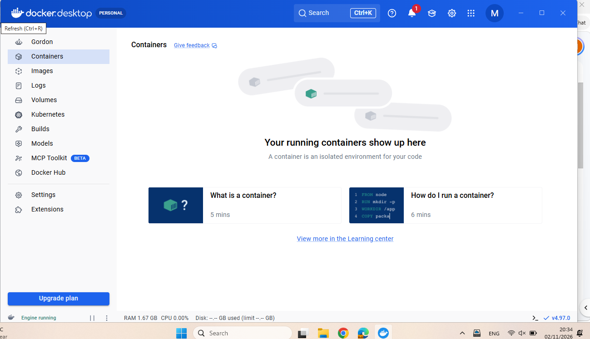

### 2.2 MySQL Database

Started MySQL 8.4 using Docker Compose:

```powershell
docker compose config --quiet
docker compose up -d --wait mysql
docker compose ps
```

The container `temsafe-mysql-1` started successfully and reported a healthy status.

The database was available locally through port `3307`.

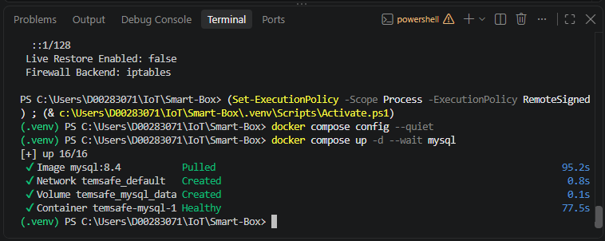

### 2.3 Database Migrations

Applied the following migrations:

- `001_add_prototype_box.sql` — creates the prototype box.
- `002_add_prototype_temperature_profile.sql` — adds the prototype temperature profile.

Commands used:

```powershell
Get-Content database/migrations/001_add_prototype_box.sql -Raw | docker compose exec -T mysql sh -c 'MYSQL_PWD="$MYSQL_PASSWORD" mysql -u temsafe temsafe'

Get-Content database/migrations/002_add_prototype_temperature_profile.sql -Raw | docker compose exec -T mysql sh -c 'MYSQL_PWD="$MYSQL_PASSWORD" mysql -u temsafe temsafe'
```

The migrations completed without visible errors.

The prototype box `TS-01` and its configured temperature limits were subsequently available through the API.

The temperature profile contained the following thresholds:

| Setting           | Temperature |
|-------------------|-------------|
| Lower limit       | 0°C         |
| Warning threshold | 24°C        |
| Upper limit       | 25°C        |

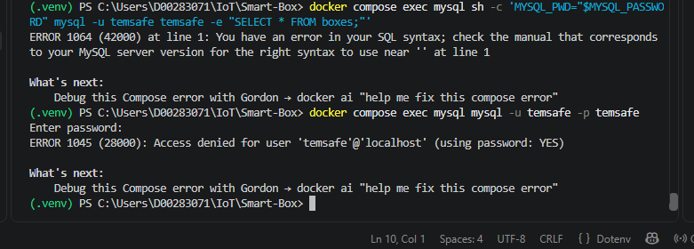

---

## 3. Backend API Integration

### 3.1 Starting FastAPI

Started the backend using:

```powershell
python -m uvicorn temsafe.main:app --reload
```

The health endpoint was successfully accessed at:

`http://127.0.0.1:8000/api/health`

The API returned:

```json
{
  "status": "ok"
}
```

This confirmed that the FastAPI application was running.

Database connectivity was additionally demonstrated by retrieving temperature data through the readings endpoint.

### 3.2 Frontend Changes

Updated:

`frontend/js/dashboard.js`

The dashboard now requests the latest temperature reading from:

`GET /api/boxes/TS-01/readings/latest`

Example:

```javascript
const response = await fetch(
    `${API_BASE}/boxes/TS-01/readings/latest`
);
```

The API response is converted into values used by the dashboard.

The frontend handles:

- Temperature values.
- Temperature status.
- Observation timestamps.
- Received timestamps.
- Temperature profile limits.
- Unreliable observation times.
- Missing temperature readings.
- Sensor errors.
- Stale readings.
- No observations.
- Failed API requests.

The page uses the existing TempSafe layout and CSS.

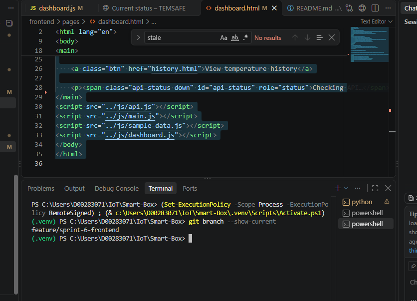

---

## 4. Testing Results

### Test 1 — Dashboard API Connection

**Result: PASS**

The dashboard successfully retrieved a temperature reading of `24.5°C` from the backend.

The API response contained an unreliable observation time.

Therefore, the dashboard displayed:

- `UNKNOWN`
- `Recorded temperature: 24.5°C (not confirmed live)`
- `Last observation: Unknown`

This prevented an unreliable reading from being incorrectly labelled as Live.

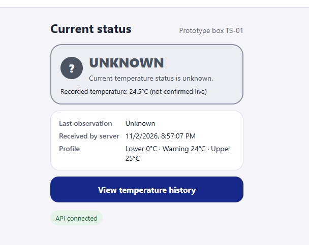

### Test 2 — No Observations: Database Setup

**Result: PASS**

Created a separate test box without temperature readings.

SQL command:

```sql
INSERT INTO boxes (box_id, name)
VALUES ('TS-TEST-EMPTY', 'Empty test box');
```

The database confirmed that one row was inserted.

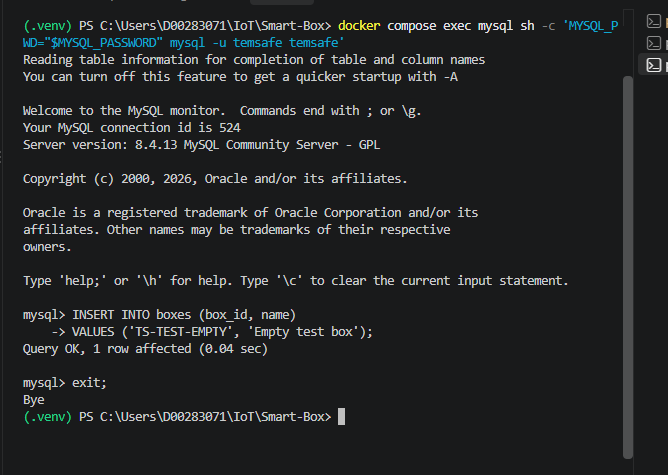

### Test 3 — No Observations: API Response

**Result: PASS**

Requested:

`GET /api/boxes/TS-TEST-EMPTY/readings/latest`

The API returned:

```json
{
  "detail": "No readings available for this box"
}
```

This confirmed that the backend correctly identified a box without temperature readings.

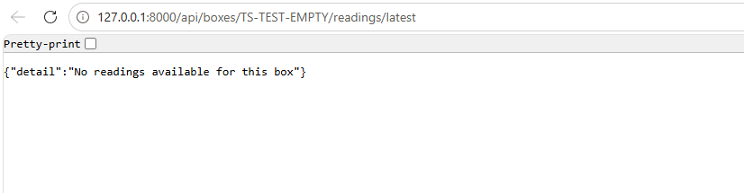

### Test 4 — No Observations: Frontend

**Result: PASS**

Temporarily configured the dashboard to request the empty test box.

The dashboard correctly displayed:

**No observations yet**

"This box has not sent any readings. Current conditions are unknown."

It did not display a misleading temperature or NORMAL status.

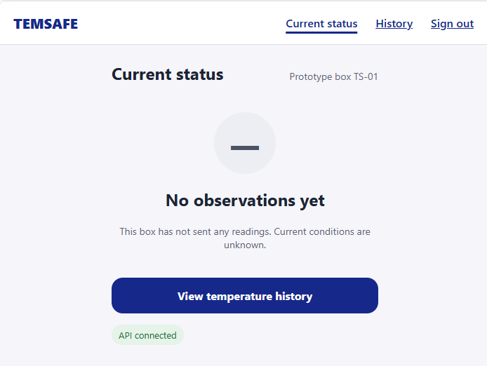

After testing, the dashboard endpoint was restored to the prototype box `TS-01`.

### Test 5 — Sensor Error

**Result: PASS**

Submitted a test reading with the following values:

```json
{
  "box_id": "TS-01",
  "temperature_c": null,
  "quality": "sensor_error",
  "observed_at": null,
  "clock_reliable": false
}
```

These are the relevant fields from the complete API request.

The dashboard correctly displayed:

- `SENSOR ERROR`
- `The sensor could not measure the temperature.`
- `Temperature unavailable`

The dashboard did not display the missing temperature as `0°C` or `NORMAL`.

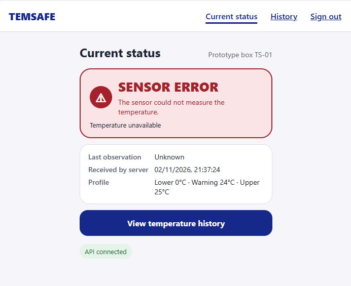

### Test 6 — Duplicate Reading Conflict

**Result: API validation confirmed**

An initial test request reused an existing sample ID or box sequence number.

The backend returned:

`HTTP 409 Conflict`

Response:

```json
{
  "detail": "Sample ID or box sequence number conflicts with an existing reading"
}
```

A subsequent test used a new sample ID and sequence number, allowing the Sensor Error scenario to be displayed.

This confirmed that the API rejects conflicting reading identifiers.

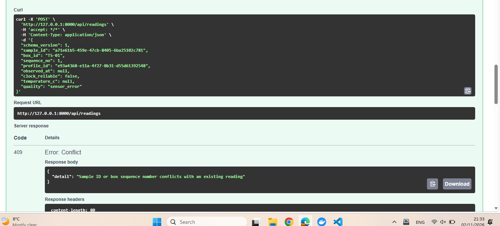

### Test 7 — Backend Availability

**Result: Partial**

Stopped the FastAPI server and refreshed the website.

The browser displayed:

`ERR_CONNECTION_REFUSED`

This confirmed that the website was served through the FastAPI application.

Because the frontend and API were served by the same application, stopping FastAPI also made the website unavailable.

This test did not independently confirm the dashboard's in-page API error message.

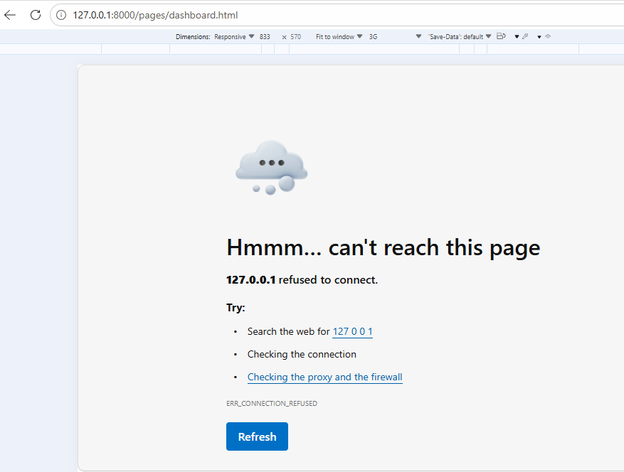

### Test 8 — Browser Developer Tools

**Result: Partial**

Opened browser Developer Tools and inspected the dashboard in responsive mode.

Network throttling was configured to simulate a slower connection.

The dashboard layout was also inspected at narrower viewport widths.

However, the screenshots do not conclusively confirm the Loading message or a complete JavaScript Console check.

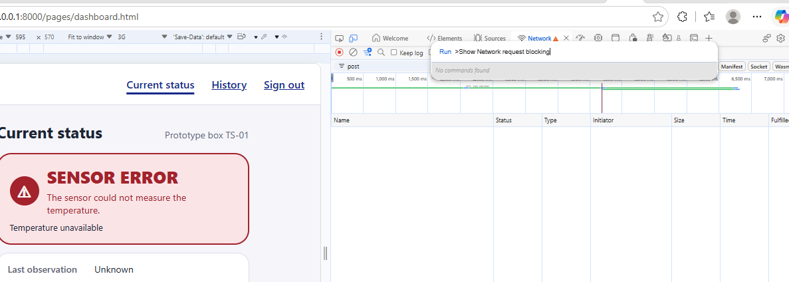

---

## 5. Test Summary

| Scenario                                  | Result                    |
|-------------------------------------------|---------------------------|
| Docker Desktop running                    | PASS                      |
| MySQL container healthy                   | PASS                      |
| Database migrations applied               | PASS                      |
| FastAPI health endpoint                   | PASS                      |
| Dashboard API temperature retrieval       | PASS                      |
| UNKNOWN / unreliable time                 | PASS                      |
| Empty test box creation                   | PASS                      |
| No observations API response              | PASS                      |
| No observations dashboard UI              | PASS                      |
| Sensor error dashboard UI                 | PASS                      |
| Missing temperature not displayed as zero | PASS                      |
| Duplicate sample conflict handling        | PASS                      |
| Backend unavailable                       | Observed                  |
| Responsive layout                         | Partially checked         |
| Loading state                             | Not conclusively verified |
| Stale state                               | Not conclusively verified |
| NORMAL / WARNING / ALERT                  | Not conclusively verified |
| In-page API failure display               | Not conclusively verified |
| Full JavaScript Console check             | Not conclusively verified |

---

## 6. Definition of Done Review

| Requirement                                                                                  | Status                                                  |
|----------------------------------------------------------------------------------------------|---------------------------------------------------------|
| Dashboard loads readings from backend API                                                    | Completed                                               |
| Temperature and profile values match the observed API response                               | Completed for tested reading                            |
| Loading, no observations, sensor errors, stale data and request failures have clear displays | Implemented; partially tested                           |
| Missing temperatures are never displayed as zero or NORMAL                                   | Verified for sensor error                               |
| Remaining demonstration mode is clearly labelled                                             | Sample-data dependency removed from dashboard rendering |
| Browser checks confirm no uncaught JavaScript errors                                         | Final confirmation outstanding                          |

---

## 7. Problems Encountered and Resolved

During development and testing, several issues were investigated.

### Docker and WSL

Docker Desktop initially required the Windows Virtual Machine Platform and an updated WSL installation.

After configuration, Docker Engine started successfully.

### MySQL Authentication

An initial attempt to connect manually produced:

`ERROR 1045: Access denied`

The connection succeeded when using the database credentials configured inside the Docker container.

### MySQL Command Syntax

An SQL query initially failed due to command-line quoting.

The query was subsequently executed from the MySQL interactive terminal.

### Unreliable Observation Timestamp

The dashboard originally displayed:

`Observed Unknown · null s ago · Live`

The frontend was updated to handle missing or unreliable timestamps safely.

The corrected dashboard displays recorded temperatures without falsely identifying them as current live measurements.

### Duplicate API Reading

A test request returned HTTP 409 because the reading identifiers had already been used.

New identifiers were used for the next test.

---

## 8. Files and Evidence

### Frontend source

`frontend/js/dashboard.js`

`frontend/pages/dashboard.html`

### Test report

`docs/testing/sprint-6-dashboard-api-test-report.md`

### Screenshots

All evidence screenshots are stored in:

`docs/assets/testing/frontend-api/`

The screenshots above document the environment setup, database preparation, frontend integration and observed test
results.

---

## 9. Conclusion

The Sprint 6 Dashboard API integration was implemented and successfully tested against the local FastAPI and MySQL
environment.

The dashboard retrieves real API responses and correctly handles unreliable timestamps, missing observations and sensor
errors in the tested scenarios.

The local development environment and database migrations were completed successfully.

The remaining edge cases should receive final verification before the entire backlog item's Definition of Done is marked
complete.

**Branch:** `feature/sprint-6-frontend`  
**Backlog:** #71049 — Connect the dashboard to the API
