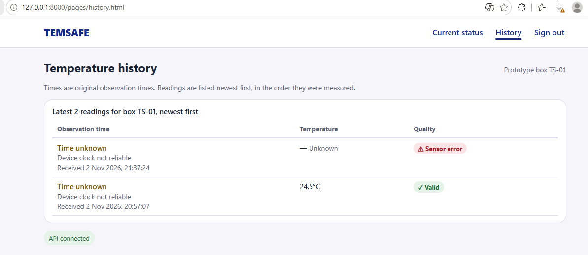
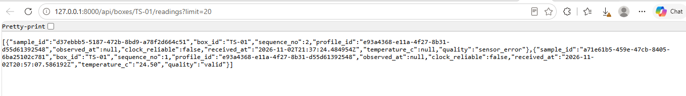

# Sprint 6 — History Table Test Report

**Project:** TempSafe (Smart-Box)  
**Date:** 2 November 2026  
**Backlog Item:** #71050 — Implement an accessible history table  
**Branch:** `feature/history-table`  
**Author:** Maryna Hordiienko

---

## 1. Objective

Replace the placeholder on the history page with a table that loads box readings from the existing API. Each row
shows the observation time, temperature and quality. Missing values, sensor errors, loading, empty results and request
failures must be clearly shown.

## 2. Implementation

| File                          | Change                                                                 |
|-------------------------------|------------------------------------------------------------------------|
| `frontend/pages/history.html` | History page with a container for the table and the API status badge.  |
| `frontend/js/history.js`      | Loads `GET /api/boxes/TS-01/readings?limit=20` and builds the table.   |
| `frontend/css/main.css`       | Table, quality tag and error banner styles; narrow-screen adjustments. |

The API returns readings in descending `sequence_no` order. The page keeps this order and does not re-sort by
`received_at`.

| Case                                        | Displayed                                                         |
|---------------------------------------------|-------------------------------------------------------------------|
| Valid reading                               | Temperature with one decimal place, e.g. `24.5°C`, and `✓ Valid` |
| Sensor error                                | `— Unknown` and `⚠ Sensor error` (never 0°C)                     |
| Missing temperature                         | `— Missing`                                                       |
| `observed_at` is null or clock not reliable | `Time unknown`, `Device clock not reliable` and the received time |
| Loading                                     | `Loading readings…`                                               |
| Empty list `[]`                             | `No observations found`                                           |
| `404`                                       | `Box not found`                                                   |
| Other errors or no connection               | `Unable to load history`                                          |

Accessibility: the table has a `<caption>` and `<th scope="col">` column headers. The table wrapper is a labelled,
keyboard-focusable region so it can be scrolled with the keyboard if needed. Text labels and symbols are used as well
as colour.

## 3. Test Results

### Test 1 — Table matches the API response

**Result: PASS**

The backend was started locally with MySQL in Docker. The page
`http://127.0.0.1:8000/pages/history.html` was compared with the raw API response from
`http://127.0.0.1:8000/api/boxes/TS-01/readings?limit=20`.

| `sequence_no` | API response                                                                                  | Table row                                                               | Match |
|---------------|-----------------------------------------------------------------------------------------------|-------------------------------------------------------------------------|-------|
| 2             | `quality: sensor_error`, `temperature_c: null`, `observed_at: null`, `received_at: 21:37:24Z` | Time unknown · Received 2 Nov 2026, 21:37:24 · — Unknown · Sensor error | Yes   |
| 1             | `quality: valid`, `temperature_c: "24.50"`, `observed_at: null`, `received_at: 20:57:07Z`     | Time unknown · Received 2 Nov 2026, 20:57:07 · 24.5°C · Valid           | Yes   |

The rows appear in the same order as the API response (newest `sequence_no` first). The sensor error is not shown
as 0°C, and neither reading is given an observation time because the device clock was not reliable.

### Test 2 — Other states

**Result: PASS**

Loading, empty results, a `404` response, a `500` response and a failed connection were checked in a browser with
mocked API responses. Each state showed the message listed in section 2. At a phone width of 375 px, the table fitted
the screen without horizontal page scrolling, and no uncaught JavaScript errors were reported.

## 4. Definition of Done Review

| Requirement                                                                       | Status    |
|-----------------------------------------------------------------------------------|-----------|
| The table loads readings for the selected prototype box from the API              | Completed |
| Each row displays observation time, temperature and quality in the agreed order   | Completed |
| Missing values and sensor errors are clearly labelled                             | Completed |
| Loading, empty results and request failures are handled                           | Completed |
| The table uses semantic headers and remains readable on phone and desktop layouts | Completed |
| Displayed values have been checked against an API response                        | Completed |
