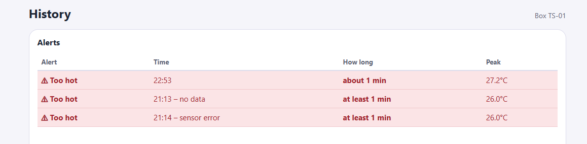
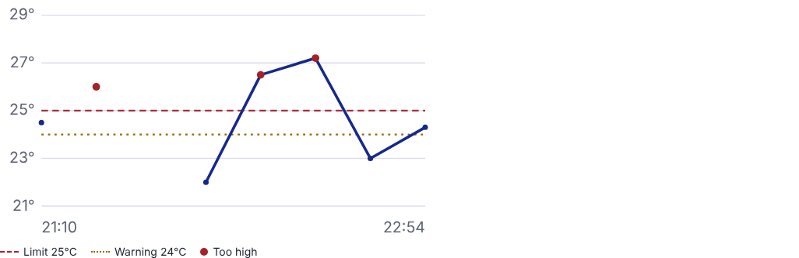
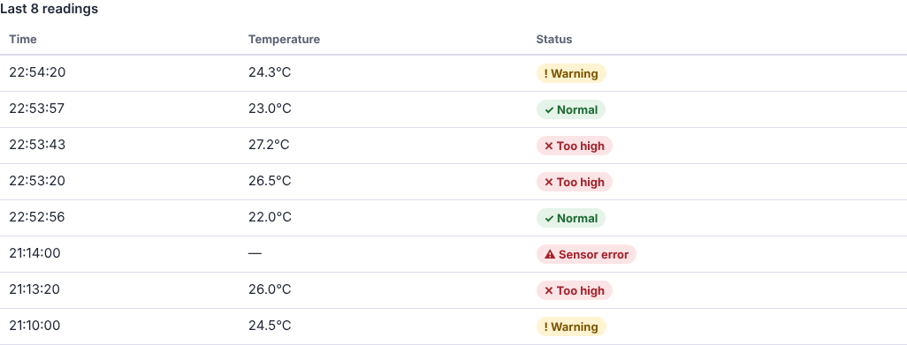
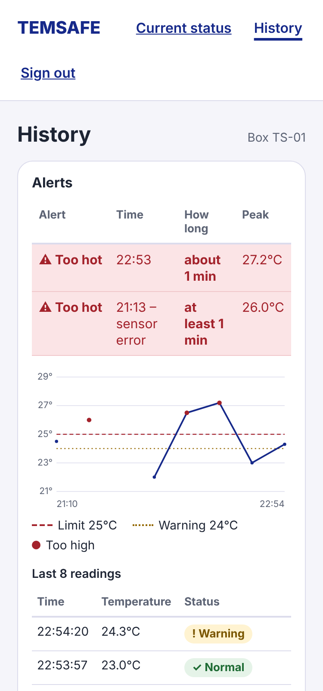

# Sprint 7 — History Graph and Alert Periods Test Report

**Project:** TempSafe (Smart-Box)  
**Date:** 4 November 2026  
**Backlog items:** #71286 — Add a temperature graph to the history page; FR-13 — Show how long the box was too hot or
too cold  
**Branch:** `feature/history-graph`  
**Author:** Maryna Hordiienko

---

## 1. Goal

Make past temperature problems easy to see on the history page. The paramedic should see when the box was too hot
or too cold, for how long, and the highest or lowest temperature. This is the key information in our
[main use case](../requirements/main-use-case.md).

## 2. What was added

| Part               | What it shows                                                                                                               |
|--------------------|-----------------------------------------------------------------------------------------------------------------------------|
| **Alerts table**   | Each alert period: type (Too hot / Too cold), time, **how long**, and peak temperature. Newest first.                       |
| **Graph**          | The last 100 readings, oldest on the left. Dashed red line = 25°C limit, dotted line = 24°C warning, red points = too high. |
| **Readings table** | Time, temperature and the **status** of each reading (Normal, Warning, Too high, Too low, Sensor error).                    |

The limits come from the box profile in the database (0°C / 24°C / 25°C), not from the code.

## 3. Rules for alert periods (FR-13)

- Readings in a row above 25°C, or at or below 0°C, form one period.
- The period ends at the first reading back within the limits. The time between readings is not known exactly,
  so the duration is shown as **"about"**.
- A **sensor error** or **no reading for more than 90 seconds** ends the period, because we do not know what happened
  next. The duration is then shown as **"at least"**.
- An alert that has not ended yet shows **"still going"**.
- Sensor errors and missing values are never shown as 0°C. They break the graph line.

## 4. Test results

The backend and MySQL were run locally. Test readings were sent with `POST /api/readings`.

### Test 1 — Alerts table with real local data

**Result: PASS**

Readings sent: 22.0°C, 26.5°C, 27.2°C, 23.0°C. Earlier test readings from the same evening (26.0°C followed by a
sensor error and a long break) were also in the database.

| Alert   | Time                 | How long       | Peak   | Why                            |
|---------|----------------------|----------------|--------|--------------------------------|
| Too hot | 22:53                | about 1 min    | 27.2°C | Ended by a normal reading      |
| Too hot | 21:13 – no data      | at least 1 min | 26.0°C | No reading for over 90 seconds |
| Too hot | 21:14 – sensor error | at least 1 min | 26.0°C | Ended by a sensor error        |

### Test 2 — Graph

**Result: PASS**

The limit lines and the legend are shown. Points above 25°C are red. The line breaks at the sensor error and at the
long break in the data, so a missing period is not drawn as a normal line.

### Test 3 — Status of each reading

**Result: PASS**

Each reading shows its own status. The sensor error shows "—" and "Sensor error", never 0°C or Normal.

### Test 4 — Other cases (automated browser check)

**Result: PASS**

Checked in Chromium with prepared test data:

| Case                                                      | Shown                                           |
|-----------------------------------------------------------|-------------------------------------------------|
| Main use case: above 25°C from 14:01 to 14:20, max 28.1°C | Too hot · 14:01 – 14:20 · about 19 min · 28.1°C |
| Alert not finished                                        | Too hot · since 14:01 · still going             |
| Below 0°C                                                 | Too cold · 14:01 – 14:02 · about 2 min · −1.2°C |
| No alerts                                                 | ✓ No alerts in these readings                  |
| Only one reading                                          | Not enough readings for a graph yet             |

### Test 5 — Accessibility and phone layout

**Result: PASS**

- axe-core (WCAG 2.2 A and AA): no violations.
- No sideways page scrolling at 320 px and 375 px.
- The alerts and readings tables have captions and column headers.
- The graph has a text summary for screen readers, and the readings table shows the same data (AC-07).
- Colour is not the only signal: every status also has a word and a symbol.

## 5. Known limits

- The page uses the last 100 readings (the API maximum). With one reading every 30 seconds, this is about 50 minutes.
- The history page does not refresh by itself; it is for reviewing past events. The dashboard refreshes automatically.
- Durations are estimates, because readings are taken every 30 seconds.

## 6. Definition of Done

| Requirement                                                                       | Status |
|-----------------------------------------------------------------------------------|--------|
| The graph shows the latest readings from the API in the order they were measured. | Done   |
| The 24°C and 25°C lines have text labels.                                         | Done   |
| Sensor errors and missing values are gaps, never 0°C.                             | Done   |
| The graph has a text label for screen readers, and the table shows the same data. | Done   |
| The graph fits a phone screen without sideways scrolling.                         | Done   |
| Alert periods show start, end, estimated duration and peak temperature (FR-13).   | Done   |
