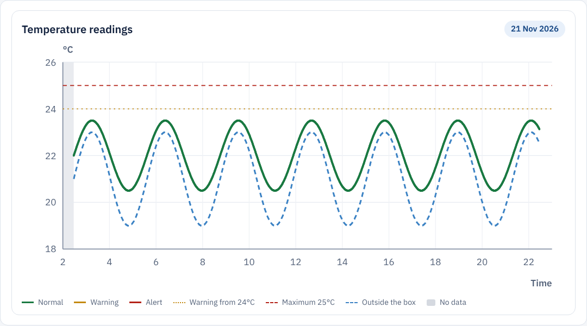
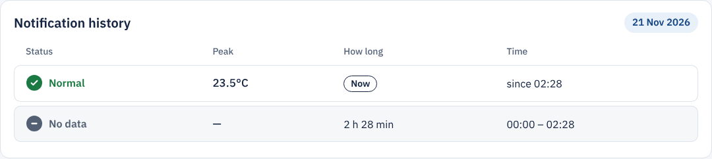
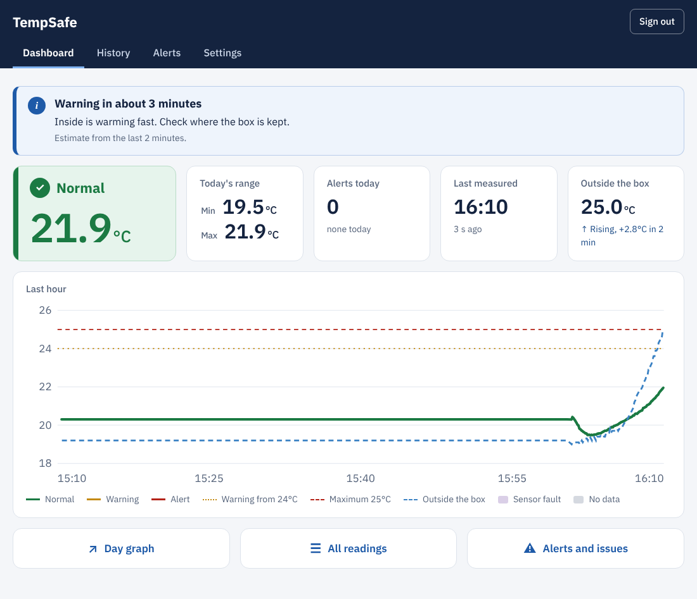
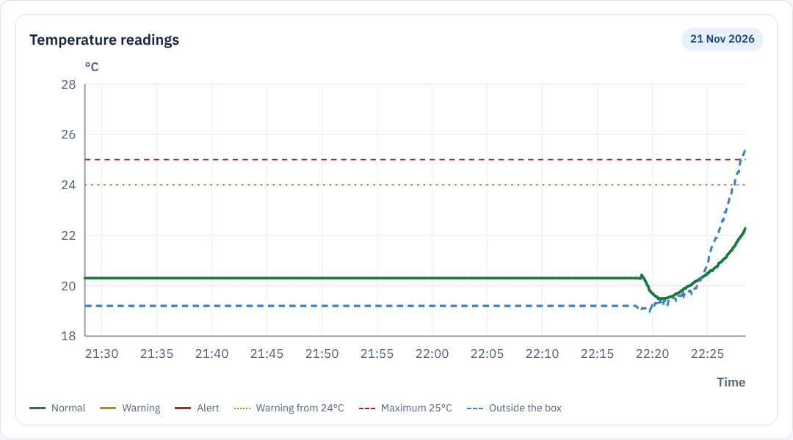
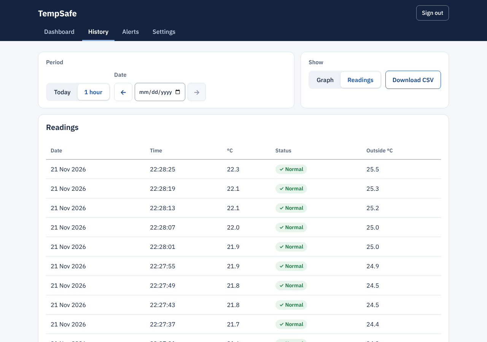
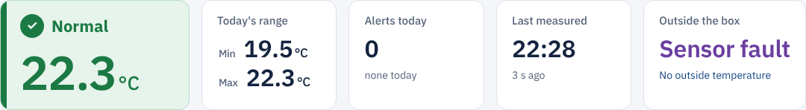
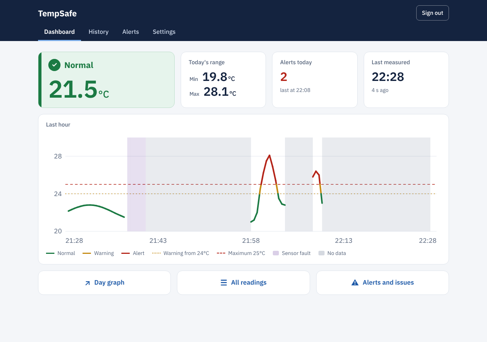
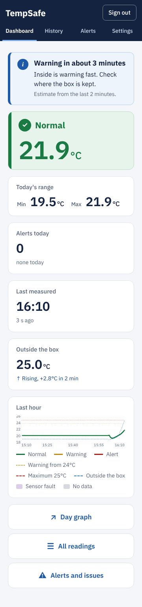

# TempSafe · Front-end test with inside and outside sensors · 21 November 2026

**Tester:** Maryna Hordiienko · **Scrumwise:** *Show inside and outside readings on the website*
**Branch:** `feature/dual-sensor-frontend` on top of `master` `60f8f24` (PR #33, dual-sensor backend)

This test checks the frontend part of the [dual-sensor rollout and handover](../../operations/dual-sensor-rollout.md#frontend-handover).
The outside sensor is not running on the box yet, so readings came from two test sources:

- **local backend and MySQL** (`master` with migrations 006 and 007), fed by the local test sender with
  `--fast --outside`: inside and outside readings share the box-wide sequence counter;
- **a local test server** with fixed scenarios: a full day of interleaved readings, Hanna's heating run of
  20 November (outside warms first), and an outside sensor fault.

Browsers: Chrome on desktop (1280 px) and at iPhone width (390 px). Accessibility: axe.

## Results

| ID   | Check                                                                     | Expected                                                                                              | Result |
|------|---------------------------------------------------------------------------|-------------------------------------------------------------------------------------------------------|--------|
| D-01 | A full day where inside and outside readings alternate (numbers 100, 101, 102 …) | No grey **No data** bands between inside readings; the only band is before the first reading           | Pass   |
| D-02 | The same day in **Alerts → Status**                                       | One continuous **Normal** period, not split at every outside reading                                  | Pass   |
| D-03 | Outside warms first (Hanna's run): Dashboard                              | Tile **Outside the box ↑ Rising**; blue forecast card *Warning in about 2 minutes* | Pass   |
| D-04 | Inside status during D-03                                                 | Still **Normal 22.3°C**; no Warning, Alert or pop-up caused by the outside sensor                     | Pass   |
| D-05 | History, 1 hour                                                           | Dashed blue *Outside the box* line next to the inside line; listed in the legend                     | Pass   |
| D-06 | History → Readings and **Download CSV**                                   | Column **Outside °C**; CSV columns `Inside temperature (°C)` and `Outside temperature (°C)`          | Pass   |
| D-07 | Outside sensor fault while inside is fine                                 | Tile **Sensor fault · No outside temperature**; no banner; inside stays **Normal**                    | Pass   |
| D-08 | Box without an outside sensor                                             | No outside tile, line or column; the Dashboard looks as before                                        | Pass   |
| D-09 | Phone width (390 px)                                                      | Tile and banner fit; no sideways scrolling                                                            | Pass   |
| D-10 | Accessibility (axe) on Dashboard, History, Readings, Alerts, Settings     | No violations                                                                                         | Pass   |
| D-11 | Local backend with the test sender (`--fast --outside`)                   | Every upload accepted (200); Dashboard shows both sensors                                             | Pass   |
| D-12 | Forecast against Hanna's run, 7 moments (added 22 Nov)                    | The card is never later than the real time inside reached 24°C; no card while outside is below 24°C  | Pass   |
| D-15 | Short card and Today's range (added 22 Nov)                           | Card shows the title, one line and *Estimate from the last 2 minutes*; Max is never below the temperature shown now | Pass   |
| D-16 | One alert ends while readings come every 5 s (added 22 Nov)            | One *Back in range* pop-up. Before the fix it repeated every 15 s (24 times), because the alert start left the latest 100 readings | Pass   |
| D-13 | Inside not rising, rising slower than 0.2°C/min, fewer than 4 readings     | No card (rise not confirmed)                                                                          | Pass   |
| D-14 | A gap or a sensor error among the last 2 minutes of inside readings       | No card                                                                                               | Pass   |

CSV extract (D-06):

```
"Date","Time","Inside temperature (°C)","Status","Outside temperature (°C)"
"2026-11-21","21:28:28","20.3","Normal","19.2"
```

## Found and fixed during the test

| Finding                                                                                     | Fix                                                                     |
|---------------------------------------------------------------------------------------------|-------------------------------------------------------------------------|
| The local database still had the old table, so the backend returned 500 (*Unknown column sensor_location*) | Applied migrations 006 and 007 to the local database, as the rollout says |
| The outside tile said **Steady** in the first two minutes, before a trend can be measured   | No trend text until there is a reading from two minutes earlier         |
| **Today's range** could show **−0.0°C**                                                      | Values are rounded before the minus sign is added                       |

## Screenshots

















Forecast results (D-12) are listed in [outside-temperature-display.md](../../design/ui/outside-temperature-display.md#when-the-forecast-card-shows).

## Not covered

- The physical AM2302 on the Pi: the device package is not installed yet.
- The hosted site tempsafe.app.
