# TempSafe mobile website usability test report

22 November 2026

We tested Dashboard, History and Alerts in mobile Chrome after pull request #34. The screenshots labelled “Observed” show what we saw during testing. Those labelled “Example” illustrate proposed changes for discussion with Maryna.

## Dashboard account and box identification

**Account and navigation.** The header shows TempSafe and Sign out. It is unclear which account and box the Normal or Offline status belongs to, and the navigation blends into the header. Show the signed-in email address beneath the product name on every page and the box ID above its summary. Give the navigation bar a slightly lighter background.

**Measurement time.** Five cards appear in succession. When the box is Offline, the first card shows 21.9 °C, but the time of that reading appears only on the fourth card, Last measured. Place the time directly beneath the temperature so users can read the value, status and age together.

| Observed · dashboard | Example · account and navigation | Example · box and reading |
| --- | --- | --- |
| <a href="../../assets/testing/dashboard-2026-11-22/current-dashboard-top.png">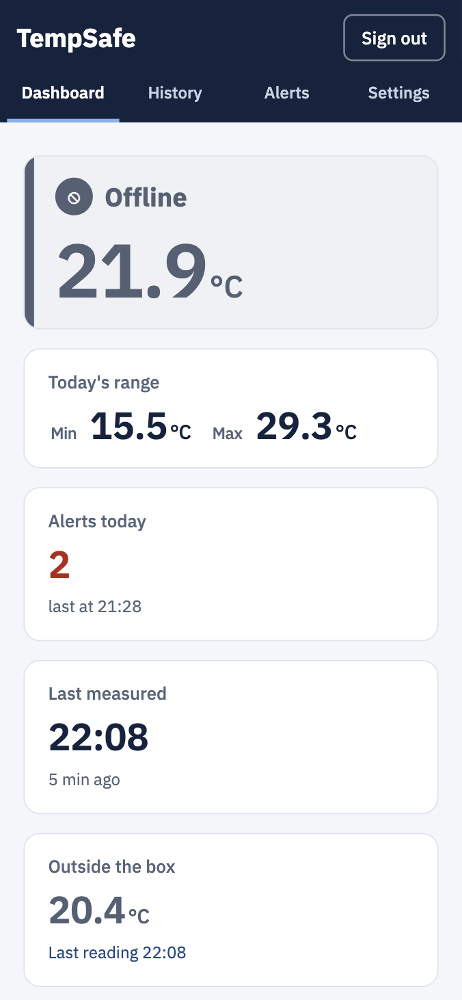</a> | <a href="../../assets/testing/dashboard-2026-11-22/header-navigation.png">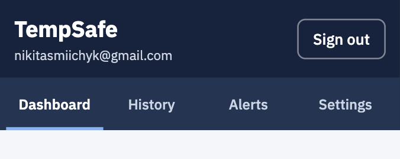</a> | <a href="../../assets/testing/dashboard-2026-11-22/inside-risk-clear.png">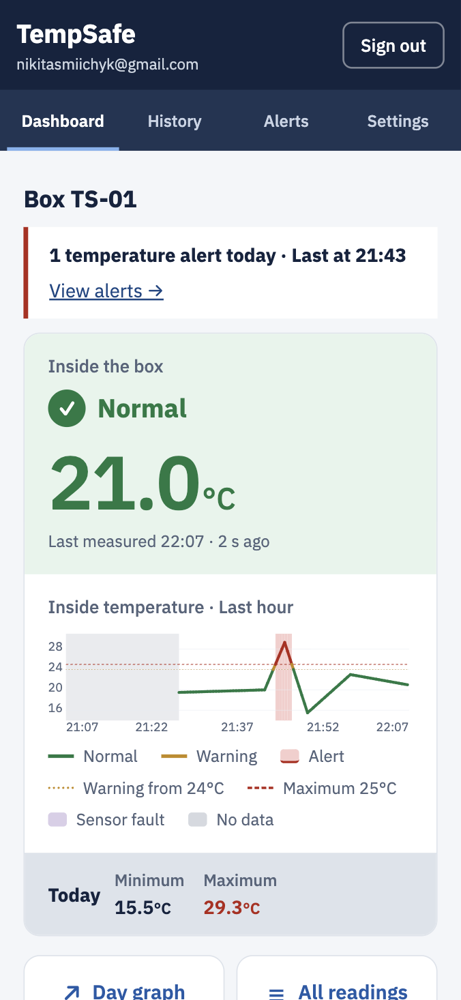</a> |

## Dashboard alerts after time away

**What is the temperature now?** On arrival, the user first wants to know whether the box is within range. In the example, 21 °C, Normal and the measurement time are visible together.

**Did I miss an alert?** The temperature is back within range, but there was an alert earlier today. During testing the graph separated the count from the link. Show “1 temperature alert today · Last at 21:46” near the top with a **View alerts** link so the event is one tap away.

**When did it happen and how long did it last?** The hourly graph shows one red interval. Pale red shading marks its duration, grey indicates missing data and the dotted Warning and dashed Maximum lines show the thresholds crossed.

**Where can I find details?** Keep the daily Minimum and Maximum below the graph. Highlight the maximum of 29.3 °C in red. Place **Day graph** and **All readings** below the daily summary.

| Observed · link below the graph | Example · alert at the top |
| --- | --- |
| <a href="../../assets/testing/dashboard-2026-11-22/current-dashboard-bottom.png">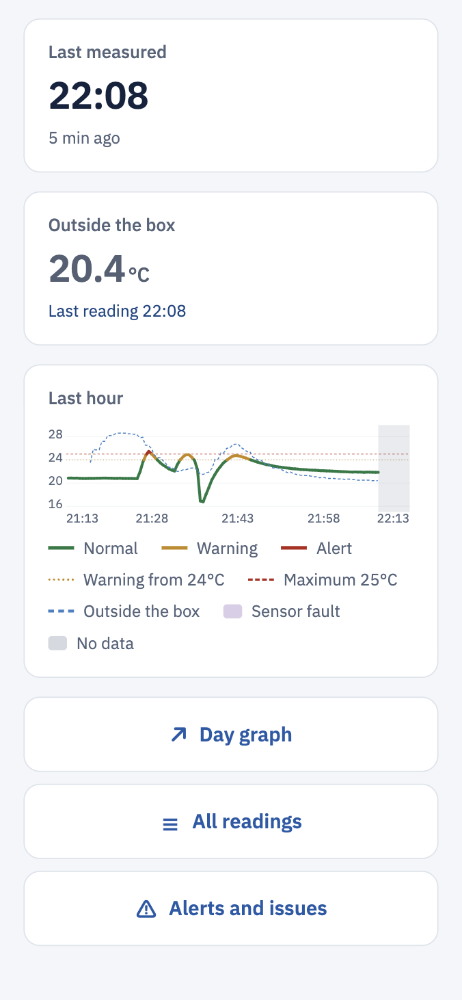</a> | <a href="../../assets/testing/dashboard-2026-11-22/dashboard-information-priority.png">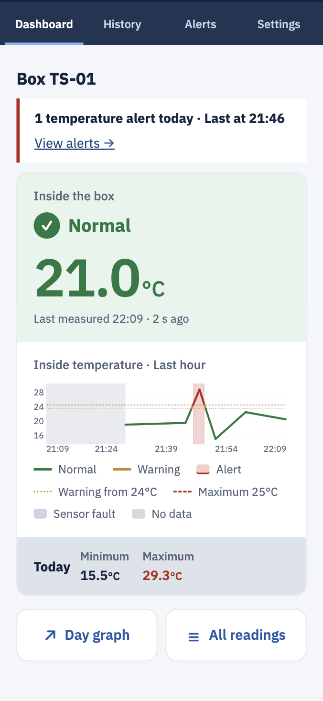</a> |

## When the outside sensor calls for action

“Rising, +4.3°C in 2 min” can sound like a forecast. The outside temperature has its own card and line on the graph, leaving users to work out whether conditions outside will affect the contents of the box.

**Proposed change.** Use outside readings to assess risk. When measurements confirm that the temperature inside is rising, show one amber message below the current reading: “At this rate, the temperature inside may reach 24 °C in about two minutes. Check where the box is kept.” Remove the message when the risk passes.

Omit outside temperature values from the message, graphs, readings table and downloadable CSV. Count and record an alert when the measured temperature inside actually crosses its alert threshold.

| Observed · outside reading | Example · warming risk | Example · no risk |
| --- | --- | --- |
|  | <a href="../../assets/testing/dashboard-2026-11-22/inside-risk-present.png">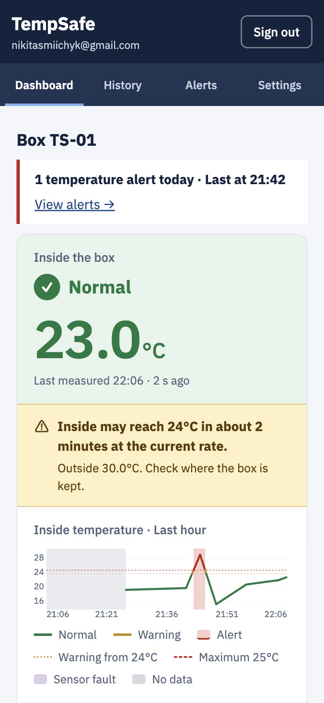</a> |  |

The middle example illustrates the position of the message. Remove “Outside 30.0°C” from the proposed wording.

## History for a selected day

**Observed.** Day graph could reopen a previously selected 1 hour period. On a phone, the separate Period and Show panels take up more than half the screen before the graph appears.

**Proposed change.** Remove the Today / 1 hour control from History. The dashboard already shows the last hour, and today can be selected in the calendar. Day graph should open today’s date. To review another day, select the date, then tap **Graph** or **Readings**. Place **Download CSV** above the readings table.

| Observed · period controls | Example · Graph | Example · Readings and CSV |
| --- | --- | --- |
| <a href="../../assets/testing/dashboard-2026-11-22/current-history.png">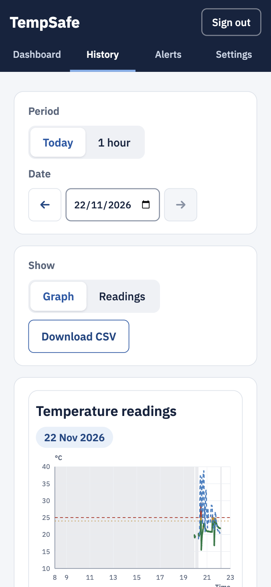</a> | <a href="../../assets/testing/dashboard-2026-11-22/history-final-graph.png">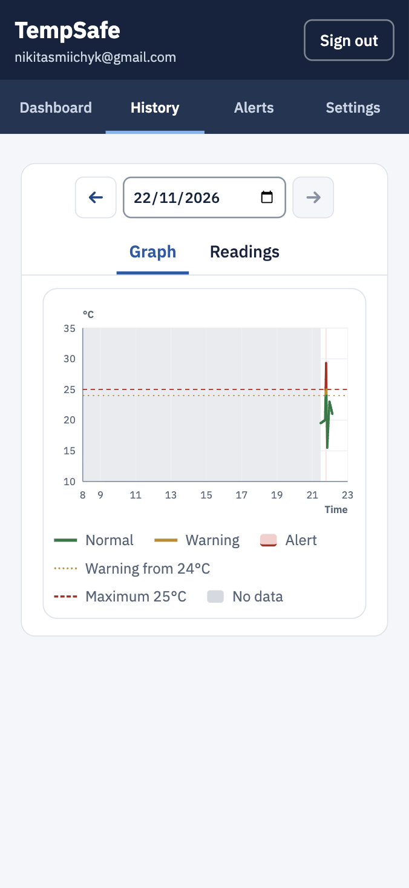</a> | <a href="../../assets/testing/dashboard-2026-11-22/history-final-readings.png">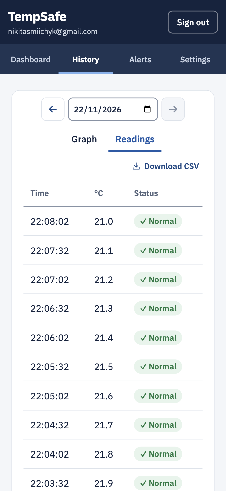</a> |

## Finding a temperature alert

**Observed.** Status and Issues are available. Data gaps have a dedicated list, while a temperature alert must be found in the full timeline. Tapping the dashboard count should take the user to the event it refers to.

**Alerts.** Add a dedicated temperature alert list below the calendar. **View alerts** should open this tab for the day shown on the dashboard. The example shows a peak of 29.3 °C lasting three minutes.

**All events.** Keep the full timeline under this label so users can see when the temperature returned to normal.

**Issues.** Keep data gaps and sensor faults here. For No data, show the time and duration. There is no measurement from which to calculate a peak.

| Observed · Status and Issues | Example · Alerts | Example · All events |
| --- | --- | --- |
| <a href="../../assets/testing/dashboard-2026-11-22/current-alerts.png">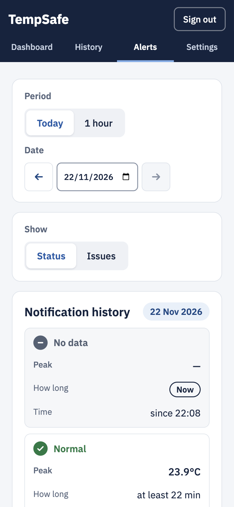</a> | <a href="../../assets/testing/dashboard-2026-11-22/alerts-final-temperature.png">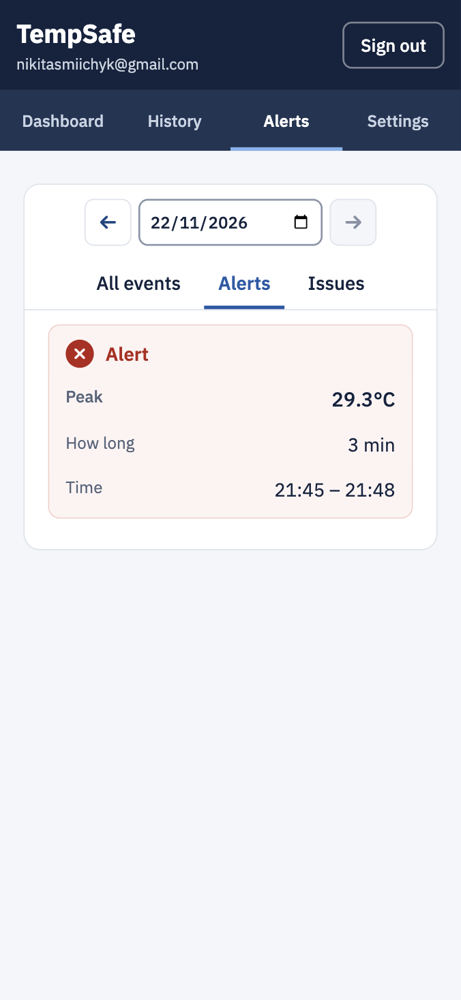</a> | <a href="../../assets/testing/dashboard-2026-11-22/alerts-final-all-events.png">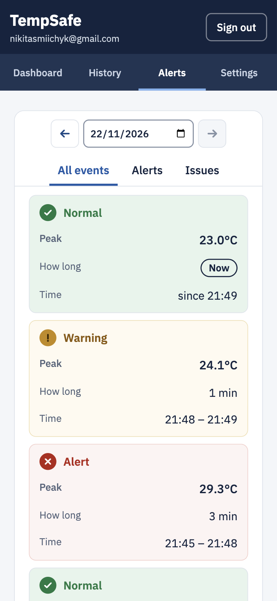</a> |

## Browser notification follow-up

Retest the review scenario in which the browser remembers a previous alert that has ended. Reopen the site during a new alert that spans the latest 100 readings. Check that the user receives the new alert notification once and then “Back in range” once. The retest result has yet to be recorded.

## Settings

No usability issues were observed on this screen. An HTTP 404 response for TS-01 limited testing of the temperature limits form in the local demo.
