# TempSafe · Manual front-end testing · 14 November 2026

I tested the `feature/sprint-9-frontend-musts` branch locally with box TS-01. The database held 19,374 test records for
8–14 November, covering readings at 30-second intervals, gaps, overheating, cooling and sensor faults. To test
notifications, we added three more readings 30 seconds apart: **21.5 → 27.1 → 21.8 °C**.

I found the new Dashboard easy to read. I could see at a glance when the box stopped sending data, the day's temperature
range and when the last reading arrived.

## Dashboard and notifications

| What I tested                                         | What I saw                                                                                                                                                                                                                        |
|-------------------------------------------------------|-----------------------------------------------------------------------------------------------------------------------------------------------------------------------------------------------------------------------------------|
| We stopped sending readings                           | The card turned grey and showed **Offline**. I could still see the last temperature (26.8 °C) and the time it was measured. The day's minimum and maximum, the alert count and the time the latest alert began were easy to find. |
| A reading of 21.5 °C arrived after the gap            | Two green notifications appeared on the Settings page I had open. **Back online** meant readings were coming in again. **Back in range** meant the new temperature was within the limits.                                         |
| A reading of 27.1 °C arrived 30 seconds later         | The Dashboard showed a red card, a banner with a **View** button and an **Alert** pop-up. The day's alert count rose from two to three. **View** gave me a quick way to open the history.                                         |
| A reading of 21.8 °C arrived another 30 seconds later | The card turned green, the status changed to **Normal** and the red banner disappeared. The day's alert count stayed at three.                                                                                                    |

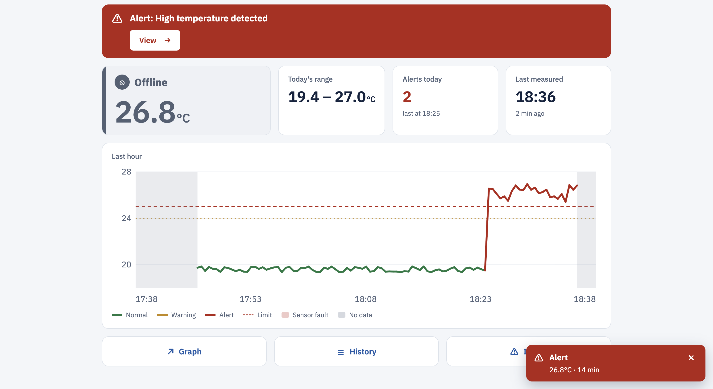
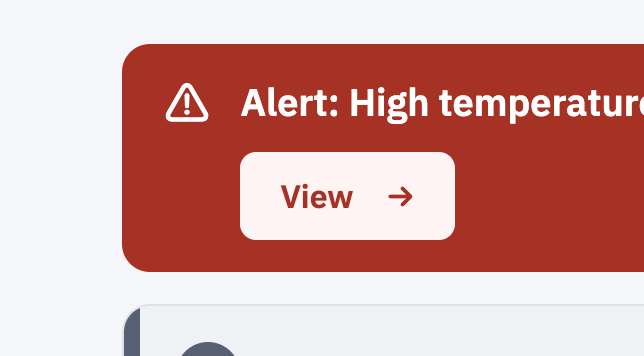
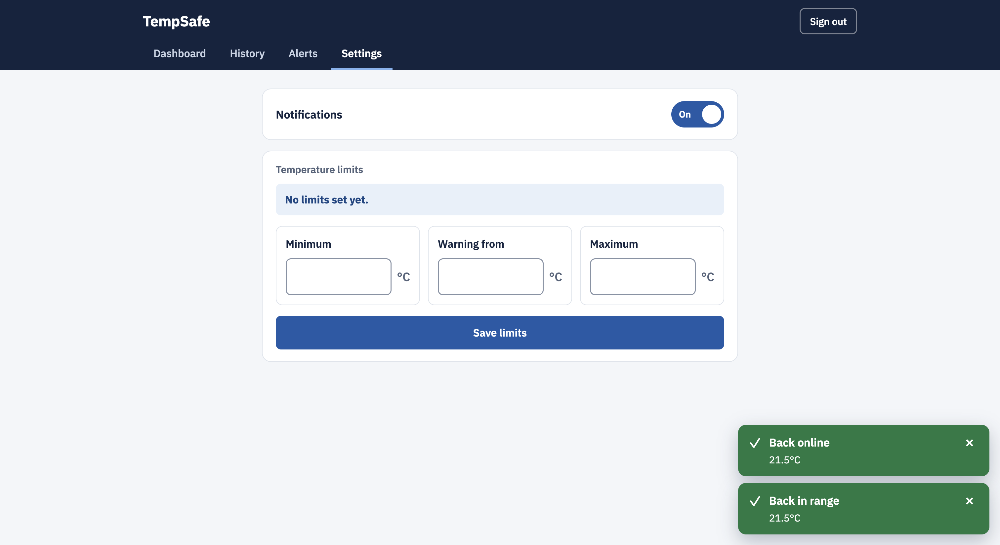
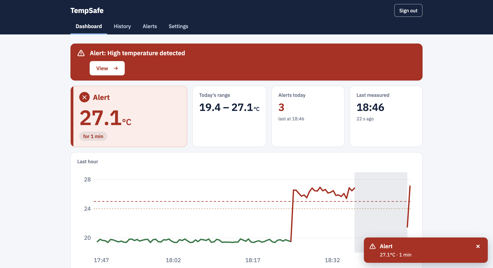
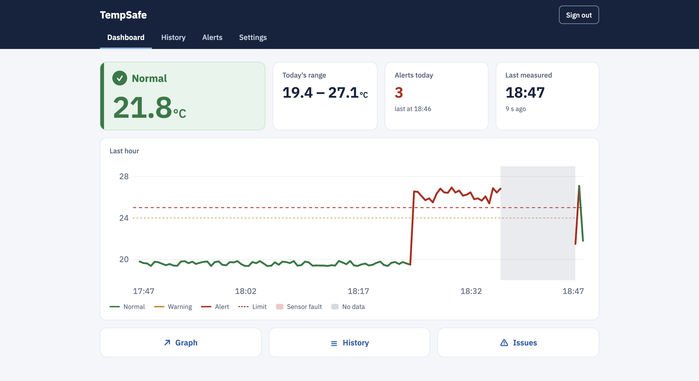

I had **Notifications** switched on. The screenshots show the pop-ups I saw within the site. I haven't confirmed whether
a system notification appeared through the browser.

## Alerts · Status and Issues

I like seeing **Normal** in the history. The change in status tells me when the temperature returned to normal, and
**How long** tells me how long it stayed there.

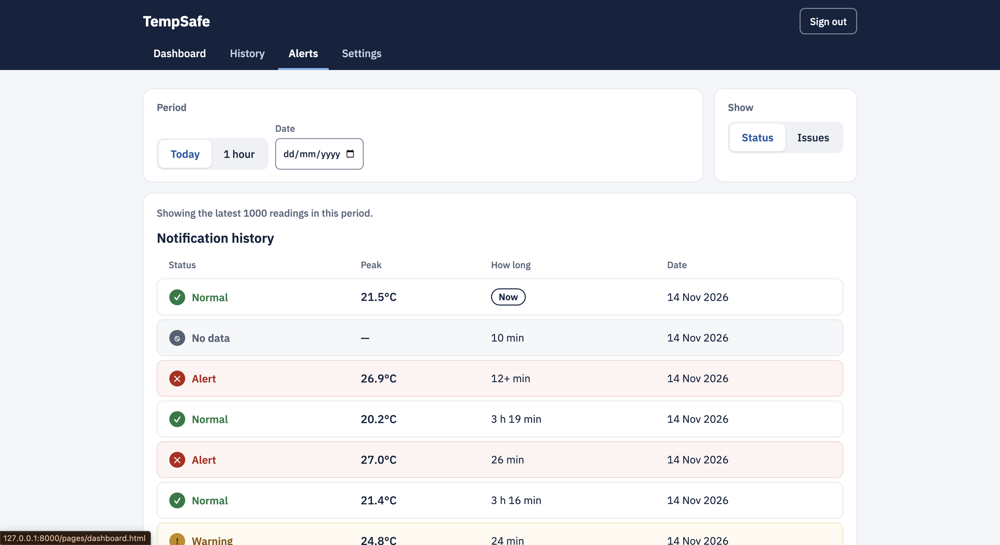
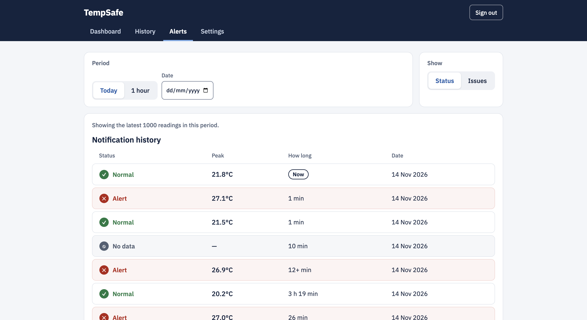

**Why I looked for Alert and Warning under Issues.** The Dashboard showed **Alerts today · 3**. The latest alert started
at 18:46. I opened **Issues** to look at those three alerts and found three **No data** entries. I found the **27.1 °C**
alert under **Status**. The counts happened to match. The Dashboard counts temperature alert episodes, while Issues
lists gaps in readings and sensor faults. Would **Data issues** make the tab easier to recognise? With the broader label
**Issues**, I expected to find **Warning** and **Alert** there too.

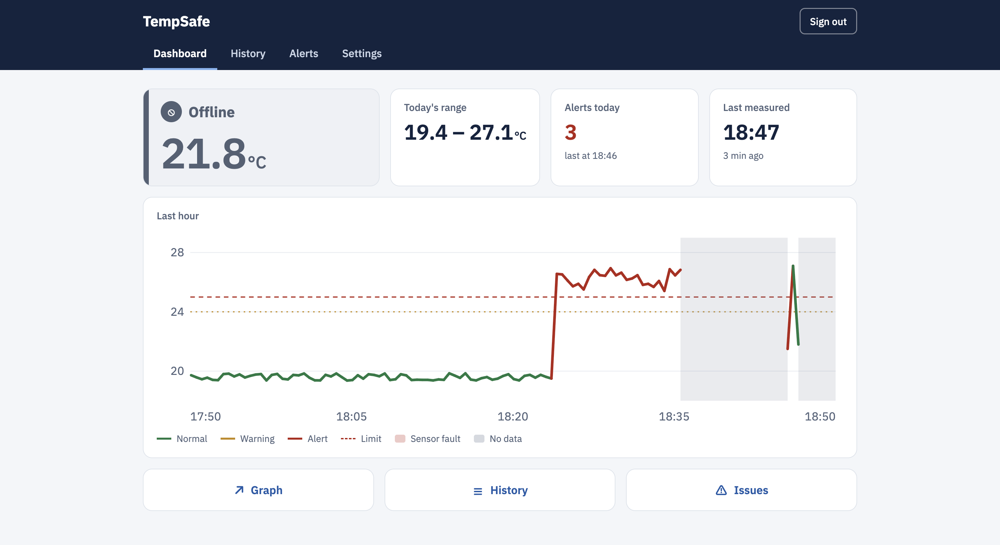

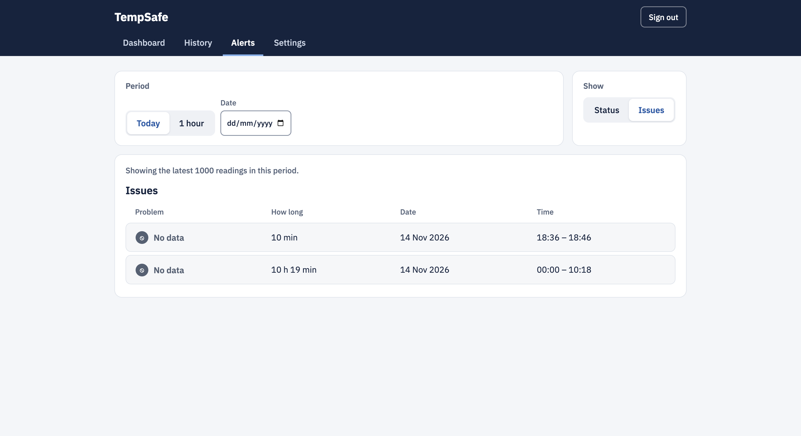

**Two situations labelled No data.** There was a genuine gap from about 18:36 to 18:46. We stopped sending readings and
then added a fresh one.

**What I saw in the morning history.** I opened History for 14 November and scrolled to the bottom of Readings. The
earliest entry was at **10:18:30**. The message *Showing the latest 1000 readings in this period* explains why the
earlier readings were missing from the table. On the graph, though, the period from 08:00 to about 10:18 was shaded
grey. The legend calls that **No data**.

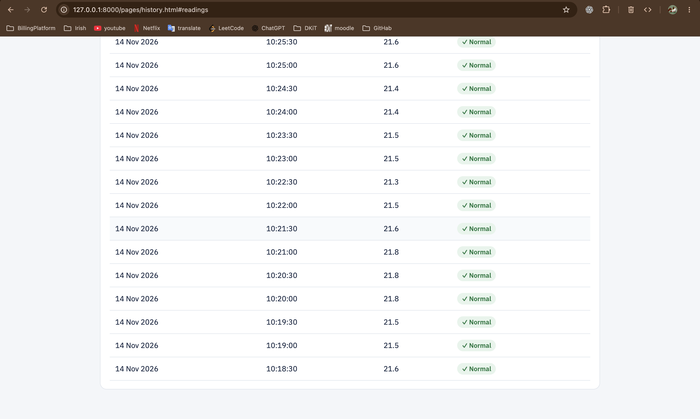

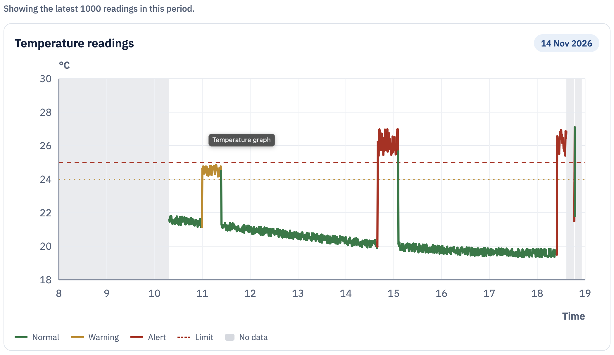

**How I checked.** I opened the TempSafe Preview database in PyCharm and queried the first two minutes of the grey area.

```sql
SELECT observed_at, temperature_c, quality
FROM tempsafe.temperature_samples
WHERE box_id = 'TS-01'
  AND observed_at >= '2026-11-14 08:00:00'
  AND observed_at < '2026-11-14 08:02:00'
ORDER BY observed_at;
```

The query returned four readings taken 30 seconds apart: **22.04, 22.27, 22.31 and 22.32 °C**. All four had a quality of
`valid`. A separate check found 1,184 valid readings between midnight and 10:18.

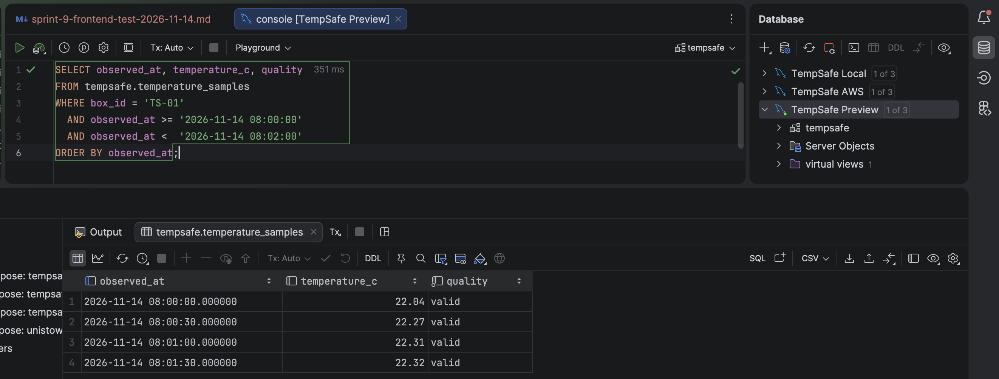

**Why this happened and what I expected.** The graph and the Issues list use the same latest 1,000 readings as the
table. The page treats the time before the earliest loaded reading as a gap. When I select **Today**, I expect the graph
to cover the whole day so far. I'd find it helpful if the graph and Issues still covered the whole selected period while
I browsed individual readings. I'd reserve grey for confirmed gaps and give any part of the day that hasn't loaded yet
its own label.

In Status, consecutive readings with the same status form one row. The figure of 1,000 refers to the readings used to
build the table. I'd find this wording clearer for the tab: *Status history based on the latest 1,000 sensor readings.*

**What does Now mean when the box is offline?** The last reading arrived at 18:47 and showed **21.8 °C (Normal)**. I
stopped adding readings. Three minutes later, the Dashboard showed **Offline**, and Issues showed a new **No data ·
Now** period labelled **since 18:47**. The previous gap, from 18:36 to 18:46, had already ended.

In Status, **Normal · Now** was still the first row. Directly below it was **No data · Now**, with a dash under
**Peak**. The first row made it look as though the temperature was still normal, even though I had no readings after
18:47. I saw the same thing after an earlier high temperature, when **Alert** and **No data** both showed **Now**. I'd
find it clearer to see the current **No data** period first and the time of the last measurement beside its temperature.

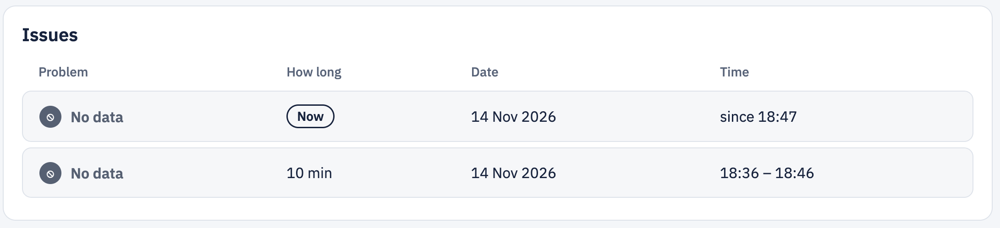

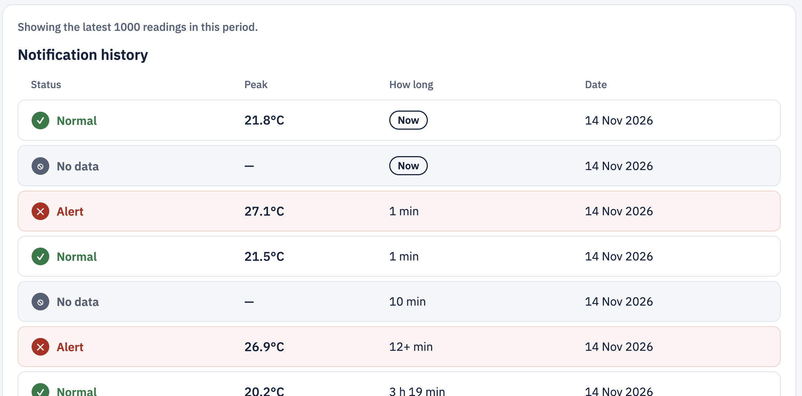

## History and date selection

I found it easy to switch from **Graph** to **Readings**. I could see the overall pattern first, then look at individual
readings. The yellow warning period and the red periods of overheating stood out on the graph.

**What I could see for a selected day.** I opened 8 November. The graph was shaded grey from 08:00 until about 15:40.
From the legend, I took that to mean the box hadn't sent any readings. At 30-second intervals, 1,000 consecutive
readings cover about 8 hours and 20 minutes. For 8 November, the earliest reading in that set was at 15:40. The grey
shading left me unsure whether the box had sent any readings earlier.

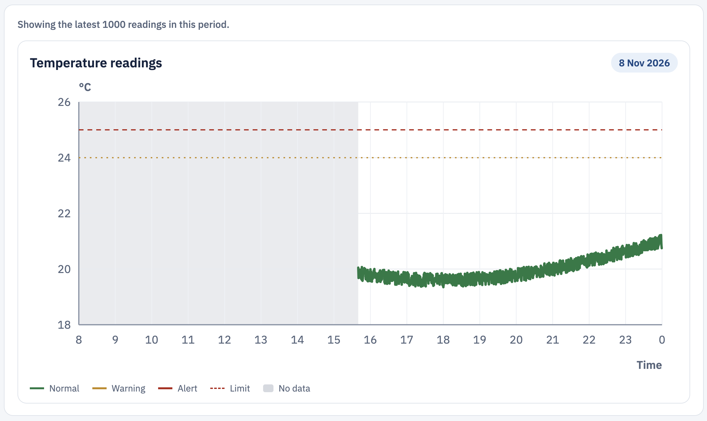

**Low temperatures.** I went through the dates to see how the graph shows a drop below the lower limit and how Readings
labels it. The database contains readings below the limit for TS-01 on 9 and 13 November, from 05:10 to 05:24:30, with a
minimum of −0.95 °C. Those early morning readings fell outside the latest 1,000 for each day, so I couldn't verify the
line colour or the status wording for low temperatures.

I found a reading of **22.04 °C at 08:00** on 14 November in the database. The earliest row I could see in **Readings**
that day was at **10:18:30**, because the table only included the latest 1,000 readings. I'd like to see the earlier
readings for the same day too. Would a *Show earlier readings* button at the bottom of the table help?

I also liked an idea from the **UI example**. For a daily overview, I'd find it useful to see one reading per hour in
**Readings**, from morning to evening. If I wanted to look more closely at a brief temperature drop, I could download a
**CSV containing all the original readings for the selected day**, including those outside the latest 1,000.

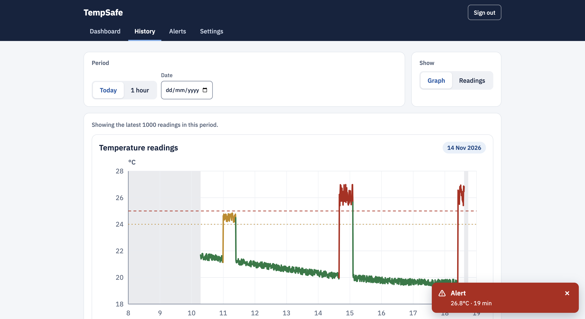

**Line colour when the status changes.** On the graph for 14 November, the red segment starts at about 20 °C around 14:
40, although the upper limit is marked at 25 °C. As the temperature returns to normal, the green segment starts above
the limit. I saw a similar change to yellow around 11:00. I found it hard to tell from the colour when the temperature
crossed the threshold.

I noticed the same thing on the Dashboard's **Last hour** graph between two grey **No data** periods. Around 18:46, the
line rises from 21.5 to 27.1 °C in red, then falls to 21.8 °C in green. The colour changes at the peak. The line crosses
25 °C twice, and I find it hard to tell from the colour how long the temperature was above the limit.

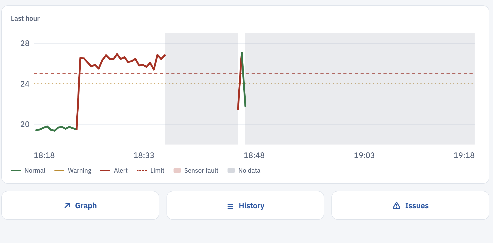

Would the graph be easier to read if the temperature line stayed one colour? **Warning** and **Alert** periods could
have pale yellow and pale red backgrounds, much like the grey shading for **No data**. I could then read the temperature
from the height of the line and the duration of a warning or alert from the width of the band.

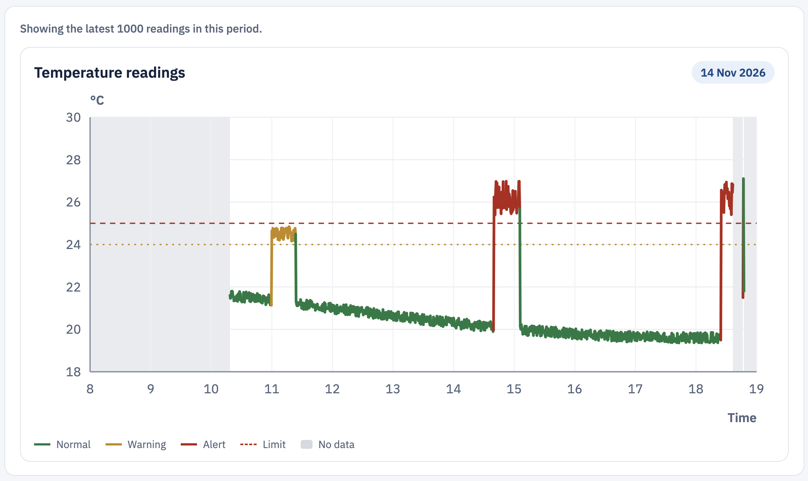

With **Today** selected, I already know I'm looking at today. The **Date** field is useful for choosing another day. In
**Alerts → Status** for 14 November, every row in **Notification history** repeats the same date. When I'm viewing a
single day, could the date appear once above the table? For **1 hour** just after midnight, dates beside the rows would
help me distinguish yesterday's events from today's.

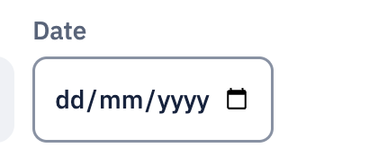

When I was looking for low temperatures, I had to open the calendar each time I wanted to move to the previous or next
day. I'd find arrows on either side of the selected date useful, as in the **UI example**. Starting on 14 November, I
could press **←** once to see the history for 13 November and again for 12 November. I could use **→** to move forward a
day or open the calendar to jump to a particular date.

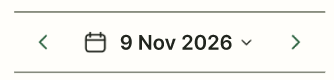

I could scroll back to 1968 in the calendar. The screenshot shows the years 2005 to 2013. The calendar didn't tell me
how far back I could actually view the history.

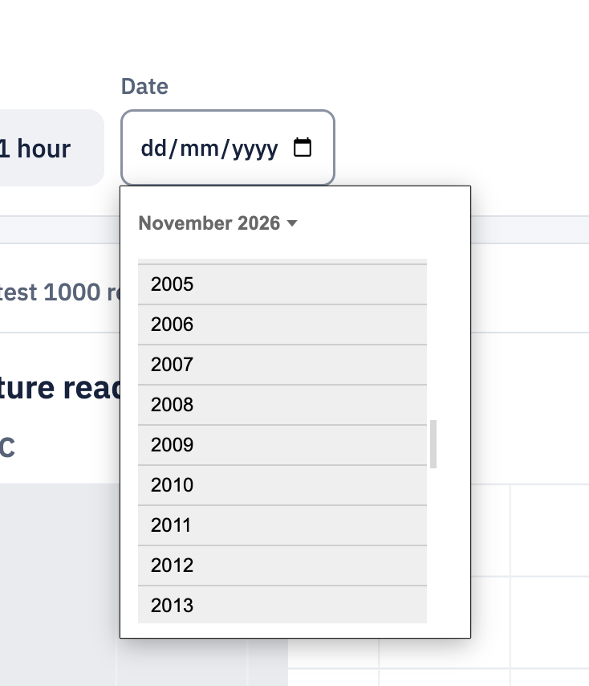

**Question for the team.** How far back should users be able to view readings and events in History and Alerts? One
option would be to let them choose any day in the past week or the past month. The period is still open for discussion.
Once agreed, the available dates could be shown beside the Date field, with the same limits applied in the calendar,
when typing a date and when requesting history through the API. How long readings are kept in the database is a separate
question.

## Settings and temperature limits

I can see a profile for **TS-01** in **threshold_profiles**. It has all three values: a minimum of **0 °C**, a warning
threshold of **24 °C** and a maximum of **25 °C**. I can see the thresholds on the Dashboard, but the fields in Settings
are empty and the page says **No limits set yet**. I expected to see the values there and be able to change them. I
didn't test saving new limits separately.

The code shows that Settings requests the profile selected for the box in **box_configuration**. The screenshot shows
the saved profile's values. To check whether that profile is selected for new readings, I'd need to compare
**profile_id** in the two tables for **TS-01**.

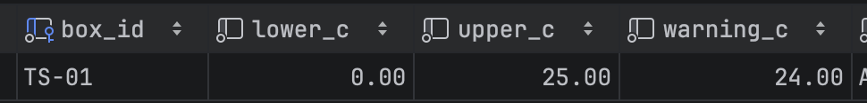

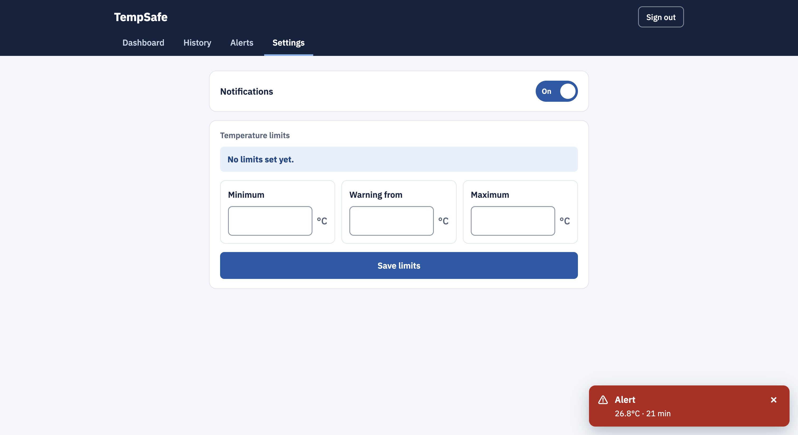
