# TempSafe · Manual frontend testing · 18 November 2026

Testing [tempsafe.app](https://tempsafe.app) after deployment of commit `3eb7a1c`
(PR #31). Box: TS-01. Dates and times use Europe/Dublin.

- [Tester 1 — MacBook, Google Chrome](#tester-1)
- [Tester 2 — iPhone, Safari](#tester-2)

## Tester 1 · MacBook, Google Chrome

Initial testing on a computer. Findings T1-01–T1-13.

| ID | Finding | Type |
|---|---|---|
| T1-01 | Moving from History to Alerts resets the selected date | Usability |
| T1-02 | The final status of a past day is labelled Now | Incorrect historical display |
| T1-03 | The dotted Warning threshold line needs its own explanation | Graph clarity |
| T1-04 | Last measured hides the date and rounds elapsed time down | Ambiguous time label |
| T1-05 | Dashboard links labelled Graph and History do not explain their destinations | Navigation clarity |
| T1-06 | It is unclear where to view all problem periods together | Finding problem events |
| T1-07 | Link Settings thresholds to graph and status colours | Interface clarity suggestion |
| T1-08 | 1 hour unexpectedly replaces the selected day with the latest hour | Unclear period selection |
| T1-09 | Switching periods produces an inconsistent graph in 1 hour mode | Possible data refresh error |
| T1-10 | Add 2-day and 7-day views with a summary of recurring excursions | Historical analysis suggestion |
| T1-11 | Temperature Alert rows lack start and end times | Finding event times |
| T1-12 | The plus sign in durations is unexplained | Ambiguous duration label |
| T1-13 | No data and Sensor fault symbols are off-centre inside their circles | Visual alignment |

### T1-01 · Preserve the selected date between History and Alerts

**User steps**

1. Open History and select 15 November 2026.
2. View the temperature graph for that day.
3. Open Alerts from the main menu to view events for the same day.

Alerts opens with Today selected and the date set to 18 November 2026.
It displays “No readings in this period”. The user has to select 15 November again.

The selected date should remain unchanged when moving between History and Alerts.
Comparing a day's graph and events should not require selecting the same date repeatedly.
The date should also be preserved in the reverse direction: Alerts → History.

Dashboard should continue to show today. This concerns date selection between
History and Alerts, rather than switching Dashboard to a past day.
Explicitly selecting Today should still return to the current day.

Repeated date selection interrupts comparison. The change may also make it appear
that the historical data the user wants is missing.

The Period controls at the top, including the date, Today / 1 hour and arrows,
look the same in History and Alerts. The available views and Download CSV differ,
but the user perceives the period as shared context. The expected journey is to
select 15 November in History, open Alerts to see events for 15 November, then
return to the graph for that same date.

<a href="../../assets/testing/sprint-9-2026-11-18/history-15-november.png">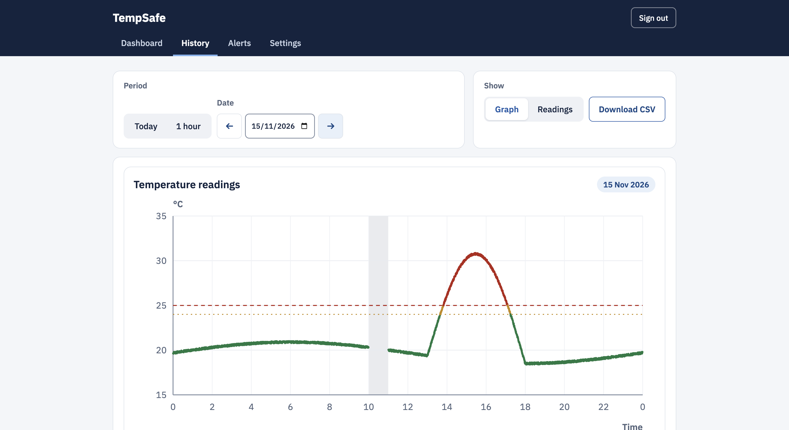</a>

<a href="../../assets/testing/sprint-9-2026-11-18/alerts-date-reset.png">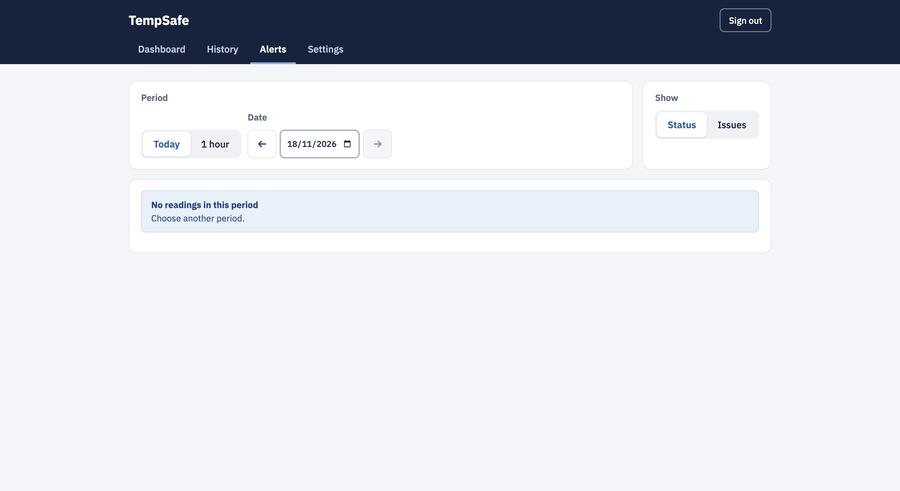</a>

### T1-02 · Do not label a past day's status Now

**User steps**

1. On 18 November 2026, open Alerts → Status.
2. Select 15 November 2026.
3. Look at the first row in Notification history.

The table is labelled 15 Nov 2026, but its first Normal row, with a peak of
23.9°C, displays Now in the How long column.

The final status of a completed day should not appear to be current.
Show the duration supported by the data within the selected period. If the exact
end time is unknown, indicate this without using Now. Now is appropriate for a
truly ongoing interval in a view that includes the present time.

The label suggests that a status from three days ago describes the box now.
The earlier check of Now for today while the box was offline did not cover this
case involving a past date.

<a href="../../assets/testing/sprint-9-2026-11-18/historical-status-now.png">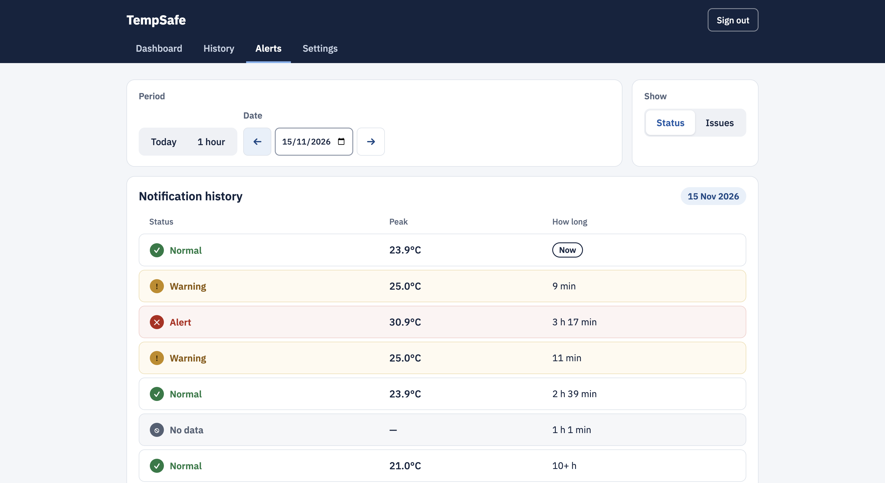</a>

### T1-03 · Explain the yellow dotted threshold line

The History graph for 15 November contains a yellow dotted horizontal line at
24°C, just below the red dashed limit at 25°C. Its meaning is unclear to the user.

This is the warning threshold. A yellow section of the temperature curve represents
readings in the Warning state, whereas the horizontal dotted line marks the
temperature at which that state begins. These are related but distinct graph elements.

The legend is not visible in the supplied screenshot. Inspection of
`frontend/js/history.js` showed that the legend includes Warning for the temperature
curve and a generic Limit entry, but no separate entry for the dotted Warning
threshold line. The finding does not claim that the word Warning is entirely absent
from the legend.

Add a separate entry with matching dots and a clear label, such as
“Warning threshold · 24°C”. Take the value from the relevant profile rather than
always displaying 24°C. Distinguish the upper and lower limits if both are shown.

Users should not have to infer the threshold's meaning from its colour or proximity
to another line. This is a graph clarity improvement; it does not itself indicate
an error in temperatures or threshold calculations.

Evidence: [History graph for 15 November](../../assets/testing/sprint-9-2026-11-18/history-15-november.png).

### T1-04 · Show the date of the latest record

**User steps**

1. On 18 November, look at Last measured on Dashboard.
2. Read “19:18” and “1 days ago” as referring to 17 November.
3. Select 17 November in History and then Alerts.

Both sections display “No readings in this period”. Dashboard does not show the
calendar date associated with 19:18.

During the server check before this test, the latest TS-01 record was from
**16 November 2026 at 19:18:20**, with quality `sensor_error`. There were no records
for 17 November. The added records covered 13–15 November. The empty History and
Alerts views therefore match the checked database contents; these screenshots do
not establish that records for 17 November were lost.

Source inspection confirmed that `ageText()` in `frontend/js/dashboard.js` uses
`Math.floor(seconds / 86400)` and always appends “days ago”. For a record between
24 and 48 hours old, it displays “1 days ago”. On 18 November before 19:18, a record
from 16 November at 19:18 can therefore be almost two days old and still have this
label. The number of complete elapsed days is not the same as the difference
between calendar dates, and omitting the date makes the label ambiguous.

Show the exact date and time, for example “16 Nov 2026 · 19:18”. A clearer elapsed
time, such as “1 day 23 hours ago”, could be added with correct singular and plural
forms. The exact duration depends on when the page is viewed. A direct link to
History for that record's date would also help.

The latest record is a failed measurement attempt, so Last measured also needs
clarification: use Last sample or Last attempt for an error, or separately show
the time of the latest successful temperature measurement.

The label directs the user to the wrong date and creates an apparent contradiction
between pages. This concerns time presentation, not data loss.

<a href="../../assets/testing/sprint-9-2026-11-18/dashboard-last-measured-relative.png">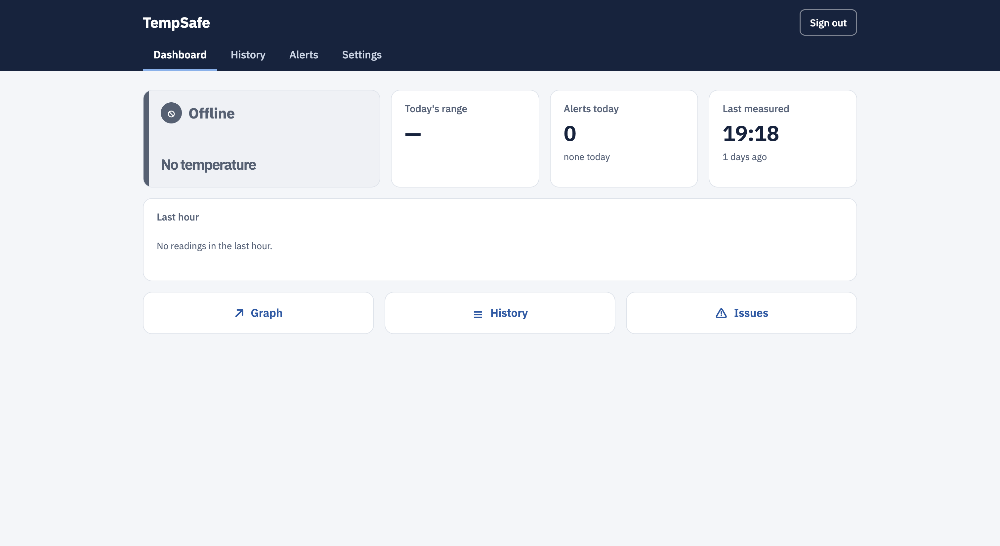</a>
<a href="../../assets/testing/sprint-9-2026-11-18/history-17-november-empty.png">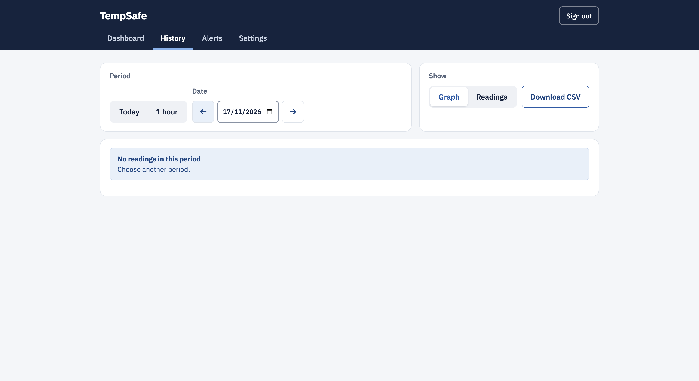</a>
<a href="../../assets/testing/sprint-9-2026-11-18/alerts-17-november-empty.png">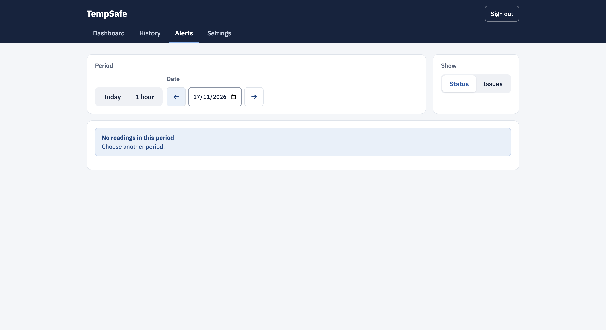</a>

### T1-05 · Explain the Dashboard shortcuts

Dashboard already contains a Last hour graph area, with a Graph link below it.
The label does not explain how the destination differs: is the graph more detailed,
does it show a whole day, or can the user select a period? The lower History link
also repeats the main navigation label without explaining the difference.
In the screenshot, Last hour is empty because there are no recent readings.

In `frontend/pages/dashboard.html`, the lower Graph link points to
`history.html#graph`, History to `history.html#readings`, and Issues to
`alerts.html#issues`. The lower History link therefore opens the readings table,
but its label does not communicate this.

The label or a short explanation should make the destination clear. Options for discussion:

- Graph → “Detailed graph”, with “View by day and select a period” as supporting text.
- History → “Readings table”, to distinguish it from the overall History section.
- If a link promises a “Daily graph”, it should actually select a daily period.

Repeating a main navigation link is not inherently wrong: shortcuts can be useful.
The finding concerns their unclear purpose. Final labels have not yet been chosen.

### T1-06 · Provide clear access to all problem periods

Issues became clear after an explanation: it covers technical problems such as
sensor faults and missing data. However, when looking for all problem periods,
the user also expects Warning and Alert events: warnings and temperatures outside
the limits.

The Dashboard Issues shortcut opens only one view. It is unclear how to obtain
a combined list of problems for the selected period without ordinary Normal rows.
Having temperature events under Status does not make the Issues link's purpose
clear. This concerns finding events and viewing them together; it does not claim
that Warning and Alert events are absent from the application.

Provide a clear route to a combined list of problem periods:

- Warning — temperature in the warning zone;
- Alert — temperature outside the permitted limits;
- Sensor fault — a measurement error;
- No data — a period without data.

One option is an “All issues” filter in Alerts, with separate temperature and
technical event filters. Normal rows can remain in the full status history but
should not appear in this filter. Event types must remain distinct: a sensor fault
is not equivalent to overheating.

If the existing link continues to show technical events only, its label or description
should state that scope. The combined list needs a clear entry point. Simply renaming
Issues to “All issues” without changing the list would not address the finding.
This is a proposal for discussion, not an agreed redesign.

Related to T1-01: moving between History and Alerts should preserve the selected date.

Evidence: [Dashboard with the Issues shortcut](../../assets/testing/sprint-9-2026-11-18/dashboard-shortcuts.png).

### T1-07 · Link Settings thresholds to status colours

Add colour indicators beside Minimum and Maximum (red), and Warning (yellow),
so that the connection between settings, the graph and statuses is clear without
further explanation. This is an improvement suggestion, not an observed threshold
calculation error. No separate Settings screenshot accompanies it.

Keep input fields neutral and add small colour indicators and explanatory text
beside the labels. Use the same palette as the graph and Alerts. For the current
profile, the explanations could be:

| Setting | Indicator colour | Explanation under the current rules |
|---|---|---|
| Minimum · 0°C | Red | Alert at 0°C and below |
| Warning from · 24°C | Yellow/amber | Warning from 24°C to 25°C inclusive |
| Maximum · 25°C | Red | Alert above 25°C |

Do not confuse a threshold indicator's colour with the state of the value itself:
exactly 25°C currently means Warning, not Alert. Exactly 0°C means Alert.
Explanations should reflect the actual rules and entered values rather than being
fixed to the 0/24/25 example.

Avoid a permanent red border around the entire input: it could make a valid value
look like an input error. Validation errors should look different from permanent
threshold indicators.

Colour should supplement text and, where useful, a symbol or line sample; it should
not be the only way to convey meaning. This follows
[WCAG 1.4.1 — Use of Color](https://www.w3.org/WAI/WCAG22/Understanding/use-of-color.html).
The criterion does not prescribe a particular Settings palette; the proposed colour
mapping supports consistency within TempSafe. Check the contrast of the selected
shades, especially yellow on white, and retain readable text labels.

Related to T1-03: threshold indicators in Settings and the graph legend should match.

### T1-08 · Explain which period 1 hour refers to

**User steps**

1. Open History and select 15 November 2026: the graph contains data.
2. Select 1 hour beside Today.

1 hour becomes selected, Date clears to the dd/mm/yyyy placeholder, and
“No readings in this period” replaces the graph. It is unclear which hour is now
selected and why the date disappeared. The user also questions the purpose of this
mode in Alerts and History when Dashboard already shows Last hour. The screenshots
capture the transition in History; they do not establish equivalent behaviour in Alerts.

In `frontend/js/history.js`, hour mode sets the range from 60 minutes before now
to now. The selected 15 November is no longer used. `renderFilter()` deliberately
clears the date field. This is not the final hour of the selected day, the latest
hour containing readings, or an arbitrary hour in the past. If no readings have
arrived recently, an empty result is expected for this range; it does not itself
mean that data for 15 November has been lost.

The 1 hour label beside the calendar can suggest a zoom level within the selected
day. It actually switches from a historical view to a recent period, but the
interface neither explains the change of context nor shows the new boundaries.

- If the current logic is retained, call the mode “Last 60 minutes” and show the
  actual date and time range even when there are no readings.
- Visually separate periods relative to now from historical date selection.
  An empty calendar should not be the only indication of a mode change.
- Provide a clear way back to the previously selected day.
- If users need to view an hour within a past day, offer time selection or graph
  zoom while preserving that date, for example “15 November, 14:00–15:00”. Keep
  this distinct from the latest 60 minutes relative to now.

Showing the latest hour in several sections is not inherently wrong: Dashboard
provides a summary, History can provide a detailed graph and table, and Alerts can
show events for that interval. However, this benefit and the selected period must
be clear. No decision to remove the mode has been made; its purpose first needs clarification.

<a href="../../assets/testing/sprint-9-2026-11-18/history-before-hour-filter.png">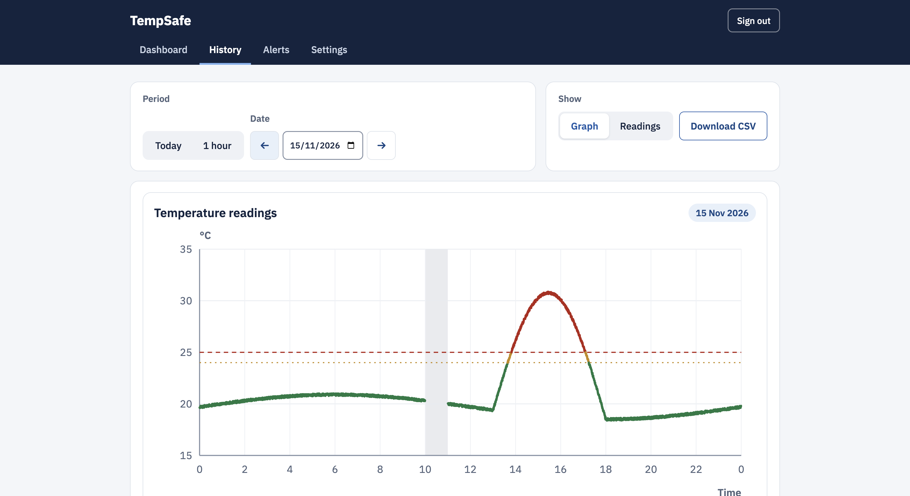</a>
<a href="../../assets/testing/sprint-9-2026-11-18/history-hour-filter-empty-date.png">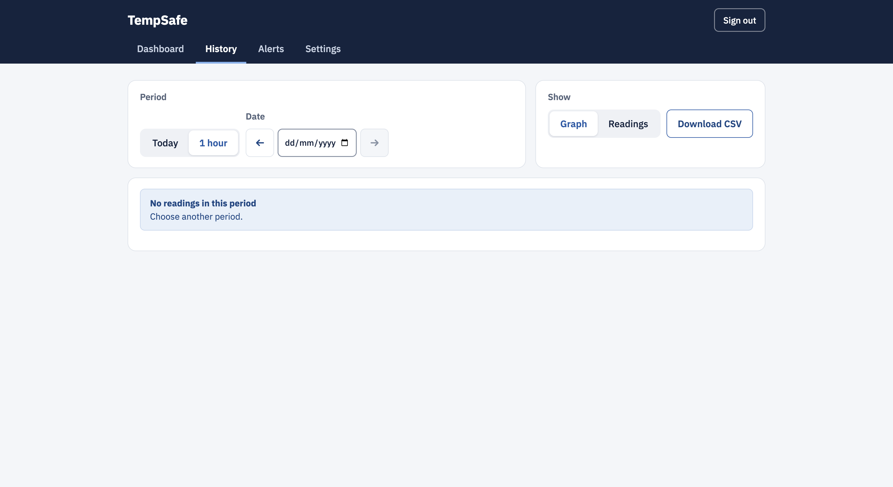</a>

The user also tried the transition without selecting a past date:

1. Select Today: Date shows 18/11/2026.
2. Select 1 hour: the date disappears, leaving dd/mm/yyyy.
3. The page still says “No readings in this period”, but does not show the date
   and time range anywhere.

This shows that the confusion is not limited to switching from a historical day.
Today clearly identifies a date, whereas 1 hour leaves the period visually
undefined. The empty field looks like an incomplete selection even though the
filter is already active.

Missing recent records explains the empty result, but does not explain the
vanishing date to the user. The empty state should explicitly say “No readings
in the last 60 minutes” and show the actual boundaries. Older readings must not
be substituted to fill this interval. If it crosses midnight, show both dates
rather than only today's date.

The supplied images concern History; they do not confirm equivalent behaviour in Alerts.

<a href="../../assets/testing/sprint-9-2026-11-18/history-today-before-hour.png">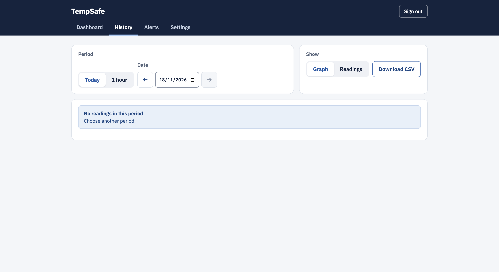</a>

The user again questioned the usefulness of 1 hour in History: Dashboard already
shows the latest hour, while analysing a past day should remain focused on that
day. Alongside clearer wording, discuss simplifying History by removing this
shortcut and retaining day selection and, if needed, time selection within the
day. This is an option for discussion, not a decision. A detailed view of the latest
60 minutes can be useful, but it needs to serve an understandable task.

### T1-09 · Inconsistent graph after switching periods

After several changes, the user obtained a different result in 1 hour mode.
The exact click sequence was not recorded; reproducibility and cause are not yet
confirmed. This is a separate rendering observation, beyond the label clarity
issue in T1-08.

- 1 hour is selected, Date is empty, and the graph is labelled 18 Nov 2026.
- The time axis shows approximately 17:45 to 18:40.
- A grey No data area covers almost the entire graph.
- An almost vertical green and red line at the left edge spans approximately −4°C to 20°C.
- The grey area's tooltip reads “No data: 23:59 – 18:43” without dates.

This view does not make clear which readings belong to the selected hour.
The tooltip may refer to a range crossing a day boundary, but without dates it
looks as though time runs backwards. A screenshot alone cannot establish data
loss or an actual sudden temperature change during the latest hour.

`loadHistory()` calculates request parameters before `await fetchPeriod(...)`,
then uses `periodDomain(currentRange)` from the current shared state after loading.
The function does not appear to cancel the previous request or verify that the
response belongs to the latest selected period. A late response for a past day
could therefore be plotted on the newly selected latest-hour axis. The X-coordinate
calculation also clamps out-of-range points to the edges, which could explain
the vertical coloured line. This is a possible explanation, not a proven cause
of the screenshot.

The selected filter, axis range, heading, data and tooltips should always refer
to the same period. Stale request responses should not replace the current view.
Readings outside the selected hour should not be compressed into a line at the
edge. If there are no readings, show a consistent empty state. If a No data area
is displayed, its boundaries and label should clearly match the selected range.

<a href="../../assets/testing/sprint-9-2026-11-18/hour-filter-inconsistent-graph.png">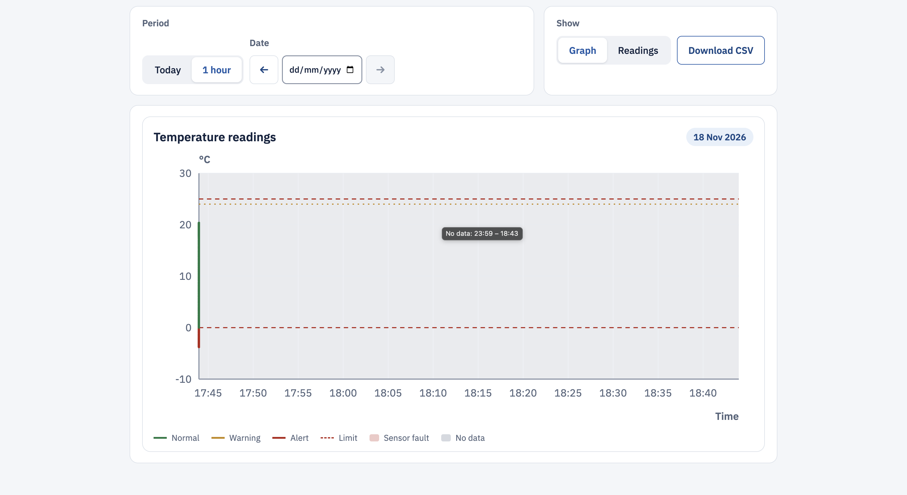</a>

### T1-10 · Show several days and the frequency of excursions

Replace 1 hour in History with “Last 2 days” and “Last 7 days” shortcuts.
Dashboard already shows the latest hour; History needs an overview of changes
over a longer period.

The user wants to see how often the temperature rose and how long individual
episodes lasted, including short episodes under 30 minutes. Currently, this means
opening each day and manually comparing and counting events. Medication storage
was given as an example where this history could matter. This describes an analysis
need, not a medical judgement about acceptable excursions: the application should
not independently decide whether the contents remain suitable for use.

- Show a graph for the entire selected period, with clear start and end dates.
- Agree whether 2/7 days means calendar days including today or the latest 48/168
  hours. The interface should show the actual boundaries explicitly.
- Preserve the period when moving between the graph, table and Alerts.
- Add a summary: Warning and Alert episode counts, total duration of each type,
  longest episode, and minimum and maximum temperatures.
- Allow an individual episode to be opened with its date, start and end times,
  duration and temperature extreme. Distinguish overheating from excessive cooling.

This is the user's proposal, with possible details for discussion with the team;
no implementation was carried out as part of the report.

Count episodes rather than readings: 20 consecutive Alert records may belong to
one event. An episode crossing midnight should not become two merely because the
date changes. Define grouping rules for Warning → Alert → Warning so that adding
categories does not present one overheating episode as several independent incidents.
Show gaps and sensor faults separately; do not count them as normal temperature
or assume an event continued through an unknown interval.

When reducing detail in a weekly graph, averaging must not hide short peaks.
Calculate summaries from the complete selected dataset. If different threshold
profiles were used, assess readings against the thresholds that applied to those records.

Related to T1-06 (all problem periods), T1-08 (the purpose of 1 hour), and T1-09
(consistency between the filter and loaded data).

### T1-11 · Show the times of temperature events

**User steps**

1. See two Alerts on Dashboard and open Alerts → Status.
2. Try to find out exactly when the temperature excursion occurred.
3. Open History → Readings and scroll through many readings to find the event.
4. Return to Alerts to compare the time found with the duration.

Dashboard shows two Alerts for 18 November. Alerts → Status shows temperature
events with extremes of 30.9°C and −3.4°C and durations of 1 h 59 min and 42 min
respectively. These are displayed values; duration calculation accuracy was not
independently checked for this finding.

The table has Status, Peak and How long columns, but no start or end times.
The adjacent Issues view does have Time, for example 17:00–17:10 for Sensor fault
and 10:29–11:00 for No data.

Duration alone does not identify the time of day or allow an event to be matched
to a work shift. Timestamps support investigation but do not, by themselves,
establish the cause or an individual's responsibility.

Show the start, end, duration and temperature extreme in the same row. Include
dates for events crossing midnight and explicitly identify ongoing events or
unknown end times. Provide a direct route to the relevant graph interval or
readings without manual searching. The exact boundaries of the two events were
not established from the supplied screenshots.

Related to T1-06 (finding all problem periods) and T1-10 (viewing several days).

<a href="../../assets/testing/sprint-9-2026-11-18/alerts-missing-times.png">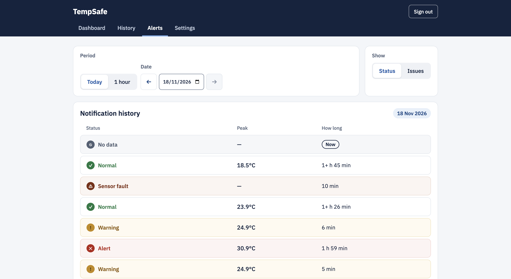</a>

<a href="../../assets/testing/sprint-9-2026-11-18/issues-time-column.png">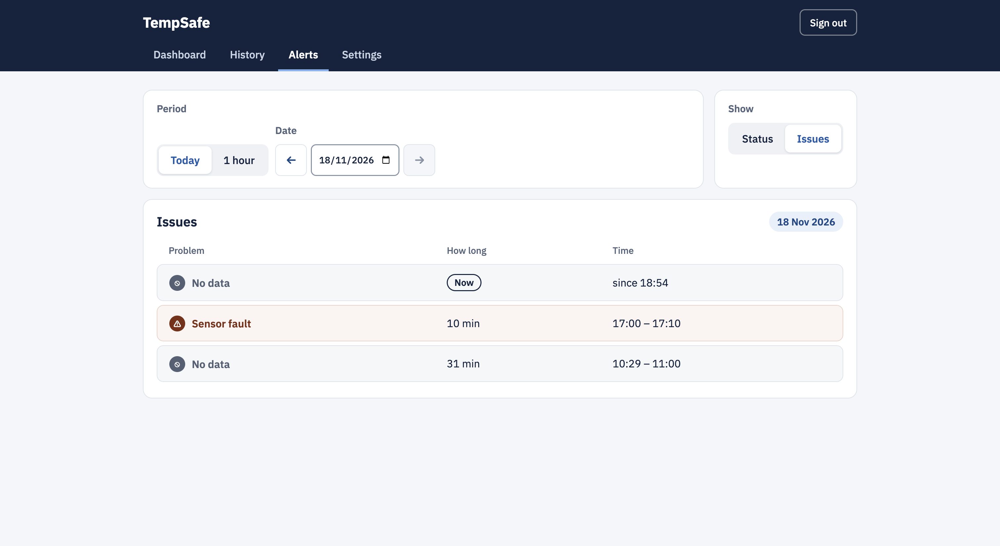</a>

### T1-12 · Explain uncertain durations without an ambiguous plus sign

In Alerts → Status, Normal rows display `1+ h 45 min`, `1+ h 26 min` and
`4+ h 9 min`. The interface does not explain the plus sign or which part of the
duration it applies to. Other rows display ordinary durations without a plus.

In `frontend/js/history.js`, `findStatePeriods` and `renderAlertPeriods` mark a
temperature period as `unsure` when it is interrupted by a gap, sensor fault or
current lack of data. Its duration is then calculated up to the period's last
reading. Formatting inserts a plus after the first number; the comment explains
this as “at least this long”. It is not an extra hour or an event count.

`4+ h 9 min` is therefore intended to mean “at least 4 h 9 min”: after the last
known reading, the exact time of the state change is unknown. The plus does not
mean that Normal is still confirmed now. The code's logic was inspected, rather
than the accuracy of every displayed period's calculation.

Replace the unclear notation with explicit text, such as “At least 4 h 9 min”,
and explain: “Exact end time unknown: readings stopped”. Separately show the last
confirmed reading time and the reason for uncertainty. Do not present a period
without data as a confirmed normal state.

Related to T1-11: event times and the certainty of their boundaries should be
understandable alongside the duration.

<a href="../../assets/testing/sprint-9-2026-11-18/status-duration-plus.png">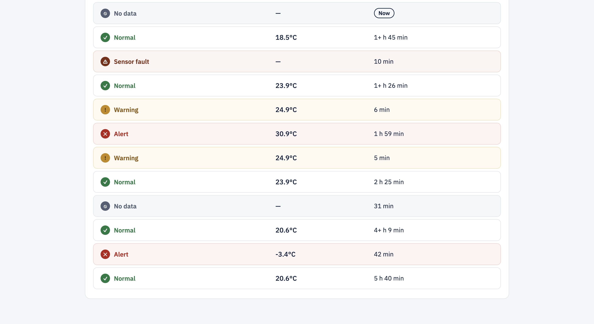</a>

### T1-13 · Centre the symbols inside their circles

The first tester noticed that the No data and Sensor fault symbols appear shifted
downwards within their circular backgrounds. This is particularly noticeable in
the enlarged image compared with the adjacent Normal symbol. Symbols should
appear centred, with consistent visual balance.

## Tester 2 · iPhone, Safari

Tester 2 is an English-speaking participant. Testing took place on an iPhone in
Safari. The participant regularly uses graphs, including stock charts. On the
iPhone, the whole graph did not fit on screen and required horizontal scrolling,
while touch interaction did not provide convenient access to values. The graph
was therefore also opened on a MacBook in Google Chrome to compare desktop interaction.

The main task in the second session was to find problem periods and identify their
start times, end times and durations. The task was not completed: Dashboard did
not provide an event overview; History showed excursions on the graph but not
their durations; Alerts provided durations but no start or end times. Answering
one question required moving between three sections, yet the participant still
did not obtain a complete answer. This is the outcome of this session, not an
assessment of every possible application workflow.

After exploring the current interface, the participant was shown the earlier
prototype. He preferred its daily overview and the list of issues below the graph.
The prototype screenshots show 11 November and illustrate information presentation;
they are not data from the tested version for 18 November. Task completion time
and interaction delays were not measured.

| ID | Finding | Type |
|---|---|---|
| T2-01 | Today’s range is read as two negative values | Range clarity |
| T2-02 | Dashboard does not help users find the day's problem periods | Event overview |
| T2-03 | Alerts today provides no direct route to the two events | Event navigation |
| T2-04 | Scrolling the mobile graph loses labels and context | Mobile graph |
| T2-05 | It is difficult to display temperature and time tooltips | Graph interaction |
| T2-06 | Graph, History, Alerts, Status and Issues overlap in meaning | Navigation clarity |
| T2-07 | How long, Peak and event durations raise questions | Event presentation |
| T2-08 | The participant would remove Warning from the overview graph | Tester preference |
| T2-09 | The selected box and account are unclear | Device and account context |
| T2-10 | Sensor fault and temperature Alert colours are too similar | Distinguishing events |

### T2-01 · Make the daily range unambiguous

**User steps**

1. Open Dashboard on a mobile device.
2. Look at Today’s range.

This was the participant's first difficulty: he read `-3.4 – 30.9°C` as two
negative values. In the verbal account, the second number was described as “minus
3.9”; the screenshot shows 30.9. The separator was interpreted as another minus
sign. The participant also noted that the unit appears only after the second value.

He suggested showing °C beside both values. A clearer presentation would use
separate labelled values: “Minimum: −3.4°C” and “Maximum: 30.9°C”. The observation
concerns reading the range, not incorrect temperatures.

<a href="../../assets/testing/sprint-9-2026-11-18/tester-2-dashboard.png">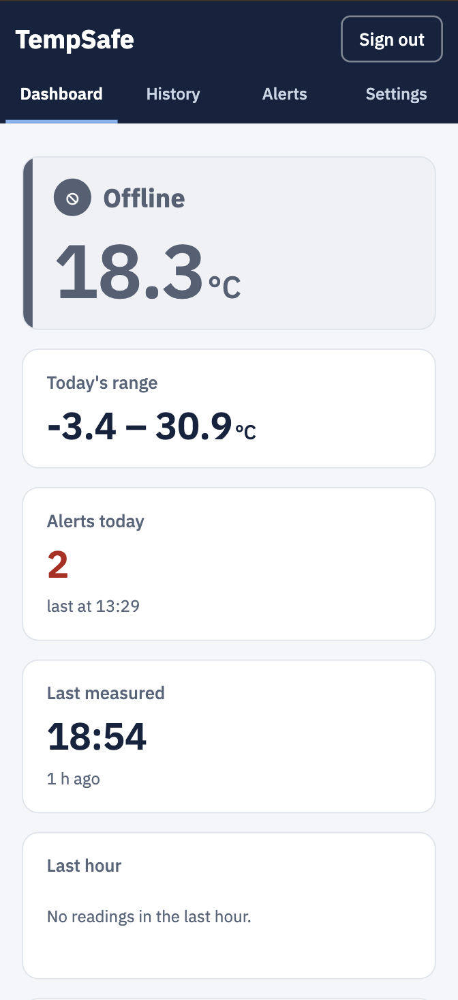</a>

### T2-02 · Show the day's problem periods on Dashboard

**User steps**

1. Open Dashboard to find problem periods and establish when they occurred.
2. See the daily range and two Alerts, but an empty Last hour graph.
3. Open History: see excursions on the graph, but not their durations.
4. Open Alerts: find durations, but no start or end times.

The main task remained incomplete. Data exists for the day, but Dashboard shows
only the latest hour, which has no readings. The participant did not receive a
visual overview of earlier excursions. The day's data has not disappeared: it
is available in History.

The participant described returning after a break: someone has been working,
travelling or visiting a patient and opens the application to see quickly what
has happened. He would prefer a graph for the current day and an issue list directly
on Dashboard, showing event type, start and end times, duration and temperature
extreme where applicable. Periods without data should also be visible.

The mobile screen feels like a long sequence of similar cards with many borders.
The participant did not object to the blue palette itself, but found this layout
inconvenient for finding the information he needed.

After seeing the prototype, he appreciated its daily graph and Issues list directly
below it: two temperature excursions appear in red and missing data in grey, with
each event's time and duration listed underneath. This preference concerns access
to information, not necessarily adopting the prototype's entire visual design.

Related to T1-06, T1-10 and T1-11.

<a href="../../assets/testing/sprint-9-2026-11-18/tester-2-prototype-overview.png">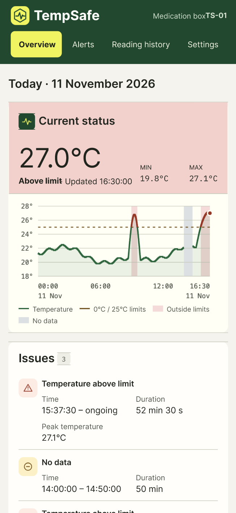</a>

<a href="../../assets/testing/sprint-9-2026-11-18/tester-2-prototype-issues.png">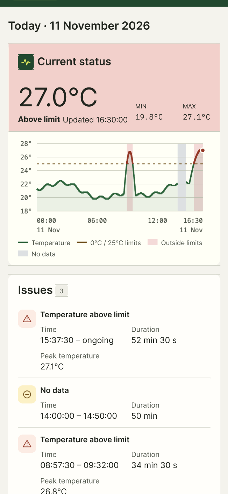</a>

### T2-03 · Open events through Alerts today

**User steps**

1. See 2 in the Alerts today card.
2. Try to open those two events directly from the card.
3. With no such link available, open History from the menu.

The participant expected the count to be clickable and to show exactly today's
two temperature events. He chose History as a logical place to look for them.
Opening the full list of all states rather than those two events would not meet
this expectation either.

The card and count are visible in the T2-01 screenshot.

### T2-04 · Preserve context when scrolling the mobile graph

**User steps**

1. Open History → Graph on a mobile device.
2. View the beginning of the daily graph.
3. Scroll horizontally towards later hours.

Initially, Temperature readings, the date, temperature scale and legend are visible.
After horizontal scrolling, these elements move out of view. A section of the
curve and time labels remains, with empty space above and below. The participant
loses the date, units and labels for Normal, Alert and other states. The two
screenshots show the difference before and after scrolling.

The participant found horizontal scrolling extremely inconvenient. He expected
the entire daily graph to fit the width of the mobile screen with clear labels.
To inspect individual values, he wanted to move his finger across the graph while
retaining the daily overview, heading, date, scale and legend.

<a href="../../assets/testing/sprint-9-2026-11-18/tester-2-history-start.png">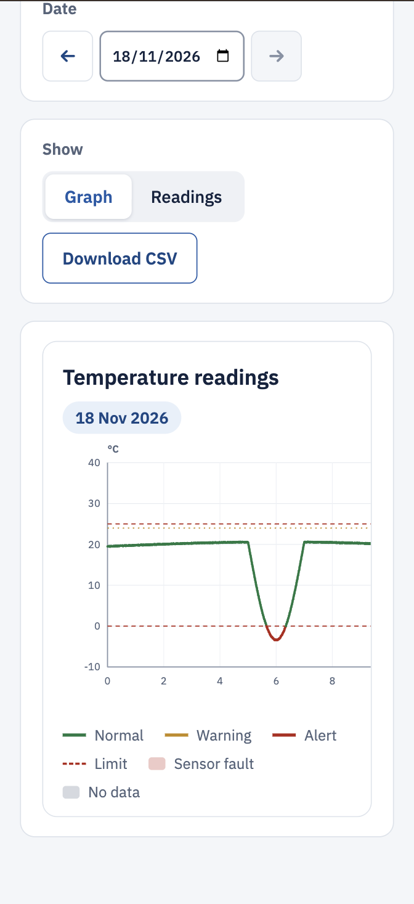</a>

<a href="../../assets/testing/sprint-9-2026-11-18/tester-2-history-scrolled.png">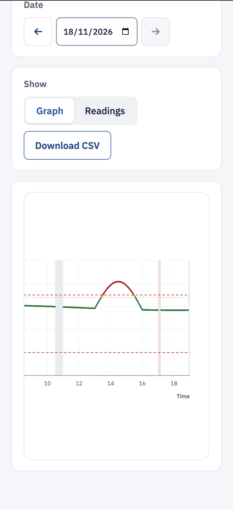</a>

### T2-05 · Make it easier to inspect a selected point on the graph

**User steps**

1. Try to select a position on the graph and read its time and temperature.
2. Try to identify where the excursion began.
3. After difficulties on the iPhone, open the graph on a MacBook in Google Chrome
   and compare the tooltip interaction.

Displaying a value required very precise targeting and a long wait or holding
the pointer in place. Similar difficulty occurred on the computer. The exact delay
was not measured; static screenshots do not establish its duration.

The participant expected the interaction he knows from stock charts: touching
anywhere within the plot displays a vertical line at the selected time and a
tooltip with the time and temperature of the nearest reading. As the finger moves,
the line follows and the values update immediately. The equivalent desktop
interaction should follow the pointer.

This should not require hitting the thin temperature curve precisely or holding
for a long time. Finger movement should inspect values on a fully visible graph,
rather than merely scrolling it beyond the screen. Selecting an interval without
data should explicitly indicate that no readings are available.

The second tester demonstrated this interaction on a stock chart: touch selects
a time, a vertical line marks it, and a point highlights the corresponding value
on the curve. For TempSafe, he expects the same point selection with the temperature
in °C and the reading's date and time. The selected point and values should update
as the finger moves.

The photograph shows the participant's example from another application.

### T2-06 · Make section and shortcut names consistent

**User steps**

1. See two Alerts on Dashboard and look for them in History.
2. Notice the lower Graph, History and Issues shortcuts.
3. Open Issues expecting problem events, then look at Alerts → Status.

The participant could not see why Graph and History need separate links when the
graph is already within History. The large lower links did not help complete the
main task. Alerts, Status and Issues also overlap in meaning: Alerts displays
ordinary Normal states, while Issues includes only No data and Sensor fault,
although he expects temperature excursions there too.

He interprets Issues as all problems, not just technical faults. On Dashboard,
he needs a clear combined list of problem events with immediate access to their
details. This repeats tester 1's difficulties in T1-05 and T1-06. Whether Warning
belongs in the combined list is a separate question; the second participant's
view of Warning on the graph is recorded in T2-08.

<a href="../../assets/testing/sprint-9-2026-11-18/tester-2-dashboard-links.png">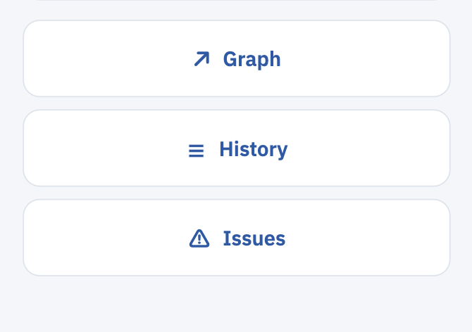</a>

### T2-07 · Clarify event labels and the information shown

**User steps**

1. Open Alerts → Status on mobile.
2. Read the No data and Normal cards, then look for a temperature event's times.

The English-speaking participant found How long less professional and preferred
Duration. This is his assessment of the wording, not a grammatical error.

No data and Sensor fault display Peak with a dash. He suggested omitting this
inapplicable temperature field and retaining time and duration information.
For a current event, an explicit ongoing label with its start time would be more
useful than an empty Peak field.

He also did not understand `1+ h 45 min`. The ambiguity in T1-12 therefore affected
both participants. An unknown end time needs a plain-language explanation rather
than requiring users to decode the notation.

Like tester 1, he could not find the event's start and end times (T1-11). Duration
matters, but does not answer “when did this happen?”. He wanted this information
in the Dashboard issue list itself.

<a href="../../assets/testing/sprint-9-2026-11-18/tester-2-alerts.png">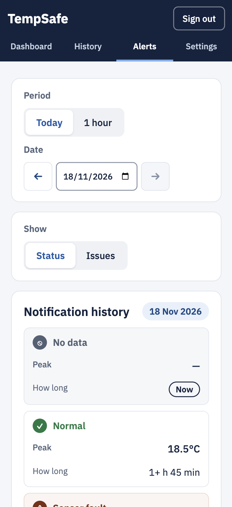</a>

<a href="../../assets/testing/sprint-9-2026-11-18/tester-2-technical-events-peak.jpg">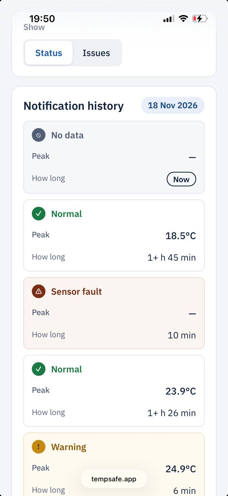</a>

### T2-08 · Preference to omit Warning from the graph

The second participant sees Warning as advance notice of an approaching problem
and does not want it on the overview graph. He prefers the prototype's emphasis
on excursions outside limits and periods without data.

This is a presentation preference, not a universal rule for graphs or a reported
Warning calculation error. It differs from tester 1's suggestions to explain the
Warning threshold more clearly (T1-03) and link threshold colours to Settings
(T1-07). Both observations are retained separately. Removing warnings from the
data or notification mechanism was not discussed as a requirement during the session.

### T2-09 · Show which box and account are in use

Even after learning that a user may have several boxes, the participant was unsure
which box was open and which account was in use. The displayed Dashboard shows
TempSafe and Sign out, but no explicit box or account name.

He needs clear context: which device the temperature, graph and events belong to,
and which account he is using. The prototype shows TS-01 in its header. The
availability and behaviour of switching between several boxes were not separately
tested in this session.

### T2-10 · Distinguish Sensor fault from temperature Alert more clearly

The second tester found the Sensor fault and temperature Alert colours too similar:
both appear red. Although the shades differ, a quick scan makes it difficult to
distinguish a sensor error from a temperature excursion. The difference should
be clearer, with labels and symbols also helping identify each event type.

This relates to T2-02 and T2-06: the participant needs a combined Dashboard issue
list covering No data, Sensor fault and temperature excursions, with clear
distinctions between them. Currently, these events have to be found in different views.

### Other results from the second session

Settings were clear to the second tester; he reported no difficulties.
He saw the colour indicators in T1-07 as a possible addition rather than a solution
to a problem he had experienced.

He did not use 1 hour in Alerts because he saw no need for it during the task.
This is an observation about its usefulness, not a test of its functionality.
The second participant did not confirm the switching problem described in T1-08
and T1-09.
